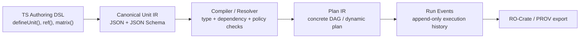
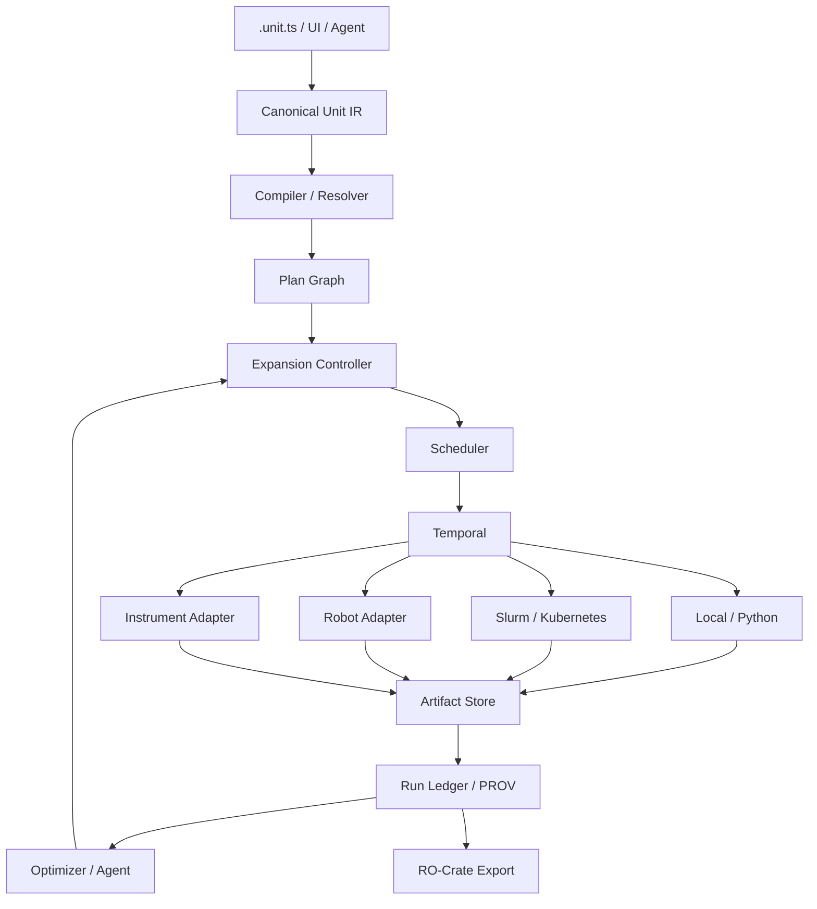

# 面向 AI4Sci 的 TypeScript 形式化实验编排：从“文件夹式工作流”到可组合的 Unit Card

## 执行摘要

截至 2026 年 9 月，AI4Sci 已经形成了几条相当成熟、但彼此仍然割裂的技术路线：一类是 **self-driving lab / autonomous experimentation**，例如 A-Lab、Coscientist、ChemCrow，把实验选择、机器人执行、测量和下一轮决策连成闭环；另一类是 **科学工作流系统**，例如 Nextflow、Snakemake、CWL、WDL、AiiDA、jobflow/atomate2，把计算步骤变成可组合、可调度、可追踪的 DAG；第三类是 **通用 durable orchestration**，Temporal、Trigger.dev、Inngest 等已经把长时间任务、失败恢复、动态分支、队列和事件历史做得相当成熟；第四类是 **科研元数据与 provenance 标准**，如 RO-Crate、W3C PROV、ISA、PEP。citeturn1search17turn1search26turn2search1turn3search5turn15search2

**但我没有找到一个已经成熟的项目，同时满足你描述的全部条件：TypeScript-first、科学实验原生、以“独立实验单元对象”而非目录/文件路径作为一等实体、可自动扩展实验实例、能跨计算与物理仪器执行，并且把 provenance、资源占用和闭环优化统一起来。** 这是本次调研最重要的结论。现有成果已经提供了几乎所有“零件”，但缺少把它们组合成这一抽象的系统。这一判断是对现有 AI4Sci、科学工作流和 TS orchestration 生态的综合推断。citeturn1search3turn10search0turn20search0turn13search27turn14search3

我认为你的方向是合理的，而且**“不要把文件夹层级作为实验语义”是一个相当值得坚持的设计决策**。最合适的抽象不是传统的：

```text
project/
  experiment-01/
    input/
    output/
  experiment-02/
    ...
```

而更接近：

```text
UnitTemplate  ──bind──> UnitInstance ──execute──> RunRecord
     │                      │                        │
 reusable intent       immutable plan           provenance
```

其中依赖应当写成 `Ref<Card, OutputPort>`，而不是 `"../exp01/output.csv"`。这实际上更接近 jobflow 的 `OutputReference`：jobflow 可以让一个 Job 引用另一个 Job 尚未产生的输出，并由系统自动推断连接关系；atomate2 又进一步以 JSON-like `TaskDocument` 保存每个工作流步骤的输入输出记录。它们是目前和“unit file card”概念最接近的科学工作流先例之一。citeturn10search0turn8search2

如果目标是现在开始实现，我的首选架构不是“重新实现一个全套 scheduler”，而是：

> **TypeScript Embedded DSL + canonical JSON Unit IR + 自己的 graph compiler / expander + Temporal 作为 durable runtime + scientific provenance layer（RO-Crate/PROV）+ domain metadata profile（ISA/PEP）+ instrument/HPC/Kubernetes adapters。**

Temporal 尤其适合作为底层，而不是作为科研 DSL 本身，因为其 TypeScript Workflow 强制确定性，外部副作用放入 Activities，事件历史允许 crash 后 replay；这恰好对应实验系统中“规划必须可重放，但真实实验操作不能随便重放”的边界。citeturn20search0turn20search5turn20search20

最值得避免的则是两种极端：

1. **不要把实验表示继续绑定到路径和文件名。** Snakemake 的依赖解析非常成功，但核心机制仍然以输入/输出文件名匹配推导 DAG，甚至官方教程建议把后续步骤置于不同输出目录；这恰好说明它解决的是 file-oriented computation，而不完全是你想要的 object-oriented experiment。citeturn15search1
2. **不要让 LLM/agent 直接成为不可约束的执行器。** Coscientist、ChemCrow、AI Scientist 等证明 agent 可以提出实验、调用工具和动态迭代，但实验自动化研究同样强调安全、可靠性、互操作性和可重复性问题。更稳妥的架构是 **Agent proposes → compiler validates → scheduler authorizes → adapter executes → provenance records**。citeturn0search0turn0search9turn1search26

换句话说，你的潜在研究贡献并不只是“再写一个 workflow engine”，而可能是：

> **为 AI4Sci 建立一种可类型检查、可组合、可展开、与存储拓扑解耦，并且同时覆盖计算实验和物理实验的“实验中间表示（Experiment IR）”。**

## AI4Sci 与形式化实验编排的研究脉络

### 从流水线到闭环自主实验

早期科学工作流主要解决的是“已知流程如何可靠执行”。Snakemake 以 Python 风格 DSL 将规则定义为从输入文件生成输出文件的转换，并递归构造 DAG；Nextflow 使用 dataflow programming model，把流程与具体的本地、HPC 和云执行环境解耦。两者都证明了一个核心原则：**科学流程定义不应该等同于具体运行机器或 scheduler 配置。** citeturn2search2turn15search0

CWL 和 WDL 又把这个思路进一步形式化。CWL 明确把 workflow 定义成输入经过有向图转换为输出的过程，并通过标准化的 `CommandLineTool` 输入、输出与执行语义提高平台间可移植性；WDL 则提供 tasks、typed inputs、dependencies 与 runtime requirements，并可以由不同 execution engine 实现。citeturn3search5turn3search13turn3search2

进入 AI4Sci / self-driving lab 后，问题发生了变化：流程不再只是静态 DAG，而变为：

\[
\text{Plan} \rightarrow \text{Execute} \rightarrow
\text{Observe} \rightarrow \text{Update Model} \rightarrow
\text{Generate Next Experiments}
\]

关于 self-driving laboratories 的 Nature 综述将其描述为由机器学习辅助的模块化平台，算法迭代选择实验并由自动化与机器人执行；关于 autonomous experiments 的综述则特别指出，reproducibility、reconfigurability 和 interoperability 必须进入系统设计，而不能成为事后补充。citeturn1search17turn1search26

A-Lab 是这一闭环的代表案例。它把机器人实验、已有第一性原理数据、机器学习数据解释、文本挖掘得到的合成知识和 active learning 结合起来，自主执行材料合成实验。这里值得借鉴的不是具体材料化学流程，而是**实验计划不是预先完整枚举的，而是依据上一轮结果持续生成**。citeturn0search1

Coscientist 则进一步展示了基于大语言模型的研究系统能够规划化学合成，并与实验自动化设施交互；ChemCrow 将 LLM 与一组专家设计的化学工具结合，还实际通过自动化化学平台执行合成。ChemCrow 特别有意义，因为它将“reasoning system”和“受约束的工具”分开，并包含安全相关工具和人工许可环节。citeturn0search0turn0search9

近年的材料自主实验研究也指出，目前成功的 autonomous experimentation systems 往往仍是面向单个问题的 bespoke system，工具集和实验范围有限。这意味着**“实验能力如何被标准化为可以组合、发现和替换的模块”仍是现实缺口，而不是已经解决的问题。** citeturn1search3

### Agentic science 对动态编排提出的新要求

AI Scientist 第一版展示了一种端到端自动研究流程：提出研究想法、修改代码、运行实验、生成图表、撰写论文并模拟评审。AI Scientist v2 又减少了对人工模板的依赖，引入更强的搜索和实验管理机制。这些系统证明了**未来实验 graph 很可能不是开发者在启动前完全写死的。** citeturn0search2turn0search5

Google 的 AI co-scientist 等更进一步探索多 agent 的科学假设生成与评估。这些结果使一个传统 DAG workflow 里不太重要的问题成为核心问题：

> “一个已经执行了一半的 experiment campaign，能否合法地产生新的实验节点？”

citeturn0search6

这正是传统 workflow 和 AI4Sci orchestration 的分水岭。我建议将其建模成：

```text
static workflow:
Graph = compile(source)

adaptive scientific workflow:
Graph(t+1) = validate(
    Graph(t) + Planner(observations(t))
)
```

这里的 `Planner` 可以是 Bayesian optimization、active learning、搜索算法或 LLM agent，但它**不能直接修改运行时内部状态**；它只能提交一个新的、可验证的 UnitCard 或 PlanPatch。

这种 separation 很重要，因为 self-driving lab 评价研究已经开始强调除了 throughput 之外还应评价实验效率、算法选择与实验工作流自身的表现。citeturn1search8

### 科学工作流给你的最直接启示

现有科学软件中，有几项特别接近你的想法。

| 研究/系统 | 核心抽象 | 对 Unit Card 的启示 |
|---|---|---|
| Snakemake | rule + input/output filename → DAG | “单元化”非常成功，但 dependency identity 仍偏 file/path-oriented；可以把你的系统视作从 file reference 升级到 typed object reference。citeturn15search1 |
| Nextflow | process + channel/dataflow | 计算和 dataflow 分离、并发自然产生，适合借鉴 port/channel composition。citeturn15search0turn2search1 |
| CWL | portable Process / CommandLineTool / Workflow | 证明“执行单元的 typed input/output + runtime requirements + compositional workflow”可以形成跨后端 IR。citeturn3search5turn3search13 |
| WDL | task + workflow + runtime | task declaration 与 execution backend 分离；OpenWDL 还出现了 validator/linter 和 VS Code tooling。citeturn3search2turn16search0 |
| jobflow | `Job`、`Flow`、`OutputReference` | **非常接近 Unit Card。** 引用未来输出即可自动推断连接和运行顺序，并支持运行时产生或修改任务。citeturn10search0 |
| atomate2 | jobflow + `TaskDocument` | 每一步可以产生 JSON-like、schema 化的输入/输出记录；非常适合借鉴为 card/run record。citeturn8search2turn9search6 |
| AiiDA | Process + provenance graph | 将工作流本身和所有输入、计算、输出统一放入 provenance graph；特别值得作为科研 trace model 参考。citeturn15search2 |
| WorkflowHub + RO-Crate | workflow-centric Research Object | 工作流可以作为带元数据、测试数据、citation 等内容的可注册科研对象，而不只是目录树中的源码。citeturn3search7turn2search5 |

这里最值得注意的是 jobflow。其 `OutputReference` 实际已经解决了你所说的一个核心问题：

```python
result_of_A = job_A.output
job_B(input=result_of_A)
```

而不是：

```python
job_B(input="../A/output/result.json")
```

系统由 object-level reference 推导执行顺序。citeturn10search0

你想做的 TS 系统，可以理解为进一步把这个思想推广到：

```ts
measure({
  sample: ref(prepare, "sample"),
  temperature: 300,
});
```

而输出实际落到哪里，是 object store / database / filesystem adapter 的事情，而不是 workflow semantics 的一部分。

### 科研元数据已经有成熟积木

这里也不建议重新从零发明 schema。

**RO-Crate** 是研究对象聚合与描述规范，适合表示一个实验包、workflow、数据以及关联元数据；Workflow Run / Provenance Run RO-Crate profile 又可以记录由 workflow orchestrate 的工具执行及参数。citeturn13search3turn13search12turn13search27

**W3C PROV-O** 提供 domain-independent 的 provenance vocabulary，围绕 Entity、Activity、Agent 及其产生和使用关系建模，适合成为底层 lineage model。citeturn13search1turn13search16

**ISA** 的 Investigation–Study–Assay 模型更接近真实实验领域：它能够表达样品特征、measurement/technology type，以及 sample-to-data 关系。citeturn13search2

**Portable Encapsulated Projects（PEP）** 则特别值得关注。PEP 将 project/sample metadata 与具体分析流程解耦，并提供 validation、imports、amendments 和一系列 programmatic modifiers。这与“一个基础实验 card，通过 overlay/modifier 自动派生大量实验实例”的思路非常接近。citeturn14search0turn14search3turn14search6

因此更合理的做法并不是设计一个几百字段的超级 schema，而是：

```text
UnitCard Core Schema
        +
domain profile
  ├── ISA profile
  ├── materials profile
  ├── genomics profile
  └── custom profile
        +
RO-Crate / PROV export
```

这也和中国当前 AI for Science 基础设施方向吻合。国家自然科学基金相关规划已经明确把自动化/智能实验平台、科学数据与文献知识融合，以及理论—实验闭环作为 AI for Science 基础设施和研究方向的重要组成部分。citeturn1search12turn1search22

## 现有工具与开源项目版图

### TypeScript / Node.js 侧

这些工具并非 AI4Sci 专用，但它们解决了你最不值得重复实现的一部分：durability、worker scheduling、retry、queue、event history、observability。

| 工具 | 语言 / DSL | 执行模型 | 调度与扩展 | 扩展机制 | Provenance / 可观测性 | UI / IDE | License |
|---|---|---|---|---|---|---|---|
| **Temporal TS** | TS/JS，code-first Workflow + Activity | event-history + deterministic replay 的 durable execution | task queue、timer、schedule、child workflow；worker 可横向部署 | Activities、child workflows、signals/updates、Nexus | 强运行历史、trace；**非科研 provenance** | Temporal Web + 标准 TS IDE | MIT。citeturn21search0turn20search0turn20search19 |
| **Trigger.dev** | TypeScript async task DSL | durable long-running tasks | queues、concurrency、cron、retries、batch、elastic scaling，可指定 task machine 资源 | SDK、build extensions、task composition、human-in-loop | run metadata、logs、trace | Web dashboard + TS IDE | Apache-2.0。citeturn21search1turn20search2turn20search27 |
| **Inngest** | TS / Python / Go，event + function + step | event-driven durable step execution | concurrency、throttling、rate limiting、priority、batching、scheduling | events、functions、step invocation | event/run history、metrics、trace | dashboard + local dev server | SDK Apache-2.0；server/CLI 为 SSPL + delayed Apache-2.0。citeturn19search1turn19search3turn23search1 |
| **BullMQ** | Node.js 为核心，也已有多语言实现；queue/job/flow API | Redis-backed distributed workers | queue、retry、backoff、scheduled jobs、parallel workers | worker processors / flows | OpenTelemetry 等运行 telemetry；无科研 provenance model | 标准 TS tooling，完整 workflow UI 需另配 | MIT。citeturn19search0turn21search13 |
| **Node-RED** | Node.js / JS，visual flow + JSON | message/event-driven flow runtime | 通过 nodes 构造事件与任务流；不是 HPC scheduler | node palette、subflow、custom nodes | flow/runtime logs；不是科研 lineage 标准 | **很强的浏览器图形编辑器** | Apache-2.0。citeturn22search0turn22search17 |
| **Dagger** | TS / Go / Python 等 typed SDK | portable DAG/container engine | 本地、CI、cloud；incremental/cache execution | reusable modules，跨语言调用 | 自动 tracing | 类型安全 SDK、editor completion、trace UI | Apache-2.0。citeturn22search11turn22search13turn22search18 |

这里我的评价非常明确：

**Temporal 是最合适的“内核候选”，但不是你的科学 DSL。**

Temporal 的关键能力是：Workflow 必须 deterministic；真实 I/O、数据库调用、LLM 调用等非确定性工作放入 Activity；Activity 结果进入 Event History，从而让 Workflow 在故障后 replay 并恢复。citeturn20search0turn20search11turn20search20

这和实验系统的理想分层几乎吻合：

```text
Unit compiler / planner        -> deterministic
Scheduler state transition     -> deterministic

robot.move()
spectrometer.measure()
LLM.ask()
Slurm.submit()
database.write()               -> Activity / effect adapter
```

Trigger.dev 更适合快速 MVP：API 更直接，TypeScript-first，已有 durable tasks、队列、机器资源配置、run metadata、dashboard、human-in-the-loop 等能力，而且可以 self-host。citeturn21search1

Inngest 则特别适合 **event-driven experiment campaign**。其 function 本身由 event/cron/webhook 触发，steps 形成可恢复的 workflow，并且 concurrency 可以基于 key 创建“虚拟队列”。例如 `instrumentId` 完全可以映射成 concurrency key，从而把一台仪器约束为同时一个 active step。citeturn19search2turn19search6

BullMQ 很适合作为 lightweight execution queue，但如果从第一天就有长生命周期实验、动态 graph、provenance 和 crash recovery 的要求，我不会只在 BullMQ 上自行堆一整层 orchestration state machine。

Dagger 则适合成为**计算实验 adapter**：其 typed/composable API、container isolation、incremental execution 和 caching 很适合把某个 UnitCard 的计算部分做成 reproducible execution capsule，而不是担当整个实验室 scheduler。citeturn22search11turn22search13

### 科学工作流侧

| 工具 / 标准 | 语言 / DSL | Graph / execution model | 调度 | 扩展性 | Provenance | UI / IDE | License |
|---|---|---|---|---|---|---|---|
| **Nextflow** | Groovy-based DSL / dataflow | process + channel，dataflow execution | local、HPC scheduler、cloud 等 | modules/plugins/containers | execution reports + reproducibility mechanisms | 官方文档推荐 VS Code extension | Apache-2.0。citeturn15search0 |
| **Snakemake** | Python-derived DSL | input/output filename matching → DAG | local、cluster、cloud，通过 executor plugins 扩展 | rules/modules/plugins | provenance/report/cache 支持 | VS Code syntax support | MIT。citeturn15search1turn17search16 |
| **CWL** | YAML/JSON declarative standard | typed Process / CommandLineTool / Workflow DAG | execution engine 决定 | vendor-neutral process model | 可结合 CWLProv / RO-Crate | 多种生态工具 | specification/open ecosystem；CWL 强调 portability/interoperability/reproducibility。citeturn3search5turn2search0 |
| **WDL / OpenWDL** | WDL declarative DSL | task + call + workflow | backend/engine-specific，可面向 local/cluster/cloud | 多 engine 实现 | 取决于 runner | Sprocket 已提供 VS Code lint/autocomplete/execution tooling | BSD-3-Clause specification。citeturn17search3turn16search0 |
| **jobflow / atomate2** | Python embedded DSL | `Job` + `Flow` + future `OutputReference`；支持 dynamic workflows | executor/backend 层负责 | Python function、Maker/Flow composition | job records / TaskDocument | 主要为 Python tooling | modified BSD。citeturn10search0turn8search2turn9search10 |
| **AiiDA** | Python API / WorkChain | process engine + provenance graph | 支持 SSH/HPC schedulers 等 | 100+ plugin 生态 | **核心优势；输入/计算/输出自动追踪** | CLI、AiiDAlab 等生态 | MIT。citeturn15search2turn15search4 |
| **FireWorks** | Python / JSON / YAML | Firework / Firetask DAG stored in MongoDB | queue adapters / arbitrary compute | Python FireTasks | persistent workflow/run state | 内置 web UI | BSD-style / modified BSD。citeturn9search0turn9search16turn17search2 |
| **SciPipe** | Go embedded DSL，flow-based programming | named ports + channels + concurrent processes | 本机并发和资源约束；可与 HPC 配合 | Go processes、subworkflows | 每个输出可产生递归 audit JSON | 使用 Go IDE/debug tooling | MIT。citeturn18search0 |

这张表揭示了一个非常鲜明的生态断层：

```text
scientific systems
  provenance + FAIR + HPC + domain semantics
                   ↑
                   │ 缺口
                   ↓
TS orchestration
  durability + event history + DX + web UI + cloud runtime
```

因此，一个新的 AI4Sci TS 项目的合理定位不应该是与 Nextflow/Snakemake 比“谁的 DAG scheduler 更快”，而应该是**连接这两层**。

## “Unit File Card”应当怎样形式化

### 先把目录从语义模型里拿掉

我建议定义三个完全不同的一等对象：

| 对象 | 含义 | 是否可变 |
|---|---|---|
| `UnitTemplate` | 可复用实验/计算步骤定义，例如“在指定温度下测量吸收谱” | versioned |
| `UnitInstance` | Template 与具体参数、输入 Ref 绑定后的计划节点 | immutable |
| `RunRecord` | 某一次真正执行产生的状态、observations、artifacts、provenance | append-only |

这比把所有东西都称作 `experiment` 要重要得多。

例如：

```text
spectroscopy.measure@v2
         │ bind
         ▼
temperature=300 K
sample=ref(sample:X)
         │
         ▼
UnitInstance
hash = 91a6...
         │ execute
         ▼
Run 01J...
```

**文件系统路径可以存在，但只能是 storage locator，而不能是 identity。**

因此：

```ts
// 不推荐
input: "../prep-017/output/sample.csv"
```

应变成：

```ts
input: ref("prep.sample", "sample")
```

最终 artifact 可以落到：

```text
s3://...
postgres://...
file://...
ipfs://...
artifact://sha256/...
```

这些 locator 只是 execution/storage concern。

这与 jobflow 的 output references、WorkflowHub/RO-Crate 的 research-object 表示和 PEP 将 project/sample metadata 与分析代码解耦的思路一致。citeturn10search0turn3search7turn14search0

### 推荐的卡片 schema

一个真正适合 AI4Sci 的核心 card 不应该只包含 `command` 和 `resources`。

```ts
interface UnitCard<I, O> {
  identity: {
    id: string;
    schemaVersion: string;
    revision: string;
    contentHash?: string;
  };

  kind:
    | "compute"
    | "prepare"
    | "measure"
    | "transform"
    | "analyze"
    | "decision";

  inputs: I;
  outputs: OutputSchema<O>;

  executor: {
    adapter: string;
    operation: string;
    environment?: EnvironmentSpec;
  };

  resources?: {
    cpu?: number;
    memoryMB?: number;
    gpu?: number;
    instruments?: ResourceClaim[];
    consumables?: ConsumableClaim[];
  };

  expansion?: ExpansionSpec;

  effects: {
    semantics:
      | "pure"
      | "idempotent"
      | "reconcile-before-retry"
      | "irreversible";
    approval?: "none" | "human" | "policy";
  };

  reproducibility: {
    seed?: number;
    code?: string;
    containerDigest?: string;
    environmentDigest?: string;
  };

  metadata?: Record<string, unknown>;
}
```

其中最容易被传统 workflow 忽略、但在真实实验中极关键的是 `effects.semantics`。

一个纯计算函数失败后通常可以再跑：

```text
simulation(params)
simulation(params)
```

而液体转移可能不可以：

```text
pipette.transfer(100 µL)   // 已经发生
process crashes
pipette.transfer(100 µL)   // 这不是 retry，这是又转了 100 µL
```

所以实验 runtime 至少需要区分：

```text
pure
idempotent
reconcile-before-retry
irreversible
```

对于 `reconcile-before-retry`，worker 恢复时应该先问 instrument adapter：

```text
did operation runId=XYZ actually finish?
```

而不是再次发送 actuator command。

ChemCrow 中关于工具边界、安全工具与人工许可的设计，以及 autonomous experiment literature 对可靠性、安全与 interoperability 的强调，都支持把这一层作为 runtime 的一等语义。citeturn0search9turn1search26

### Ref，而不是 path，才应产生依赖

核心 API 可以非常简单：

```ts
type Ref<T = unknown> = {
  readonly $ref: {
    unit: string;
    port: string;
  };
};

function ref<T>(
  unit: string,
  port: string
): Ref<T> {
  return {
    $ref: { unit, port }
  };
}
```

于是：

```ts
const prepared = prepareSample({
  source: "sample-A"
});

const spectrum = measure({
  sample: prepared.output("sample"),
  wavelength: [400, 700]
});

const result = analyze({
  spectrum: spectrum.output("spectrum")
});
```

compiler 看到 `Ref` 后推导：


这和 jobflow 通过 future output references 自动推导 connectivity/execution order 的机制非常相近。citeturn10search0

### Folder 可以退化成 View

没有目录之后，用户仍然需要“组织”。

但组织可以变成 query：

```ts
units.where({
  campaign: "perovskite-2026",
  kind: "measure",
  status: "completed",
  tags: ["temperature-sweep"]
});
```

UI 可以提供：

```text
Saved View: Perovskite / spectroscopy
Saved View: Failed experiments
Saved View: generated-by-agent
Saved View: instrument = XRD-03
Saved View: descendants-of(sample-17)
```

也就是说：

> **Hierarchy 是 view，而不是 ontology。**

一个 card 可以同时属于多个 collection，而不用复制文件。

### 最关键的 IR 分层

我尤其建议不要直接让 TS AST 变成 execution state。

更稳妥的是四层：



这样以后 Python、Go、图形编辑器、LLM 都可以生产同一种 Unit IR。

也就是说，**TS 是 authoring language，而不是 interchange format。**

这是我认为最重要的架构决策之一。

## 自动扩展、调度与可重复性的编排策略

### 不应只有一种“expand”

实验自动扩展至少有五种不同语义。

**Parameter matrix：**

```ts
matrix({
  temperature: [250, 275, 300, 325],
  pressure: [1, 5, 10]
});
```

编译后产生 \(4\times3=12\) 个 UnitInstance。

**Map / scatter：**

```ts
samples.map(sample =>
  measure({ sample })
);
```

**Conditional：**

```ts
when(
  ref(qc, "passed"),
  runMainExperiment
);
```

**Hierarchical：**

```text
Campaign
  └─ Batch
       └─ Sample
            └─ Measurement
```

这里 hierarchy 是 execution composition，而不是文件夹。

**Adaptive：**

```ts
adaptive({
  propose: BayesianOptimizer,
  objective: maximize("yield"),
  budget: 100,
  batchSize: 4,
  stop: improvementBelow(0.01, 5)
});
```

最后一种才是真正 AI4Sci 的关键：


A-Lab 等 self-driving lab 已经证明这种基于结果反复选择下一轮实验的闭环是可行的；active-learning autonomous experimentation 文献则把这种模型选择—执行—更新视为核心模式。citeturn0search1turn1search26

### 动态 expansion 必须有预算与约束

否则一个 LLM 很容易产生：

```text
10 experiments
→ 100 variants
→ 每个再 100
→ 10,000
→ ...
```

所以 expansion 本身应是一个被 scheduler 管理的 resource：

```ts
interface ExpansionBudget {
  maxUnits: number;
  maxDepth: number;
  maxWallTime?: string;
  maxCost?: number;
  maxSamples?: number;
}
```

同时每一个实例应存在稳定 identity：

\[
instanceId =
H(
 templateHash,
 normalizedParameters,
 upstreamArtifactHashes
)
\]

这样相同的 proposal 可以 deduplicate。

对于大型 sweep，也不应提前物化一百万个 database rows。应该支持：

```text
lazy expansion
→ admission control
→ bounded ready window
→ execution
→ expand next window
```

这与传统 dataflow 系统强调 parallel execution、以及 durable orchestrator 用 queue/concurrency 控制实际 active work 的思想相容。Nextflow 采用 dataflow 模型，Inngest 可以针对 active steps 设置 concurrency，而 Trigger.dev 也通过 queue 控制 task concurrency。citeturn15search0turn19search6turn20search2

### 物理实验的 scheduler 与计算 scheduler 不一样

计算任务通常表达为：

```text
CPU = 4
RAM = 16 GB
GPU = 1
```

实验任务还需要：

```text
instrument = LCMS-2 exclusive
sample = S123 consume 20 µL
operator = optional
calibration = < 8 h old
temperature chamber = 300 K
cleaning required after task
hazard class <= room policy
```

因此资源模型更适合：

```ts
type ResourceClaim =
  | {
      type: "capacity";
      resource: string;
      amount: number;
    }
  | {
      type: "exclusive";
      resource: string;
    }
  | {
      type: "state";
      resource: string;
      requires: Record<string, unknown>;
    };
```

这里 `state` 非常重要。例如连续执行：

```text
experiment A: 300 K
experiment B: 301 K
experiment C: 500 K
experiment D: 302 K
```

按 FIFO 很可能不是最有效方案。

scheduler 可以把 setup/changeover 纳入成本：

\[
\min
\left(
\text{makespan}
+
\lambda_1 \text{setupCost}
+
\lambda_2 \text{deadlinePenalty}
\right)
\]

所以最终 scheduler 应是两层：

```text
logical scheduler
  dependency / priority / campaign

        ↓

resource scheduler
  GPU / Slurm / instrument /
  consumable / reservation / setup
```

而不是把所有问题塞进一个 DAG topological sort。

### 可重复性应从 hash chain 开始

最低限度，每一次 RunRecord 应记录：

```text
UnitCard canonical hash
parameters
all upstream artifact hashes
source-code revision
container/image digest
runtime version
instrument firmware/software version
random seed
calibration state
operator / agent identity
start/end timestamps
raw observations
executor version
```

如果包含 LLM，则还应记录：

```text
provider
model identifier/version
system prompt
tool definitions
input messages
sampling parameters
retrieved context identifiers
tool versions
recorded output
```

因为在 agentic science 中，“重放”不应该默认意味着重新问一次模型。对于严格 replay，更合理的是读取已记录的 model/tool result，类似 durable execution 系统读取 Event History，而不是重新执行副作用。Temporal 正是利用已记录事件恢复 workflow state，而不是简单从头重新执行所有外部行为。citeturn20search5turn20search14

科研层 provenance 可以再映射到 PROV-O：

```text
UnitInstance / Artifact    -> prov:Entity
Run                        -> prov:Activity
Researcher / Agent/Robot   -> prov:Agent

Run used Artifact
Run generated Artifact
Run wasAssociatedWith Agent
```

W3C PROV 就是为跨领域 provenance 表达和交换设计的。citeturn13search1turn13search25

运行完成后可以导出 Workflow Run RO-Crate，形成可发表、可交换的 research object，而不是把内部数据库 schema 当科研标准。citeturn13search27

## 一个最小 TypeScript DSL、编译器与 Runtime 原型

我建议 MVP **不要先发明新的文本 grammar**。

先采用：

```text
.ts      authoring
↓
JSON IR  canonical serialization
↓
runtime
```

以后真有需要，再加：

```text
.unit.yaml
.unit.json
visual editor
Python SDK
Go SDK
```

### Card parser 与核心 IR

下面是一个足够小、但方向正确的 skeleton。示例使用 Zod 做 runtime validation：

```ts
import { z } from "zod";

const RefSchema = z.object({
  $ref: z.object({
    unit: z.string(),
    port: z.string(),
  }),
});

const ResourceClaimSchema = z.discriminatedUnion("type", [
  z.object({
    type: z.literal("capacity"),
    resource: z.string(),
    amount: z.number().positive(),
  }),
  z.object({
    type: z.literal("exclusive"),
    resource: z.string(),
  }),
]);

const UnitCardSchema = z.object({
  schemaVersion: z.literal("unit/v1"),

  id: z.string().min(1),

  kind: z.enum([
    "compute",
    "prepare",
    "measure",
    "transform",
    "analyze",
    "decision",
  ]),

  inputs: z.record(z.string(), z.unknown()).default({}),

  outputs: z.record(
    z.string(),
    z.object({
      type: z.string(),
    })
  ),

  executor: z.object({
    adapter: z.string(),
    operation: z.string(),
  }),

  resources: z.array(ResourceClaimSchema).default([]),

  effects: z.object({
    semantics: z.enum([
      "pure",
      "idempotent",
      "reconcile-before-retry",
      "irreversible",
    ]),
  }),

  metadata: z.record(z.string(), z.unknown()).optional(),
});

type UnitCard = z.infer<typeof UnitCardSchema>;

export function parseUnitCard(input: unknown): UnitCard {
  return UnitCardSchema.parse(input);
}
```

这部分未来最好另外生成 JSON Schema，使 canonical IR 不依赖 Zod 或 TypeScript。

### 一个 TS embedded DSL

```ts
export type Ref<T = unknown> = {
  readonly $ref: {
    readonly unit: string;
    readonly port: string;
  };
};

export interface UnitHandle<O extends Record<string, unknown>> {
  id: string;

  output<K extends keyof O & string>(
    port: K
  ): Ref<O[K]>;
}

type UnitDefinition<I, O extends Record<string, unknown>> = {
  id: string;
  kind: UnitCard["kind"];

  executor: {
    adapter: string;
    operation: string;
  };

  effects: UnitCard["effects"];

  outputs: {
    [K in keyof O]: { type: string };
  };

  resources?: UnitCard["resources"];
};

const registry = new Map<string, UnitCard>();

export function defineUnit<
  I extends Record<string, unknown>,
  O extends Record<string, unknown>
>(
  definition: UnitDefinition<I, O>
) {
  return (inputs: I): UnitHandle<O> => {
    const instanceId =
      `${definition.id}:${crypto.randomUUID()}`;

    const card: UnitCard = {
      schemaVersion: "unit/v1",
      id: instanceId,
      kind: definition.kind,
      inputs,
      outputs: definition.outputs as UnitCard["outputs"],
      executor: definition.executor,
      resources: definition.resources ?? [],
      effects: definition.effects,
    };

    registry.set(instanceId, card);

    return {
      id: instanceId,

      output(port) {
        return {
          $ref: {
            unit: instanceId,
            port,
          },
        } as Ref<O[typeof port]>;
      },
    };
  };
}
```

生产实现不要用随机 UUID 做 semantic instance identity；这里仅为最小示例。正式系统应以 canonical serialization + content hash 形成稳定实例标识。

### 实验卡组合

例如：

```ts
type Sample = {
  sampleId: string;
};

type Spectrum = {
  wavelengths: number[];
  intensities: number[];
};

const prepareSample = defineUnit<
  {
    source: string;
    volumeUL: number;
  },
  {
    sample: Sample;
  }
>({
  id: "lab.prepare-sample",
  kind: "prepare",

  executor: {
    adapter: "opentrons",
    operation: "prepareSample",
  },

  outputs: {
    sample: { type: "Sample" },
  },

  resources: [
    {
      type: "exclusive",
      resource: "liquid-handler-01",
    },
  ],

  effects: {
    semantics: "reconcile-before-retry",
  },
});

const measureSpectrum = defineUnit<
  {
    sample: Ref<Sample>;
    temperatureK: number;
  },
  {
    spectrum: Spectrum;
  }
>({
  id: "lab.measure-spectrum",
  kind: "measure",

  executor: {
    adapter: "spectrometer",
    operation: "measure",
  },

  outputs: {
    spectrum: { type: "Spectrum" },
  },

  resources: [
    {
      type: "exclusive",
      resource: "spectrometer-02",
    },
  ],

  effects: {
    semantics: "reconcile-before-retry",
  },
});

const analyzeSpectrum = defineUnit<
  {
    spectrum: Ref<Spectrum>;
  },
  {
    peak: number;
  }
>({
  id: "analysis.find-peak",
  kind: "analyze",

  executor: {
    adapter: "local-python",
    operation: "findPeak",
  },

  outputs: {
    peak: { type: "number" },
  },

  effects: {
    semantics: "pure",
  },
});

const prepared = prepareSample({
  source: "sample-A",
  volumeUL: 100,
});

for (const temperatureK of [280, 290, 300, 310, 320]) {
  const measured = measureSpectrum({
    sample: prepared.output("sample"),
    temperatureK,
  });

  analyzeSpectrum({
    spectrum: measured.output("spectrum"),
  });
}
```

这里开发者没有创建：

```text
280/
290/
300/
310/
320/
```

但 compiler 可以得到五个独立的 UnitInstance。

### Dependency resolver

Ref 解析器可以递归扫描 inputs：

```ts
function collectRefs(
  value: unknown,
  refs: Ref[] = []
): Ref[] {
  if (
    value &&
    typeof value === "object" &&
    "$ref" in value
  ) {
    refs.push(value as Ref);
    return refs;
  }

  if (Array.isArray(value)) {
    for (const x of value) {
      collectRefs(x, refs);
    }
    return refs;
  }

  if (value && typeof value === "object") {
    for (const x of Object.values(value)) {
      collectRefs(x, refs);
    }
  }

  return refs;
}

type PlanNode = {
  card: UnitCard;
  dependsOn: Set<string>;
};

function compilePlan(
  cards: Iterable<UnitCard>
): Map<string, PlanNode> {
  const plan = new Map<string, PlanNode>();

  for (const card of cards) {
    const refs = collectRefs(card.inputs);

    plan.set(card.id, {
      card,
      dependsOn: new Set(
        refs.map(ref => ref.$ref.unit)
      ),
    });
  }

  // Production compiler:
  // - verify missing references
  // - verify output port types
  // - detect cycles
  // - validate resource policies
  // - calculate hashes
  // - normalize parameters

  return plan;
}
```

真正的 compiler 在这个阶段应该完成：

```text
schema checking
type checking
Ref resolution
cycle detection
resource validation
safety policy validation
expansion
content hashing
cache lookup
backend placement
```

执行 runtime 不负责修改语义 graph。

### Matrix expansion

不要把 matrix 写成某个 runner 的特殊逻辑；它应当是 compiler transform：

```ts
function cartesian<T extends Record<string, unknown>>(
  dimensions: {
    [K in keyof T]: readonly T[K][];
  }
): T[] {
  const entries = Object.entries(dimensions);

  let rows: Record<string, unknown>[] = [{}];

  for (const [key, values] of entries) {
    rows = rows.flatMap(row =>
      (values as unknown[]).map(value => ({
        ...row,
        [key]: value,
      }))
    );
  }

  return rows as T[];
}

const conditions = cartesian({
  temperatureK: [280, 300, 320],
  pressureBar: [1, 5, 10],
});

// 9 bound experiment instances
```

更重要的是以后 `adaptive()` 可以拥有完全相同的输出接口：

```ts
interface ExpansionResult {
  newUnits: UnitCard[];
  stop: boolean;
  reason?: string;
}
```

于是 Grid Search、Bayesian Optimization 和 LLM planner 对 runtime 来说没有本质区别。

### Adapter runtime

不要让 Card 直接包含任意 shell/javascript callback；把 execution capability 放到 adapters 中：

```ts
export interface ExecutionContext {
  runId: string;

  resolve(ref: Ref): Promise<unknown>;

  emitArtifact(
    name: string,
    value: unknown
  ): Promise<string>;

  log(
    event: string,
    data?: Record<string, unknown>
  ): Promise<void>;
}

export interface ExecutorAdapter {
  execute(
    card: UnitCard,
    ctx: ExecutionContext
  ): Promise<Record<string, unknown>>;

  reconcile?(
    card: UnitCard,
    ctx: ExecutionContext
  ): Promise<
    | { state: "not-started" }
    | {
        state: "completed";
        outputs: Record<string, unknown>;
      }
    | { state: "unknown" }
  >;
}

const adapters =
  new Map<string, ExecutorAdapter>();

export function registerAdapter(
  name: string,
  adapter: ExecutorAdapter
) {
  adapters.set(name, adapter);
}
```

然后执行逻辑明确处理 physical side effects：

```ts
async function executeCard(
  card: UnitCard,
  ctx: ExecutionContext
) {
  const adapter =
    adapters.get(card.executor.adapter);

  if (!adapter) {
    throw new Error(
      `Unknown adapter: ${card.executor.adapter}`
    );
  }

  if (
    card.effects.semantics ===
    "reconcile-before-retry"
  ) {
    if (!adapter.reconcile) {
      throw new Error(
        "Adapter must support reconciliation"
      );
    }

    const state =
      await adapter.reconcile(card, ctx);

    if (state.state === "completed") {
      return state.outputs;
    }

    if (state.state === "unknown") {
      throw new Error(
        "Unsafe to retry physical operation"
      );
    }
  }

  if (
    card.effects.semantics === "irreversible"
  ) {
    // Production implementation:
    // require authorization token / policy decision.
  }

  return adapter.execute(card, ctx);
}
```

这层就是我会映射为 Temporal Activities 的地方。Temporal 的 Workflow 保持 deterministic，而 Activity 封装外部副作用，Activity 结果进入 Event History。citeturn20search0turn20search11

于是整体实现可以是：



这其实是把四个已经被分别验证的设计组合起来：

- scientific workflow 的 typed units；
- jobflow 式 object references；
- Temporal 式 durable execution；
- RO-Crate / PROV 式科研 provenance。citeturn3search5turn10search0turn20search20turn13search27

## 如何验证这套系统，以及真正值得研究的开放问题

### 系统评价不应只测“吞吐量”

建议至少建立以下实验矩阵。

| 评价维度 | 推荐实验 | 核心指标 |
|---|---|---|
| **Graph correctness** | 随机生成含 Ref、branch、matrix、subflow 的 cards，并注入 cycle/type errors | dependency resolution precision、错误检出率、compile latency |
| **大规模 expansion** | 从 \(10^3\) 到 \(10^6\) 个潜在 experiment instances | peak memory、materialized nodes、plan latency、scheduler throughput |
| **Failure durability** | 在每个 transition 随机 kill worker/runtime | lost runs、duplicate logical actions、recovery latency |
| **物理副作用安全** | instrument emulator 在“command 已执行但 ack 丢失”时 crash | duplicate actuation rate，目标应为 0 |
| **资源调度** | 模拟 GPU + 两台仪器 + consumable + setup cost | makespan、resource utilization、changeover count、starvation |
| **Reproducibility** | 在 clean environment 重放相同 UnitInstance | artifact equality / semantic equivalence、provenance completeness |
| **Adaptive science** | synthetic objective 或实验模拟器上比较 random/grid/BO/agent | experiments-to-target、wall-clock-to-target、cost-to-target |
| **Provenance portability** | export RO-Crate / PROV 后由独立程序重建 lineage | graph reconstruction completeness |
| **Authoring UX** | 同一 campaign 分别用 folder/file dependency 与 UnitCard/Ref 实现 | edits per change、broken references、reuse rate、time-to-understand |

self-driving lab 研究本身也在推动超越单纯 throughput 的评价框架，因为自动化实验系统最终关心的是“用多少真实实验和多少时间取得多少科学信息”。citeturn1search8

### 一个尤其重要的 failure-injection benchmark

真实实验最值得发表的 benchmark 可能不是“每秒调度多少 job”，而是：

```text
send physical command
        ↓
instrument executes
        ↓
network failure before acknowledgment
        ↓
orchestrator crashes
        ↓
orchestrator restarts
        ↓
???
```

正确答案不能总是：

```text
retry()
```

因此可以设计一个 **Scientific Exactly-Once Effects Benchmark**：

```text
Scenario A
command not received

Scenario B
command received, not executed

Scenario C
executed, response lost

Scenario D
executed partially

Scenario E
instrument rebooted

Scenario F
orchestrator rebooted
```

然后测试 adapter 的 reconciliation protocol 能否恢复到明确状态。

这比把普通 cloud workflow engine 直接搬进实验室更有研究意义，因为一般分布式系统所谓“retry”并没有自动解决物理世界的不可逆操作。

### 当前最大的研究缺口

**缺口之一是 representation。**

科学工作流中的“单元”通常仍然主要是：

```text
command
file input
file output
```

AI4Sci 需要的却是：

```text
intent
sample
measurement
instrument capability
resource state
uncertainty
observation
effect semantics
provenance
```

CWL、WDL、Nextflow、Snakemake 为计算 workflow 建立了很好的 foundations，但并没有统一定义上述物理实验语义。citeturn3search5turn3search2turn15search0turn15search1

**缺口之二是动态 graph 的科研 provenance。**

一个 optimizer 在第 17 轮看到结果后为什么生成 experiment 18？

传统 lineage：

```text
A → B → C
```

是不够的。

真正需要：

```text
Observation 17
    ↓
Optimizer state 17
    ↓
Decision / proposal
    ↓
Experiment 18
```

即 **decision provenance**。

对于 LLM，则进一步需要保存：

```text
observation
prompt
retrieval context
model/tool versions
proposal
validator result
human/policy approval
```

否则最终只能解释“实验 18 被执行了”，却无法解释“为什么会出现实验 18”。

RO-Crate 和 PROV 提供了表达 provenance 的基础，但 AI-driven adaptive experiment campaign 如何形成标准化、可交换的 decision provenance，目前仍有明显空间。citeturn13search1turn13search27

**缺口之三是 scientific capability typing。**

传统 scheduler 知道：

```text
gpu: 1
memory: 32GB
```

未来实验 scheduler 应该理解：

```text
capability:
  measurement: UVVisAbsorbance
  wavelength:
    min: 190nm
    max: 1100nm
  sampleForm: liquid
  temperatureControl: true
```

于是一个 UnitCard 声明：

```text
requires capability UVVisAbsorbance
```

scheduler 再决定：

```text
instrument-07
```

而不是 card 写死：

```text
instrument = "spectrometer-07"
```

这会让 experiment 本身真正 portable。

**缺口之四是 human/AI/automation 的统一权限模型。**

ChemCrow 已经体现出工具使用和 human permission 的必要性，autonomous experimentation 文献也持续强调安全与可靠性。下一代系统应该允许：

```text
planner may propose
compiler may reject
policy may approve automatically
human may approve manually
scheduler may delay
instrument adapter may refuse
```

而不是单一 `execute()`。citeturn0search9turn1search26

### 我会如何推进这个方向

如果把它真正做成研究 + 工程项目，我会按下面的依赖关系推进，而不是先做漂亮 UI。

**第一阶段只做 Experiment IR。**

目标是回答：

> 什么是一个 Unit？

完成：

```text
UnitCard v0.1 JSON Schema
Ref semantics
UnitTemplate / UnitInstance / RunRecord
content-addressed identity
effects semantics
resource claims
provenance events
```

并实现：

```text
TS defineUnit()
JSON serialization
validation
graph compiler
local executor
```

这个阶段甚至不需要 AI。

**第二阶段实现 durable runtime。**

优先把 PlanIR 编译到 Temporal。理由不是 Temporal 是科研工具，而是它已经提供经过工程验证的 event history、replay、long-running workflow、Activity 隔离以及 workflow versioning；自行重新实现这层成本很高，而且很容易在 failure semantics 上出错。citeturn20search4turn20search5turn21search0

同时提供：

```text
local adapter
container adapter / Dagger
Python adapter
Slurm adapter
HTTP adapter
instrument emulator
```

计算单元可进一步借鉴 Dagger 的 typed/composable/containerized execution。citeturn22search13

**第三阶段加入科研 provenance。**

内部保持 append-only event model，对外导出：

```text
PROV
RO-Crate
Workflow Run RO-Crate
```

领域 profile 再使用 ISA 或自定义 schema。对 sample table / campaign parameterization 可以吸收 PEP 的 modifiers、imports、amendments 思路。citeturn13search27turn13search2turn14search3

**第四阶段才加入 adaptive expansion。**

先支持：

```text
matrix
map
conditional
scatter/gather
```

然后：

```text
Bayesian optimization
active learning
```

最后才让 LLM/agent 产生：

```text
PlanPatch
```

而不是让 LLM 任意调用 runtime。

这样 agent 永远位于：

```text
proposal plane
```

而不位于：

```text
trusted execution plane
```

这会比直接复制 AI Scientist/Coscientist 的 agent loop 更适合作为长期科学基础设施。相关 AI4Sci 系统已经证明 agent-driven experimentation 的潜力，而 self-driving lab 研究同时说明可靠性、互操作与科学有效性需要作为基础设施属性处理。citeturn0search0turn0search2turn1search17turn1search26

**第五阶段做 folderless UI。**

UI 不要先做“文件管理器”，而应该做：

```text
Card view
Graph view
Campaign view
Sample lineage view
Run timeline
Resource calendar
Saved queries
```

Node-RED 已经证明浏览器中的 flow-based visual programming 可以在 Node.js 生态中做到成熟的模块化编辑，其 flow library/subflow 思路可以作为 UI 层参考；但你的 canonical truth 应继续是 Unit IR，而不是画布坐标。citeturn22search0turn22search17

### 最终建议

如果把这个项目压缩成一句技术定义，我会写成：

> **A TypeScript-first, content-addressed, graph-native experiment orchestration IR for AI4Sci, where typed unit cards describe scientific intent, references—not filesystem paths—define dependencies, planners may dynamically expand validated plans, durable runtimes execute effects, and every physical/computational action generates interoperable provenance.**

它与现有工作的区别不是 TypeScript 本身，而是几个边界同时发生了移动：

```text
file              → scientific object
folder            → query / collection / graph
path dependency   → typed reference
static DAG        → incrementally generated plan
task              → effect-aware experiment unit
retry             → reconcile + retry policy
log               → scientific provenance
agent execution   → agent proposal + formal validation
workflow source   → canonical Experiment IR
```

从本次调研看，**最有新意、也最可能形成真正 AI4Sci 基础设施贡献的部分，是 `UnitCard + Ref + dynamic PlanPatch + effect semantics + provenance` 这一层，而不是 scheduler 本身。** 现成科学工作流已经充分证明 typed modular workflows 的价值，jobflow 已经证明 object-level future references 很适合科学任务组合，RO-Crate/PROV 已提供 provenance building blocks，Temporal 等 TS runtime 又解决了 durable orchestration；真正缺失的是把这些抽象统一到物理实验和 agent-driven adaptive experimentation 之上。citeturn10search0turn13search27turn20search0turn1search3

因此，在工程选择上，我会把第一版明确限定成：

```text
Authoring:
  TypeScript embedded DSL

Interchange:
  canonical JSON Unit IR + JSON Schema

Identity:
  content-addressed cards/artifacts

Dependency:
  typed Ref<Output>

Compiler:
  normalize → validate → resolve →
  expand → policy-check → PlanIR

Durable orchestration:
  Temporal

Compute execution:
  local / container / Slurm / Kubernetes / Dagger adapters

Lab execution:
  capability-based instrument adapters
  + reconcile-before-retry

Metadata:
  core schema + domain profiles

Provenance:
  append-only RunRecord
  → PROV / RO-Crate export

AI:
  planner proposes PlanPatch
  compiler remains trusted authority

UI:
  card/graph/query views
  rather than folder hierarchy
```

这条路线并不是与现有 AI4Sci 工具重复建设；更准确地说，它是在填补 **“scientific workflow representation” 与 “durable TypeScript orchestration” 之间目前仍然存在的结构性空白**。