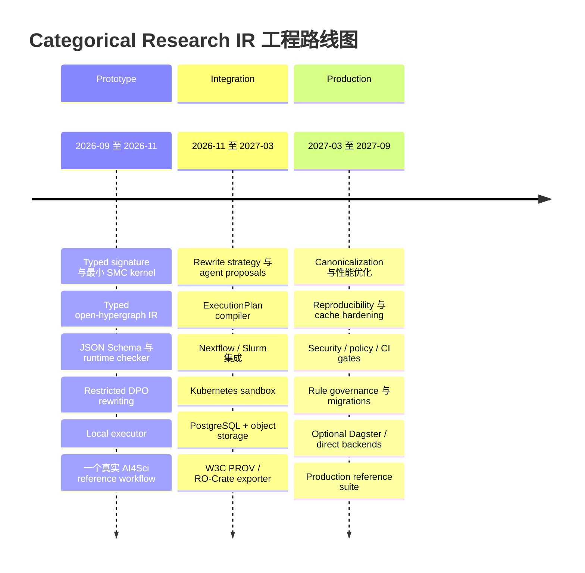

# 范畴论驱动科研实验编排的工程实现：截至 2026 年 9 月的技术评估与实施计划

## 执行摘要

截至 **2026 年 9 月 9 日**，我对 string diagrams、typed/open hypergraphs、DPO/SPO graph rewriting、categorical databases、provenance、scientific workflow、agentic science 与相关开源实现重新梳理后的判断是：

> **这条路线在数学上已经足够成熟，可以开始工程化；但“面向科研实验的完整 categorical runtime”仍不是成熟产品类别。最合理的做法不是从零制造一个范畴论 workflow platform，而是只自行实现一个很薄的 TypeScript semantic kernel / Research IR，把成熟的执行、存储、provenance 与 sandbox 系统放在它下面。**

这一判断有相当明确的依据。string diagram 与 typed hypergraph/DPO rewriting 之间已有系统化理论，包括对一般 symmetric monoidal theories 的 convex DPO rewriting，以及 termination/confluence 的理论工作；Wilson 与 Zanasi 又进一步给出了以 structured cospans / array-like ACSets 表示 string diagrams，并对 composition、tensor 和 functor application 给出高效算法的方案。citeturn14academia20turn14search0turn14search4turn21academia8

工程上也已经存在多个“局部答案”：Catlab.jl 提供 applied category theory、wiring diagrams、序列化和符号计算；AlgebraicRewriting.jl 已实现 C-Set 上的 DPO、SPO、SqPO；DisCoPy 提供 Python string-diagram/category 层；`open-hypergraphs` 直接尝试把 open hypergraph 做成 scalable combinatorial syntax。可是 Catlab 官方仍明确把自身描述为持续研究中的项目，AlgebraicRewriting 也明确提示 API/behavior 尚不能假设稳定，而 `open-hypergraphs` 的 rewriting 本身直到近期仍处于持续实现阶段。citeturn21search0turn21search1turn17search3turn17search11

另一边，真正成熟的是执行和运维基础设施。Nextflow 已经把 pipeline logic 与 local、Slurm、Kubernetes 等 executor 解耦，并提供 task hashing、cache/resume；Dagster 则已经提供生产级 orchestration、execution plan、lineage 与 observability。W3C PROV 是成熟的 provenance 标准；RO-Crate 1.2 被官方标记为稳定版本，Workflow Run RO-Crate 又专门面向计算 workflow execution provenance。citeturn15search1turn15search0turn19search3turn14search1turn17search0turn17search1

而 AI4Science 的最新发展正在从另一侧逼近我们讨论的架构。2026 年的 **Experiment-as-Code Labs** 已经提出“declarative experiment specification → program analysis / safety checking / resource assignment / orchestration → device API”的编译式实验栈；AI Scientist-v2 则用 agentic tree search 管理实验探索。这些系统都说明“实验作为程序”和“agent 自动扩展实验空间”正在成为现实，但它们目前还没有把这一过程建立在 typed open-hypergraph + categorical rewriting 的统一 IR 上。citeturn13search3turn13search6turn13search2

因此，我建议的核心架构不是：

\[
\texttt{ExperimentObject}\rightarrow\texttt{WorkflowObject}\rightarrow\texttt{Executor}
\]

而是：

\[
\boxed{
\text{Typed Experiment Algebra}
\longrightarrow
\text{Typed Open-Hypergraph IR}
\longrightarrow
\text{Typed Rewriting}
\longrightarrow
\text{ExecutionPlan}
\longrightarrow
\text{Existing Executors}
}
\]

并另外维护：

\[
G_0
\xRightarrow{\rho_1}
G_1
\xRightarrow{\rho_2}
G_2
\]

这样的 **research-state / rewrite provenance**。也就是说，“一次实验是什么”与“我们为什么从实验 \(G_0\) 改成 \(G_1\)”不要塞进同一个超级对象或超级图里。

具体到技术选择，我的推荐是：

| 关键决策 | 推荐 |
|---|---|
| 核心数学语义 | **free symmetric monoidal category on a typed signature** |
| canonical IR | **typed open hypergraph with explicit boundaries** |
| string diagram | 作为 view / notation，不作为唯一存储表示 |
| copy / fan-out | 不默认笛卡尔化；对 `Copyable` 类型显式/自动降糖为 `copy_n` |
| `id` / `swap` | structural wiring，不建 task node |
| `compose` / `tensor` | graph operations，不建 experiment object |
| 状态模型 | 对外 immutable snapshots；内部允许 ephemeral mutable builder |
| serialization | versioned JSON + JSON Schema 2020-12；provenance 另导出 JSON-LD/RO-Crate |
| rewrite | **restricted typed DPO 为默认**；SPO 仅用于显式 destructive operations |
| confluence | 只要求 normalization rules；exploration rules 明确允许不终止 |
| 类型系统 | TS generics + nominal/type-expression layer + runtime Ajv validation |
| dependent-like constraints | symbolic unification + runtime refinements；不强迫 TS 冒充依赖类型语言 |
| 执行语义 | `F_exec : C_exp → C_plan`，**不直接映射 Slurm/K8s** |
| 第一执行后端 | local |
| 第一生产集成 | **Nextflow → Slurm/K8s** |
| Dagster | 可选 operational backend，不作为 categorical kernel |
| provenance | internal derivation graph + W3C PROV + RO-Crate export |
| agent | 只产生 `RewriteProposal`；不能直接修改 canonical graph |
| sandbox | generated code 永远不在 orchestrator host 直接执行 |
| storage | prototype: SQLite/CAS；integration: PostgreSQL + S3-compatible object store |
| 工程周期 | 2–3 名核心工程师约 **8–13 个月**达到可信 production baseline；prototype 约 6–10 周 |

最重要的一项设计结论是：

\[
\boxed{
\text{我们不应该“实现范畴论框架”，而应该实现一个很小的 scientific categorical IR。}
}
\]

Catlab、AlgebraicRewriting、open-hypergraphs 等现有项目最值得借鉴的是**表示法、算法和测试思路**，而不是直接成为 TypeScript 产品运行时。生产执行则反过来应尽可能依靠 Nextflow、Slurm、Kubernetes、Dagster、PROV 和 RO-Crate 等已经成熟的基础设施。citeturn21search0turn21search1turn17search3turn15search1turn14search1turn17search4

## 目标、成功标准与总体架构

我们的目标不应该定义成“实现 category theory”，甚至也不应该定义成“实现一个新的 workflow engine”。正确目标是：

> **构造一个足够小、可验证、可序列化、可重写、可被 agent 操作的 Research IR，使复杂科研实验主要通过 typed composition 和 local rewrite 生长，而不是通过继承、目录复制、YAML 拼装或超级 Experiment object 生长。**

这意味着文件或“实验卡片”仍然可以存在，但它们只是 projection / view。一个 TS 文件可以声明 generator，一个卡片可以展示某个 composite diagram，一个目录可以用于存储 artifact；**这些空间组织都不能成为实验语义本身**。

我会把以下五项定义为架构不变量：

\[
\begin{aligned}
&\text{复杂性来自 composition，而不是 inheritance};\\
&\text{所有 scientific boundaries 显式 typed};\\
&\text{所有 duplication / side effects 显式};\\
&\text{research evolution 表示为 rewrite，而不是 object mutation};\\
&\text{execution 是 interpretation，而不是 experiment definition}.
\end{aligned}
\]

这和现有高效 string-diagram representation 的方向高度一致：Wilson 与 Zanasi 将 monoidal signature 明确分为 generating objects、generating morphisms、equations 和 typing relation，并以 structured cospans 表示带边界的 diagrams；其 composition、tensor、identity、symmetry 都可以作为 diagram algebra 操作，而不是面向对象方法层级。citeturn21academia8

我建议定义五级成熟度：

| 等级 | 含义 |
|---|---|
| M5 | 有稳定标准或广泛生产使用，可直接依赖 |
| M4 | 成熟工程组件，生产可用但需要 adapter |
| M3 | 可靠研究软件/已有较充分实现，可借鉴或局部采用 |
| M2 | 活跃研究实现，适合验证思想，不宜成为生产关键依赖 |
| M1 | 主要为理论构想或早期实验 |

按照这个尺度，截至目前各维度的状态是：

| 维度 | 现状成熟度 | 最大挑战 | 我建议的工程决策 | 主要风险与缓解 |
|---|---:|---|---|---|
| 目标/实验代数 | M3 | 科研过程是否真能压缩为少量 generators + rewrites | 先限定计算型 AI4Sci；真实案例验证，而非追求万能 ontology | 抽象过度 → 用真实研究流程作为 acceptance suite |
| 最小语义内核 | 理论 M5 / TS M1 | SMC 与实际科研副作用之间的距离 | Free SMC + typed signature，只做 `id/compose/tensor/symmetry` | 范畴层膨胀 → 禁止早期加入高阶抽象 |
| IR | 理论 M4 / 工程 M2–3 | graph equality、boundary、copy semantics | typed open hypergraph，保持 monogamy 约束 | 隐式 Frobenius/copy → copy/discard 必须显式 |
| rewriting | 理论 M4 / 工程 M2–3 | matching、termination、confluence | typed restricted DPO；normalization/exploration 分轨 | 搜索爆炸 → bounded strategy + index + budget |
| 类型 | TS M4 / dependent M2 | TS 静态类型无法验证动态 agent graph | TS ergonomics + runtime JSON Schema/Ajv + unification | 伪安全 → serialized graph 必须 runtime check |
| execution | 后端 M5 / 映射 M2 | failure/effects 破坏严格 functoriality | 先编译到 `ExecutionPlan`，再 adapter | 自造 scheduler → 坚决复用 Nextflow/K8s/Slurm |
| provenance | 标准 M5 / categorical M2 | semantic provenance 与 run provenance 不同 | 内部 derivation graph，外部 PROV + RO-Crate | metadata 双写漂移 → event-derived exporter |
| agentic expansion | M2 | LLM proposal 不可靠、成本无界 | agent 只能提交 typed rewrite proposal | 任意代码执行 → sandbox + allowlisted rules |
| production engineering | 单项 M5 / 整合 M2 | cache、artifact、security、reproducibility | CAS + PostgreSQL/S3 + container digest + CI property tests | 平台工程吞噬项目 → 分阶段只接一个 backend |
| 中文/工程资料 | 理论教育 M3 / 工程 M1–2 | 工程 primary material 主要为英文 | 中文文档自己建设，primary source 仍以论文/官方仓库为准 | 二手资料失真 → 核心设计直接追原论文 |

DPO/string-diagram rewriting 的理论基础已相当系统化，而 Catlab/AlgebraicRewriting 官方状态又说明“工程集成成熟度”显著落后于数学成熟度。citeturn14academia20turn14search4turn21search0turn21search1

真正的成功标准应当可测试，而不是“看起来很 categorical”。我会设置以下 production gates。

**语义正确性 gate。** 对随机生成的小/中型 diagrams 进行 property-based testing，持续验证 identity、associativity、tensor interchange、symmetry/naturality 等核心 law；canonicalization 后 equivalent compositions 必须得到同一 semantic identity。Wilson–Zanasi 的工作已经说明 composition、tensor、construction 和 functor application 可以以数组结构有效实现，为这一方向提供了直接工程依据。citeturn21academia8

**类型安全 gate。** 任何从文件、数据库、网络或 agent 得到的 graph 都必须经过 runtime validation；错误 arity、port type、boundary mismatch、illegal fan-out、DPO gluing failure 在执行前全部被拒绝。TypeScript 的 generics/conditional types很适合表达 authored code 的 input-output 关系，但动态加载的数据在编译期本质上仍是 `unknown`，因此运行时 schema validation 不可省略。citeturn18search0turn18search4turn18search15

**执行等价 gate。** 一套 reference research suite 至少要能由同一个 semantic graph 在 local 和 Nextflow/Slurm 两条路径执行；对于声明为 deterministic 的节点，输入 artifact、代码和环境相同时，输出 artifact identity 必须一致。Nextflow 已经把 functional pipeline logic 与 local/HPC/cloud executors 解耦，并以 task hash + work directory 实现 resume，这部分没有理由重新发明。citeturn15search1turn15search0

**provenance gate。** 每个 graph snapshot、rewrite application、task execution、artifact generation 都必须可追溯。外部 interchange 至少可以导出 PROV 和一个 RO-Crate；W3C PROV 已提供 Entity、Activity、Agent、Usage、Generation、Derivation 等稳定概念，而 RO-Crate 1.2 是当前官方稳定 specification。citeturn14search3turn14search1turn17search0turn17search4

**agent safety gate。** agent 的输出是 data proposal，而不是 authority。它只能请求：

\[
(G,\rho,\theta)\mapsto G'
\]

其中 \(\rho\) 是已注册 rule 或受控 rule template，\(\theta\) 是参数。validator 负责决定 proposal 是否 admissible；executor 再独立决定是否允许执行。2026 年 Experiment-as-Code Labs 把 program analysis、安全检查、资源分配置于 agent specification 与 device actuation 之间，正说明这种“agent 与执行权分离”已经成为 autonomous science 中非常现实的设计需求。citeturn13search3turn13search12

总体系统应当分成五层，而不是一个框架包办全部：

```text
TypeScript authoring DSL / Agent proposals
                  │
                  ▼
        Typed semantic terms
       Free symmetric monoidal
                  │
                lower
                  ▼
       Typed Open-Hypergraph IR
      ┌───────────┴───────────┐
      │                       │
 typed rewrites        derivation history
      │                       │
      ▼                       ▼
    snapshot              provenance
      │
      ▼
      ExecutionPlan
      │
 ┌────┼──────────────┬───────────┐
 ▼    ▼              ▼           ▼
local Nextflow     Kubernetes   Dagster
       │
       ▼
   Slurm / K8s / cloud
```

尤其要强调中间的 `ExecutionPlan`。我**不建议**真的写：

\[
F_{\rm exec}:\mathcal C_{\rm exp}\rightarrow\mathrm{Slurm}.
\]

Slurm 不是一个适合作为 scientific semantic codomain 的抽象；failure、retry、queue、resource availability 和外部副作用也不会严格保持所有 categorical laws。工程上更合理的是：

\[
F_{\rm plan}:
\mathcal C_{\rm exp}
\longrightarrow
\mathcal C_{\rm plan},
\]

然后：

\[
I_{\rm local},
I_{\rm nextflow},
I_{\rm k8s},
I_{\rm dagster}
:
\mathcal C_{\rm plan}
\rightarrow
\text{Runtime}.
\]

这样“范畴论语义”和“现实调度器的脏东西”不会被混在一起。

## 语义内核、IR 与重写系统

最小可行内核应当比“Experiment class”小得多。我甚至建议**语义 kernel 中不存在 `Experiment` 类型**。

存在的是一个 typed signature：

\[
\Sigma=(\Sigma_0,\Sigma_1,\tau)
\]

其中 \(\Sigma_0\) 是 port/object types，\(\Sigma_1\) 是 generating morphisms，而：

\[
\tau(g)=
(A_1,\ldots,A_m)
\rightarrow
(B_1,\ldots,B_n).
\]

复杂实验只是：

\[
f:
A\rightarrow B
\]

由 generators 通过 composition 与 tensor 构成。这和 Wilson–Zanasi 所采用的 monoidal signature / typed diagram model 是直接一致的。citeturn21academia8

这里有一个非常重要的工程细化：

> **`identity`、`swap` 是 morphisms；但 `compose`、`tensor` 是构造 morphism 的操作。它们都不应该被误建模为 ordinary task nodes。**

也就是说：

\[
id_A:A\to A
\]

在 IR 中基本就是 boundary wire passthrough。

\[
\sigma_{A,B}:A\otimes B\to B\otimes A
\]

通常只需要一个 port permutation。

而：

\[
g\circ f
\]

实现上是连接 \(f\) 的 outputs 与 \(g\) 的 inputs。

\[
f\otimes g
\]

实现上是两个 diagrams 的 disjoint union 加 boundary concatenation。

这会让执行 compiler 获得一个重要性质：`identity` 和 `swap` 默认根本不产生计算 task，只影响数据引用和 port routing。

一个适合 TS prototype 的核心接口可以非常薄：

```ts
type TypeExpr =
  | { readonly tag: "atom"; readonly name: string }
  | { readonly tag: "app"; readonly ctor: string; readonly args: readonly TypeExpr[] }
  | { readonly tag: "var"; readonly name: string };

interface PortType {
  readonly type: TypeExpr;
  readonly capabilities?: readonly ("copy" | "discard")[];
}

interface Generator {
  readonly id: string;
  readonly version: string;
  readonly inputs: readonly PortType[];
  readonly outputs: readonly PortType[];
  readonly effects: readonly string[];
}

interface Diagram {
  readonly schemaVersion: string;
  readonly signatureHash: string;
  readonly inputs: readonly BoundaryPort[];
  readonly outputs: readonly BoundaryPort[];
  readonly boxes: readonly BoxInstance[];
  readonly wires: readonly Wire[];
}
```

这里最值得防范的是 **open hypergraph 与普通 string diagram 并不自动等价**。在 hypergraph-category interpretation 中，Frobenius structure 会使 copy、merge 等 wiring 行为天然可表达；对于普通 free SMC，则需要类似 monogamy/convexity 等限制才能保持正确 correspondence。相关工作对此区别有明确说明。citeturn14academia20turn21academia8

这对科研系统不是数学细节，而是核心语义问题。比如：

```text
Dataset ─────┬──> Train A
             └──> Train B
```

普通 DAG 会很自然地把这理解成“一个数据集 fan-out 两次”。

但 category-first system 必须问：

> Dataset 这种 resource 允许复制吗？

对 immutable file artifact，答案通常是“逻辑引用可以复制”；对 physical sample、instrument state、stream、consumable reagent，答案可能完全相反。

所以我建议不是把整个 category 直接变成 cartesian category，而是引入 capability：

\[
\mathrm{Copyable}(A)
\]

并把 fan-out 降糖为显式 morphism：

\[
\Delta_A:A\to A\otimes A.
\]

如果 artifact 实际是 immutable content-addressed blob，`F_exec(\Delta_A)` 可以只是复制两个引用，不复制数据。这同时保持了 semantic explicitness 与执行效率。

因此三个 IR 候选的比较如下：

| IR | 优点 | 问题 | 建议定位 |
|---|---|---|---|
| String-diagram AST | 与数学表达最接近；错误信息和源码映射好 | rewriting/matching 时受 syntactic nesting 影响 | **authoring / debug representation** |
| Typed hypergraph | graph matching 和 n-ary operators 自然 | global input/output boundary 不是天然一等概念 | 中间表示基础 |
| Typed open hypergraph | ports、arity、全局 boundary、composition 都自然 | 需要认真控制 Frobenius/copy 语义与 graph equality | **canonical semantic IR** |
| Rendered string diagram | 人类可读，适合 UI | 不是理想 canonical store | **view only** |

open-hypergraph 路线已经有实际实现。`open-hypergraphs` 官方仓库将其描述为面向 scalable combinatorial syntax 的 general/data-parallel structure，并直接实现 Wilson–Zanasi 的 string-diagram 数据结构工作；不过其 rewriting 支持仍可看到近期持续开发痕迹，因此现阶段更适合作为参考实现和 correctness oracle，而不是 Node 产品的硬依赖。citeturn17search3turn17search11

我的实际实现会采用：

\[
\boxed{
\text{typed open hypergraph}
+
\text{ordered ports}
+
\text{explicit boundary}
+
\text{monogamy constraints}
}
\]

而不是简单 adjacency-list DAG。

其中一个 box：

\[
f:A\otimes B\to C\otimes D
\]

必须保留：

```text
input port 0 : A
input port 1 : B
output port 0: C
output port 1: D
```

不能仅保存“f 连着 A/B/C/D”，否则 arity/order 会丢失。

**Immutable vs mutable** 方面，我不建议走两个极端。逻辑状态应 immutable：

\[
G_0\rightarrow G_1\rightarrow G_2
\]

每个 snapshot 有独立 semantic hash，从而允许 provenance、branching、cache 和 agent search。可是算法内部可以有：

```ts
const b = new GraphBuilder(snapshot);
b.removeBox(...);
b.addBox(...);
const next = b.freeze();
```

这里的 mutable builder 只是 implementation detail，并不意味着 semantic object mutable。

这能避免纯 persistent graph implementation 在大规模 rewrite 中产生不必要的对象分配，又保持外部：

\[
\boxed{\text{snapshot semantics}}
\]

不被破坏。

serialization 方面，我建议 source of truth 使用 versioned JSON，并用 JSON Schema 2020-12 验证。JSON Schema 官方当前 specification 是 2020-12，Ajv 对该版本有直接支持；因此这比把 TypeScript compiler 当 runtime validator 更稳妥。citeturn18search1turn18search5turn18search2

例如：

```json
{
  "schemaVersion": "research-ir/0.1",
  "signature": "sha256:...",
  "inputs": [],
  "outputs": [],
  "boxes": [],
  "wires": [],
  "constraints": []
}
```

我不会让 GraphML 成为 canonical representation；Catlab 虽然支持 wiring diagrams 的 JSON / GraphML serialization，但这更适合作为 interoperability/visualization 参考。citeturn21search0

同样，我也不会一开始就让 JSON-LD 成为主 IR。JSON-LD 更适合 provenance/publication layer；RO-Crate 1.2 本身也是以 JSON-LD metadata 为核心组织 research object。citeturn17search4turn17search24

最棘手的是 canonical identity。两个 graph 可能只因 internal node ID 不同而语义等价：

\[
G\simeq G'.
\]

因此不能简单对原始 JSON 做 hash 然后宣布它是 semantic hash。

我的 prototype 会保留两个 identity：

\[
\texttt{snapshotId}
\neq
\texttt{semanticHash}.
\]

`snapshotId` 只标识具体 representation；`semanticHash` 来自 deterministic normalized representation。早期只承诺在我们的 compiler 产生的 canonical form 内稳定，不试图一次性解决一般 graph-isomorphism canonicalization。生产阶段再扩大 equality 范围。这是一个非常重要的 scope cut。

重写系统方面，理论支持已经比工程实现成熟得多。typed hypergraph 上的 DPO rewriting 与 string-diagram rewriting 的 correspondence 已有系统研究，一般 SMC 情形需要 convexity 等额外条件；相应 confluence 理论也已有专门研究。citeturn14academia20turn14search0turn14search4

工程上我会把 rule 定义为：

\[
L \xleftarrow l K\xrightarrow r R
\]

加上：

\[
\mathrm{Boundary}(L)=
\mathrm{Boundary}(R)
\]

以及显式 type/effect constraints。

例如 evaluation 替换：

\[
\mathrm{Eval}_{old}
\Rightarrow
\mathrm{Normalize}
\circ
\mathrm{Eval}_{heldout}
\]

只要 replacement 的外部 interface 仍是：

\[
Model\otimes TestData\to Metrics.
\]

对于科研扩展：

\[
Train(p)
\Rightarrow
Train(p-\delta)\otimes Train(p)\otimes Train(p+\delta)
\]

则可以由外层 aggregator 包裹，使整个 rewrite 仍保持规定 boundary。

DPO、SPO 与 SqPO 的工程选择我会非常明确：

| 机制 | 本项目角色 |
|---|---|
| **DPO** | 默认。用于 semantic-preserving/local experiment rewrites |
| SPO | 只在显式 destructive editing / repair 场景开放 |
| SqPO | 后期若出现需要 cloning 的高级 rule 再引入 |
| e-graph/equality saturation | 用于 algebraic optimization，不直接作为科研探索引擎 |

AlgebraicRewriting.jl 已经同时实现 DPO、SPO 与 SqPO，因此很适合作为测试语义和案例的外部 oracle，但项目官方明确提示仍处于 active development，API/behavior 不应被假设稳定。citeturn21search1

Equivalence Hypergraphs 则把 DPO rewriting 与 monoidal e-graphs / equality saturation 结合起来，说明“categorical IR 上的等价优化”已有直接研究基础；但我不会把 equality saturation 和 agentic experiment search 混为一谈。前者目标是找到**等价**表达，后者通常恰恰在生成科学上**不等价**的候选实验。citeturn14search2

因此 rewrite rules 必须分两类。

**Normalization rules**：

\[
G\Rightarrow^* N(G)
\]

要求尽可能 terminating，并对关键 rule sets 做 critical-pair/confluence 检查。

**Exploration rules**：

\[
G\Rightarrow G_1,G_2,\dots
\]

本来就不应该 terminating，例如：

```text
add_seed
parameter_sweep
alternative_metric
ablation
alternative_preprocessing
replication
higher_resolution
```

它们必须由 strategy 和 budget 控制，而不是企图证明 global confluence。

因此 DSL 最初甚至不应该提供任意递归，而只需要：

```text
seq(r1, r2)
choice(r1, r2, r3)
repeat(r, max = N)
untilNoMatch(r)
where(predicate)
beam(width, depth)
budget(cpuHours, gpuHours, money)
```

这也是我认为 category-theory prototype 能否走向工程的一个关键判断：**理论 rewrite relation 与实际 rewrite strategy 必须分开。**

## 类型系统与执行后端

TypeScript 非常适合做 surface DSL，但不应该把它幻想成完整 proof assistant。

TS 官方 generics 和 conditional types 可以表达很强的 input-output 关系；然而从 JSON、数据库或 agent 动态读入的数据不会神奇获得 compile-time dependent proof。因此正确架构是“双层类型系统”：authoring-time static types + runtime semantic checker。citeturn18search0turn18search4turn18search15

例如 authored generator 可以是：

```ts
const train = defineGenerator<
  [Dataset<InputSchema>, TrainConfig],
  [Model<InputSchema, LabelSchema>]
>({
  id: "train",
  ...
});
```

于是 TS 在普通手写代码里可以拒绝很多：

```text
Dataset<A> -> Model<A,B>
Dataset<C> -> ...
```

的明显 mismatch。

但 canonical IR 中仍然应该保存自己的 `TypeExpr`：

\[
Dataset<S>
\]

\[
Model<I,O>
\]

\[
Tensor<f32,[N,D]>
\]

\[
Metrics<Task>
\]

并由 runtime unifier 检查。

例如：

\[
Tensor<f32,[N,D]>
\stackrel?=
Tensor<f32,[M,D]>
\]

可产生约束：

\[
N=M.
\]

这已经具有一部分 dependent-like typing 的能力，但不要求 TypeScript 本身成为 Agda/Lean/Rocq。

我的优先级是：

\[
\boxed{
\text{nominal types}
>
\text{parametric types}
>
\text{symbolic constraints}
>
\text{full dependent types}
}
\]

这里尤其应该避免 TypeScript 默认的 structural assignability 在 semantic boundary 上自动成为科学上的“子类型”。科研类型转换应尽可能显式：

\[
A\xrightarrow{coerce}B
\]

而不是：

> “它们字段长得差不多，所以算同一类型。”

否则 categorical explicitness 会在 host language 类型系统中被偷偷破坏。

interface matching 我会采用：

\[
\operatorname{cod}(f)
\unify
\operatorname{dom}(g)
\]

成功才允许：

\[
g\circ f.
\]

implicit coercion 默认为禁用。

对于 unit、shape、schema version 等无法完全 compile-time 确定的约束，validator 返回：

```text
proved
disproved
deferred(runtime guard)
```

而不是简单 boolean。

这样将来可以接更强的 solver 或 proof sidecar，而不改 IR。

serialization boundary 统一使用 JSON Schema。JSON Schema 2020-12 是当前官方 specification，而 Ajv 提供 2020-12 validator；TypeBox 可以作为 TypeScript/JSON Schema 构建辅助，但我不会把某一 TS schema-builder 的内部表示变成 wire standard。citeturn18search5turn18search2turn18search3

执行层最重要的决定则是：

\[
\boxed{
\text{不要实现 scheduler。}
}
\]

Nextflow 当前官方 executor 层已经支持 local、Kubernetes、Slurm 以及多种 HPC/cloud systems，并明确把 executor 定义为“pipeline definition 与 underlying execution system 之间的 abstraction”。citeturn15search1turn15search4

因此 `F_exec` 应首先编译为：

```ts
interface ExecutionPlan {
  readonly tasks: readonly TaskSpec[];
  readonly dependencies: readonly Dependency[];
}

interface TaskSpec {
  readonly id: string;
  readonly generator: string;

  readonly image?: string;
  readonly command: readonly string[];

  readonly inputs: readonly ArtifactBinding[];
  readonly outputs: readonly ArtifactDeclaration[];

  readonly resources: ResourceRequest;
  readonly effects: readonly Effect[];

  readonly cacheable: boolean;
  readonly retryPolicy?: RetryPolicy;
  readonly timeoutMs?: number;
}
```

semantic structural operations 的 mapping 则很干净：

| semantic construct | ExecutionPlan interpretation |
|---|---|
| \(id_A\) | artifact reference passthrough |
| \(\sigma_{A,B}\) | port/reference remapping |
| \(f\otimes g\) | 两个可并行 subplans |
| \(g\circ f\) | 建立 output → input dependency |
| generator \(f\) | 一个或多个 executable tasks |
| `copy(A)` | 对 immutable artifact 通常复制 reference |
| rewrite | execution 之前改变 plan source graph |

最初 local backend 可以直接由 Node process/container adapter 执行。

第二个 backend 我推荐**不是直接 Slurm，而是 Nextflow**：

\[
\mathcal C_{\rm exp}
\to
\mathcal C_{\rm plan}
\to
\text{Nextflow}
\to
\{\text{local, Slurm, K8s, ...}\}.
\]

原因是 Nextflow 已经解决 executor abstraction 和 cache/resume。其当前 cache key 涉及 task name、container、inputs、script 等元数据，并结合 work directory 判断是否可恢复，因此可以直接作为我们设计 semantic cache policy 时的重要工程参照。citeturn15search0

对大量独立重复实验，例如：

\[
E_1\otimes E_2\otimes\cdots\otimes E_n,
\]

Slurm job arrays 本身就是高效管理相同 resource requirement 批处理 job 集合的机制，所以无需 semantic kernel 自己实现 HPC queue manager。citeturn19search2

Kubernetes 则适合 agent-generated workloads 的隔离执行。Kubernetes 本身提供 batch execution、resource requests/limits、RBAC 等机制，因此更适合作为 sandbox/runtime，而不是 research semantics。citeturn20search0turn19search9turn19search6

Dagster 的定位又不同。它当前是 production-oriented data orchestrator，强调 assets、lineage、observability 与 testability。对于数据平台团队，它是很好的 operational interpretation；但对于“任意 typed string diagram / scientific morphism”，强行把所有东西首先翻译成 Dagster asset model 反而会再次让执行平台决定科研语义。citeturn19search3turn13search5

因此我的 backend 顺序是：

\[
\boxed{
Local
\rightarrow
Nextflow
\rightarrow
Slurm/K8s
\rightarrow
Dagster\;(\text{optional})
}
\]

而不是并行实现五套 runtime。

还有一个不能回避的问题是 effects。

纯 computational morphisms 比较自然地满足：

\[
f\otimes g
\]

可并行。

但如果：

```text
f = write database
g = actuate microscope
```

则自由交换执行顺序可能完全错误。

因此 generator 必须至少携带 effect information：

```text
pure
filesystem-read
filesystem-write
network
external-service
instrument
non-idempotent
```

prototype 阶段先规定 scientific core 主要处理 pure/deterministic computation。physical lab actions 和复杂 runtime branching 暂不进入核心；2026 年 EaC Labs 和 Agent-to-Instrument Protocol 的工作说明，一旦进入真实 instrument actuation，safety validation 和 device-specific semantics 会成为独立的一层问题。citeturn13search3turn13search12

loops/feedback 也同理。第一版不要因为“traced monoidal category 很漂亮”就立刻实现 runtime feedback。

参数 sweep：

\[
p\in\{p_1,\dots,p_n\}
\]

直接在 rewrite/compile time 展开成 finite tensor。

agent feedback：

\[
G_t\Rightarrow G_{t+1}
\]

放在 meta-level research loop。

这样内核可以长期保持静态、有限、可分析。

## Provenance、Agent 与生产工程

这里我建议把所谓 categorical provenance 分成三个不同层次，否则很容易再次形成一个“万能 provenance object”。

第一层是 **semantic provenance**：

\[
G_0
\xRightarrow{\rho_1}
G_1
\xRightarrow{\rho_2}
G_2.
\]

它记录：

```text
graph before
rule
match
parameters
graph after
actor
reason
timestamp
policy decision
```

这是“为什么实验定义发生变化”。

第二层是 **execution provenance**：

\[
Artifact_A
\xrightarrow{TaskExecution}
Artifact_B.
\]

它记录 task、container/image、inputs、outputs、seed、runtime、executor、hardware class 等。

第三层才是 **publication/interchange provenance**：把前两层映射到 PROV 与 RO-Crate。

W3C PROV 的稳定模型已经覆盖 Entity、Activity、Agent、Usage、Generation、Derivation 等核心 provenance 概念；其目标就是跨系统 provenance 表示与交换，因此没有必要自行发明一个外部 categorical provenance standard。citeturn14search1turn14search3turn14search19

一个自然映射是：

| Internal | W3C PROV |
|---|---|
| GraphSnapshot | `prov:Entity` |
| Artifact | `prov:Entity` |
| RewriteApplication | `prov:Activity` |
| TaskExecution | `prov:Activity` |
| Human / Agent / Model | `prov:Agent` |
| input | `prov:used` |
| generated artifact | `prov:wasGeneratedBy` |
| graph evolution | `prov:wasDerivedFrom` |

RO-Crate 则负责把 code、data、workflow、run metadata 与研究对象一起 packaging。RO-Crate 1.2 当前由官方列为 stable release；Workflow Run RO-Crate 工作组专门定义 computational workflow execution provenance profiles，`runcrate` 也已有相应工具，不过其包元数据仍把开发状态标为 pre-alpha，这再次表明“标准成熟”和“某个具体工具成熟”必须分开评价。citeturn17search0turn17search1turn15search2turn15search5

内部所谓“categorical provenance”我会非常克制地定义成：

\[
\mathcal P:
\quad
\mathrm{Obj}=\{\text{snapshots/artifacts}\},
\quad
\mathrm{Mor}=\{\text{derivations/executions}\}.
\]

composition 表示 derivation composition。

但**第一版不实现完整 2-category/double-category framework**。

我们只保留足够的信息，使未来可以把：

\[
\text{morphisms}
\]

理解为 experiment execution，而：

\[
\text{2-cells}
\]

理解为 experiment rewrites。

这是一条值得保留的理论扩展路径，却不应该成为 prototype blocker。

agentic search 则应建立在这一层之上，而不是直接改源码。

我建议严格使用：

\[
\boxed{
\text{LLM proposes; kernel validates; policy authorizes; runtime executes.}
}
\]

agent 的基本输出：

```ts
interface RewriteProposal {
  readonly baseSnapshot: string;
  readonly ruleId: string;
  readonly match: MatchSelector;
  readonly parameters: unknown;

  readonly hypothesis?: string;
  readonly expectedUtility?: number;
  readonly estimatedCost?: CostEstimate;
}
```

而不是：

```ts
agent.editGraph(graph)
```

更不能默认：

```ts
agent.exec(arbitraryGeneratedPython)
```

第一阶段 agent 只可以从 allowlisted rule catalogue 选择：

```text
replicateSeed
parameterSweep
replaceEvaluator
addControl
ablateComponent
increaseResolution
alternativePreprocess
```

第二阶段才允许生成新的 rule candidate；新 rule 仍必须先通过 typechecking、boundary checks、rewrite admissibility、test suite 和 policy gate。

这点与当前 agentic science 的经验非常相关。AI Scientist-v2 已经展示了由 experiment manager 管理实验探索/agentic search 的方向，而 Experiment-as-Code Labs 则明确把 agent 生成 specification 与系统层的 analysis、安全检查和 orchestration 分开。citeturn13search2turn13search3

我会进一步区分两个 graph：

\[
G
=
\text{experiment graph}
\]

和：

\[
S=
\text{research search graph}.
\]

其中：

```text
S node = immutable experiment snapshot G_i
S edge = rewrite proposal / accepted rewrite
```

于是：

```text
                 G2
               /
G0 ---> G1 ---+
               \
                 G3 ---> G4
```

就是科研探索空间。

这样 agent search 不需要把“所有可能实验”塞进一个巨大 hypergraph。

cost model 则至少应是多目标：

\[
Score(G')
=
U_{\rm science}(G')
-\lambda C_{\rm compute}(G')
-\mu R_{\rm safety}(G')
-\nu C_{\rm duplication}(G').
\]

其中 \(U_{\rm science}\) 可以初期由 heuristic/agent estimate 提供；计算成本则尽量由 task resource model 机械估计。

要强调一点：

> **agentic expansion 本来就不应该满足 termination。**

termination 的责任属于 strategy budget：

```text
maxDepth
maxCandidates
maxGpuHours
maxWallClock
maxMonetaryCost
maxInstrumentActions
```

而不是 rewrite calculus。

生产工程方面，我不会用 filesystem hierarchy 当 database。

prototype：

```text
SQLite
+
content-addressed local blob store
+
canonical JSON snapshots
```

integration：

```text
PostgreSQL
+
S3-compatible object storage
+
OCI registry
```

数据库主要索引：

```text
snapshot
generator
rule
rewrite
run
task
artifact
agent proposal
policy decision
```

大 artifact 不进 PostgreSQL，而是按 content digest 存 object store。

同样，我不建议一开始引入 graph database。我们的 graph 本身就是 immutable serialized research object；大部分 operational query 是：

```text
哪个 snapshot？
哪个 parent rewrite？
哪个 run？
哪些 input artifact？
哪个 generator version？
```

PostgreSQL 足够。等真正出现跨百万 diagram 的复杂 graph pattern query，再重新评估。

cache key 应建立在：

\[
H(
generatorVersion,
parameters,
inputArtifactDigests,
codeDigest,
environmentDigest,
seed,
semanticOptions
)
\]

上，而不是文件名。

Nextflow 当前的 task-cache 实践也表明，cache correctness 实际依赖 task script、container、inputs、environment 等多个维度，而不仅是 command string。citeturn15search0

Artifact identity 应优先 content-addressed。OCI specifications 本身广泛采用 digest/content-addressed references；这与 immutable research artifact 很契合。citeturn20search2

但必须明确 deterministic 与 nondeterministic task。

对：

```text
deterministic = true
```

可以要求相同 semantic cache key 导致相同 artifact digest。

对 stochastic training，应强制记录：

```text
seed
RNG family/version
framework version
hardware class
determinism flags
```

而不能虚假承诺 GPU 科学计算的一般 bitwise reproducibility。

CI/CD 不只是普通 unit tests，我会增加“代数性质测试”：

| 测试层 | 核心测试 |
|---|---|
| Parser/schema | JSON round-trip、version migration |
| Type | arity mismatch、unification、coercion |
| Category laws | identity、associativity、tensor、symmetry |
| IR | canonicalization、boundary invariants |
| Rewrite | match、DPO admissibility、preserved boundaries |
| Strategy | boundedness、deterministic seeded search |
| Backend | local/Nextflow golden outputs |
| Provenance | snapshot → run → artifact lineage completeness |
| Security | sandbox escapes、secret/network policies |
| Reproducibility | deterministic reference suite rerun |

security 是 agent 进入 production 后的硬前提。

Kubernetes 可以提供 resource limits、RBAC、batch isolation 和 network policy 等基础机制；这适合将 generated workloads 与 orchestrator 本身隔离。citeturn19search9turn19search6turn20search4

我的 baseline sandbox policy 会是：

```text
non-root
read-only root filesystem
no privileged containers
no host filesystem mount
minimal service account/RBAC
CPU / memory / wall-time limits
network deny by default
explicit artifact ingress/egress
no long-lived cloud credentials
immutable image digest
full execution audit
```

software supply chain 上，SLSA 把 build provenance 和 artifact integrity 明确作为供应链安全的重要机制，因此 production 阶段至少应保存和验证 build provenance，而不是仅记录一个 Docker tag。citeturn20search1

这里还有一个重要工程原则：

\[
\boxed{
\text{Research provenance}
\neq
\text{Security provenance}
}
\]

PROV/RO-Crate回答：

> 科研结果是怎么来的？

SLSA/OCI digest 回答：

> 执行的代码/镜像到底是哪一个，是否能验证其来源？

二者都要有，但不要混成一个 ontology。

## 现有项目与文献比较

截至目前，没有一个项目完整覆盖我们需要的：

\[
\text{typed categorical IR}
+
\text{rewriting}
+
\text{scientific provenance}
+
\text{agent search}
+
\text{production execution}.
\]

但已有项目正好形成了一套非常清晰的“拼图”。

| 项目 / 论文 | 主要覆盖 | 本报告成熟度 | 语言 / 许可 | 对本项目的价值 | 官方/原始来源 |
|---|---|---:|---|---|---|
| **Catlab.jl** | applied category theory、GAT、wiring diagrams、serialization | M3 | Julia / MIT | 最重要的 API、schema、wiring diagram 设计参考之一；不直接作为 TS runtime | 官方仓库 citeturn21search0 |
| **AlgebraicRewriting.jl** | C-Set 上 DPO/SPO/SqPO | M2–3 | Julia / MIT | rewrite correctness/reference implementation | 官方仓库明确称 active development citeturn21search1 |
| **open-hypergraphs** | scalable/data-parallel open hypergraph syntax | M2 | Rust / Apache-2.0 + MIT | 最接近我们 canonical IR 的现有实现之一 | 官方仓库及 rewrite 工作 citeturn17search3turn17search11 |
| **Data-Parallel Algorithms for String Diagrams** | structured cospan/ACSet representation、compose/tensor/functor algorithms | 理论 M4–5 | 论文 | TS array IR 的核心理论依据 | 原始论文摘要 citeturn21academia8 |
| **DisCoPy** | monoidal categories / string diagrams / functorial evaluation | M3 | Python / BSD-3-Clause | surface DSL、diagram algebra、测试案例参考 | 官方项目/论文 citeturn7view0 |
| **String Diagram Rewrite Theory 系列** | DPO、convex rewriting、termination/confluence | 理论 M4–5 | 论文 | typed rewrite kernel 的理论基础 | 原始论文 citeturn14academia20turn14search0turn14search4 |
| **Equivalence Hypergraphs** | monoidal e-graphs、DPO/equality saturation | M2 | 研究论文 | 后期 normalization/optimizer 方向 | 原始论文 citeturn14search2 |
| **Catlab + AlgebraicJulia 生态** | compositional scientific models / algebraic data structures | M2–3 | Julia / 多数 MIT | 证明 category theory 可以成为实际 scientific modeling 工具链，而不只是一套 notation | Catlab 官方说明 citeturn21search0 |
| **Nextflow** | scientific workflow、local/HPC/cloud executor、cache/resume | M5 | Java/Groovy / Apache-2.0 | 第一生产 execution backend | 官方仓库及文档 citeturn13search0turn15search1turn15search0 |
| **Dagster** | data orchestration、assets、lineage、observability | M4–5 | Python / Apache-2.0 | 企业 operational backend，可选 | 官方仓库/文档 citeturn13search5turn19search3 |
| **Slurm** | HPC scheduling、job arrays | M5 | C / 开源 | tensor/sweep 的 HPC 低层运行时 | 官方文档 citeturn19search2 |
| **Kubernetes** | Jobs、resource isolation、RBAC、network/security | M5 | Go / Apache-2.0 | sandbox 与 cloud batch runtime | 官方仓库/文档 citeturn20search0turn19search9turn19search6 |
| **W3C PROV** | interoperable provenance model | M5 | W3C 标准 | external provenance vocabulary | W3C Recommendation citeturn14search1turn14search3 |
| **RO-Crate 1.2** | research object metadata/package | M4–5 | Specification / tooling 多许可 | publication/archive/run bundle | 官方当前稳定 specification citeturn17search0turn17search4 |
| **Workflow Run RO-Crate** | computational workflow run provenance | M3–4 | Specification / tooling | Execution provenance export 直接可用 | 官方 profile 工作组 citeturn17search1turn17search21 |
| **AI Scientist-v2** | autonomous research、agentic experiment search | M2 | 主要 Python / 自定义 Responsible-AI 衍生许可 | research-state search 的现实参照，而不是 IR 参照 | 官方仓库 citeturn13search2 |
| **Experiment-as-Code Labs** | declarative experiment、analysis、安全、orchestration、device APIs | M1–2 | 论文 | 与我们的 compiler-stack 思路最接近的 2026 AI4Sci 架构之一 | 原始论文 citeturn13search3turn13search6 |
| **Sci-Orchestra** | cloud-native scientific orchestration | M1–2 | 研究论文 | 2026 年科学编排工程化的邻近方向 | 原始论文 citeturn13search9 |
| **Agent-to-Instrument Protocol** | autonomous science instrument protocol / safety | M1–2 | 研究论文 | 将来扩展 physical labs 时重要 | 原始论文 citeturn13search12 |

从这个表能看到一个非常鲜明的“成熟度断层”：

\[
\begin{array}{ccc}
\text{Categorical semantics}
&
\text{Agentic science}
&
\text{Production runtime}
\\
M3
&
M2
&
M5
\end{array}
\]

真正缺少的不是 scheduler，不是 provenance vocabulary，也不是 string-diagram 数学，而是中间这个：

\[
\boxed{
\text{Scientific Typed Rewrite IR}
}
\]

以及它与两侧之间的稳定 ABI。

Catlab 尤其值得认真研究，但也值得认真**不照搬**。官方强调它提供 data structures、algorithms、serialization、type-safe symbolic systems 和 wiring diagrams，同时也明确说 applied category theory 是年轻领域、Catlab 仍持续研究，文档也尚不如期望成熟。citeturn21search0

这恰好支持一个工程结论：

> TS 项目应该借鉴 Catlab 的 semantic design，而不是让 Node runtime 依赖 Julia Catlab server 才能运行。

AlgebraicRewriting 也类似。它非常适合我们的测试与理论验证，因为已有 DPO/SPO/SqPO 具体实现；但其官方明确警告 API 与 behavior 还不能视为恒定。citeturn21search1

`open-hypergraphs` 则更接近底层 IR。它直接以 open hypergraph 作为 syntax datastructure，并与 data-parallel string diagram 工作相连；但近期仍能看到 rewriting implementation 工作，说明它尚不像 PostgreSQL、Nextflow、Kubernetes 那样是可以无条件放进生产 critical path 的依赖。citeturn17search3turn17search11

所以正确的 reuse strategy 是：

\[
\boxed{
\text{reuse mathematics and tests from categorical projects}
}
\]

\[
\boxed{
\text{reuse runtime from production workflow projects}
}
\]

而我们自己只拥有中间：

```text
signature
type checker
typed open-hypergraph
rewrite engine
strategy
execution compiler
provenance bridge
```

中文资料方面，目前核心工程实现的 primary/official material 仍明显以英文论文、项目文档和 GitHub 仓库为主。中文可以使用清华大学丘成桐数学科学中心的范畴论课程资料等作为概念、术语和数学背景辅助，但它不是这套 engineering architecture 的实现依据。citeturn10search1

所以对这个项目而言，我会主动维护一套中文 ADR/设计文档，把：

```text
object / morphism
generator
signature
tensor
symmetry
open hypergraph
cospan
boundary
rewrite rule
match
DPO
provenance
interpretation/functor
```

统一翻译并绑定代码概念。否则团队很容易出现“数学家说 morphism，工程师说 task，agent prompt 又说 experiment node”，最后三套 ontology 同时存在。

## 路线图、风险与结论

下面的时间不是来自论文，而是基于上述技术边界给出的**工程估算**。假设团队为：

> **2 名全职核心工程师**：一名偏 language/IR/rewrite，一名偏 runtime/backend/storage；另有约 0.25–0.5 FTE 的科研用户/领域专家，以及 integration/DevOps 的阶段性支持。

单人完成时，我会粗略按这里周期的 **1.8–2.5 倍**预算，因为最耗时的通常不是编码，而是语义设计、real-world testcase、backend integration 和 reproducibility debugging。

三个阶段的整体规划是：

| 阶段 | 时间估算 | 核心问题 | Exit criterion |
|---|---:|---|---|
| **Prototype** | 6–10 周 | categorical IR 是否真的改善真实科研实验组织？ | 一个真实 AI4Sci workflow 完全由 typed generators/composition/rewrite 表达并 local 执行 |
| **Integration** | 10–16 周 | IR 是否能和成熟 workflow/provenance/storage 对接？ | 同一 graph 可 local + Nextflow/Slurm/K8s 执行，带 cache/provenance/agent proposal |
| **Production** | 16–28 周 | 是否达到可靠、安全、可维护、可扩展？ | sandbox、CI、migration、observability、reproducibility、policy 和性能均达到 production gate |

各维度的具体交付物如下：

| 维度 | Prototype：6–10 周 | Integration：10–16 周 | Production：16–28 周 |
|---|---|---|---|
| 目标/成功标准 | 选择一个真实研究流程；建立 reference suite | 增加 3–5 类研究模式：sweep/seed/ablation/evaluator replacement | 多团队/多项目验证，明确 unsupported semantics |
| 语义内核 | typed signature；`id/compose/tensor/swap`；explicit copy | effects/capabilities；parameterized generators | versioned semantic laws、migration policy |
| IR | TS typed open hypergraph；immutable snapshot；JSON | canonicalization 改进；PostgreSQL indexing | large-graph profiling、binary cache representation |
| Rewrite | restricted typed DPO；5–10 个 rules | strategy DSL；normalization/exploration 分离；match index | critical-pair tooling、rule governance、performance hardening |
| 类型 | nominal/parametric types；Ajv runtime check | symbolic dimensions/unification/refinements | optional proof/certificate hooks for high-assurance rules |
| Execution | local process/container backend | Nextflow compiler；Slurm/K8s integration | backend capability matrix、retry/failure semantics、optional Dagster |
| Provenance | snapshot/rewrite/run event log | W3C PROV + RO-Crate exporter | provenance validation、archive/import/migrations |
| Agentic search | rule selection proposal only | bounded beam/tree search + cost model | policy-managed rule synthesis、human approval classes |
| Storage/cache | SQLite + local CAS | PostgreSQL + object store + OCI images | retention、GC、backup、HA、disaster recovery |
| Reproducibility | generator version + inputs + seed | environment/image digest + semantic cache key | reproducibility reports、reference rerun CI |
| Security | no host arbitrary code | K8s sandbox、RBAC/resource/network isolation | signed/provenanced builds、audit、tenant isolation |
| Developer experience | TS DSL + CLI + string-diagram renderer | inspector、diff、rewrite visualization | migration tools、IDE support、documentation |

对应的实际时间线我会安排为：



第一阶段尤其重要，因为这里应该有一个明确的 **kill criterion**。

如果我们选一个真实科研过程，例如：

\[
Data
\xrightarrow{preprocess}
TrainData
\xrightarrow{train}
Model
\xrightarrow{evaluate}
Evidence
\]

然后要求它自然支持：

\[
\text{seed replication},
\quad
\text{parameter sweep},
\quad
\text{ablation},
\quad
\text{alternative evaluator},
\quad
\text{baseline replacement},
\]

最终发现这些变化仍然需要大量 escape hatch：

```text
custom object metadata
custom imperative callback
hidden mutable state
special-case compiler branch
```

那么应该承认：

> categorical kernel 没有获得足够的 compression ratio。

而不是继续不断扩充 category，最终造出一个“Categorical God Object”。

反过来，如果十几个真实实验操作能被压缩成少数：

\[
\Sigma
+
R
\]

即：

\[
\text{small generator signature}
+
\text{small rewrite vocabulary},
\]

并且 agent 只需操作这些结构即可组合和扩展研究，那么核心假设就得到非常强的实证支持。

我会特别避免以下几件事：

| 不做 | 原因 |
|---|---|
| 第一阶段实现通用 category-theory framework | Catlab 已经证明这本身就是长期研究项目；不是我们的产品目标。citeturn21search0 |
| 自己实现 distributed scheduler | Nextflow、Slurm、K8s 已经成熟。citeturn15search1turn19search2turn20search0 |
| 第一版实现所有 DPO/SPO/SqPO/e-graph | 范围失控；DPO 足够检验主要假设。citeturn21search1turn14search2 |
| 一开始证明所有 rewrite confluence | exploration 本身有意产生分支，global confluence 不是需求。string-diagram confluence 本身已有复杂理论条件。citeturn14search4 |
| 一开始引入完整 dependent type theory | TS prototype 得不偿失；runtime schema + unification 足够先验证价值 |
| 让 agent 自由生成并直接运行代码 | autonomous science 的当前发展已经表明 analysis/safety layer 应处于 agent 与执行之间。citeturn13search3turn13search12 |
| 把所有 provenance 塞进 graph node metadata | semantic evolution、execution lineage 和 publication provenance 是三个不同层次 |
| 使用目录层级表达实验关系 | 它会重新把逻辑关系退化为空间组织 |
| 建立 `Experiment extends BaseExperiment` 体系 | 会重新回到我们最初试图摆脱的 OOE/OOP 问题 |

从技术栈上，我最终会给出这样一套相当具体的 baseline：

| 层 | 推荐实现 |
|---|---|
| Monorepo / API | TypeScript + Node.js LTS，strict mode |
| Static authoring types | TS generics / branded nominal types |
| Runtime schema | JSON Schema 2020-12 + Ajv citeturn18search2turn18search5 |
| Semantic IR | 自研最小 typed open-hypergraph；array-oriented representation |
| IR reference | Wilson–Zanasi / open-hypergraphs / Catlab citeturn21academia8turn17search3turn21search0 |
| Rewrite | 自研 restricted typed DPO；AlgebraicRewriting 作 oracle/reference citeturn21search1 |
| Equality optimization | 后期可参考 Equivalence Hypergraphs / e-graph 思路 citeturn14search2 |
| Local executor | Node process/container adapter |
| Scientific backend | Nextflow compiler citeturn15search1 |
| HPC | Nextflow → Slurm；必要时后期 direct Slurm adapter citeturn19search2 |
| Cloud sandbox | Kubernetes Jobs + resource/security policy citeturn20search0turn19search9 |
| Enterprise data orchestration | Dagster optional adapter citeturn19search3 |
| Metadata | SQLite → PostgreSQL |
| Artifacts | local CAS → S3-compatible object store |
| Runtime images | OCI digest-addressed images citeturn20search2 |
| Research provenance | Internal event/derivation model |
| Interchange provenance | W3C PROV citeturn14search1 |
| Research packaging | RO-Crate / Workflow Run RO-Crate citeturn17search4turn17search1 |
| Supply-chain provenance | SLSA-oriented build provenance citeturn20search1 |
| Agent interface | typed `RewriteProposal` API |
| Search | bounded strategy/beam/tree over immutable snapshots |
| Visualization | render IR → string diagrams；不要把 renderer 变成 source of truth |

最终，我对这项工作的判断比前面的讨论更明确：

\[
\boxed{
\text{现在已经足够成熟，可以开始做；}
}
\]

但：

\[
\boxed{
\text{只应该自己做约 10\%-20\% 的“语义中层”，}
}
\]

而不是造完整 scientific platform。

真正值得我们拥有的知识产权和技术核心，大概就是这四样：

\[
\boxed{
\Sigma
+
\mathcal G
+
R
+
F_{\rm plan}
}
\]

其中：

\[
\Sigma
=
\text{科研领域 typed signature},
\]

\[
\mathcal G
=
\text{typed open-hypergraph research IR},
\]

\[
R
=
\text{scientifically meaningful typed rewrite vocabulary},
\]

\[
F_{\rm plan}
=
\text{从 scientific semantics 到 execution semantics 的 compiler}.
\]

其中最有研究价值的甚至不是 open-hypergraph 数据结构本身——那方面已有越来越多工作。真正没有得到充分解决的，是：

\[
\boxed{
R:
\text{什么样的少量 rewrite rules 足以描述“科研如何生长”？}
}
\]

例如：

\[
\begin{aligned}
\rho_{\rm replicate}&:\text{single run}\Rightarrow\text{replicated evidence}\\
\rho_{\rm sweep}&:\text{point estimate}\Rightarrow\text{parameter family}\\
\rho_{\rm ablate}&:\text{composite mechanism}\Rightarrow\text{controlled variants}\\
\rho_{\rm control}&:\text{uncontrolled claim}\Rightarrow\text{controlled comparison}\\
\rho_{\rm challenge}&:\text{evidence}\Rightarrow\text{alternative evaluator}\\
\rho_{\rm refine}&:\text{failed hypothesis}\Rightarrow\text{refined experiment}
\end{aligned}
\]

如果这一层最后能形成一个稳定的、小型 **Scientific Rewrite Algebra**，那么我们得到的就不只是一个 workflow DSL。

我们会得到一种适合人和 AI 共同操作的：

\[
\boxed{
\textbf{Research Intermediate Representation}
}
\]

它把“科研项目”从：

```text
folders
scripts
configs
objects
jobs
logs
```

重新定义成：

\[
\boxed{
\text{typed relations}
+
\text{compositions}
+
\text{rewrites}
+
\text{evidence}
+
\text{derivations}.
}
\]

而从截至 2026 年的文献和工程现状来看，**这正处在一个很有意思的窗口期**：底层范畴论与 graph rewriting 已经足够成熟，生产执行与 provenance 基础设施也已经成熟，而 autonomous science 又刚好开始需要一种比“让 LLM 修改 Python/YAML”更强的 machine-operable experiment representation。Data-parallel string-diagram IR、Catlab/AlgebraicRewriting、Nextflow/PROV/RO-Crate 与 2026 年 Experiment-as-Code 等工作已经分别把这些拼图推到了足够近的位置，但尚未形成一个统一的 production architecture。citeturn21academia8turn21search0turn21search1turn15search1turn14search1turn17search0turn13search3

所以我的具体工程决策会是：**立即做 prototype，但严格限制在 semantic kernel；六到十周后用真实科研工作流决定是否值得继续，而不是先投入一年造平台。**