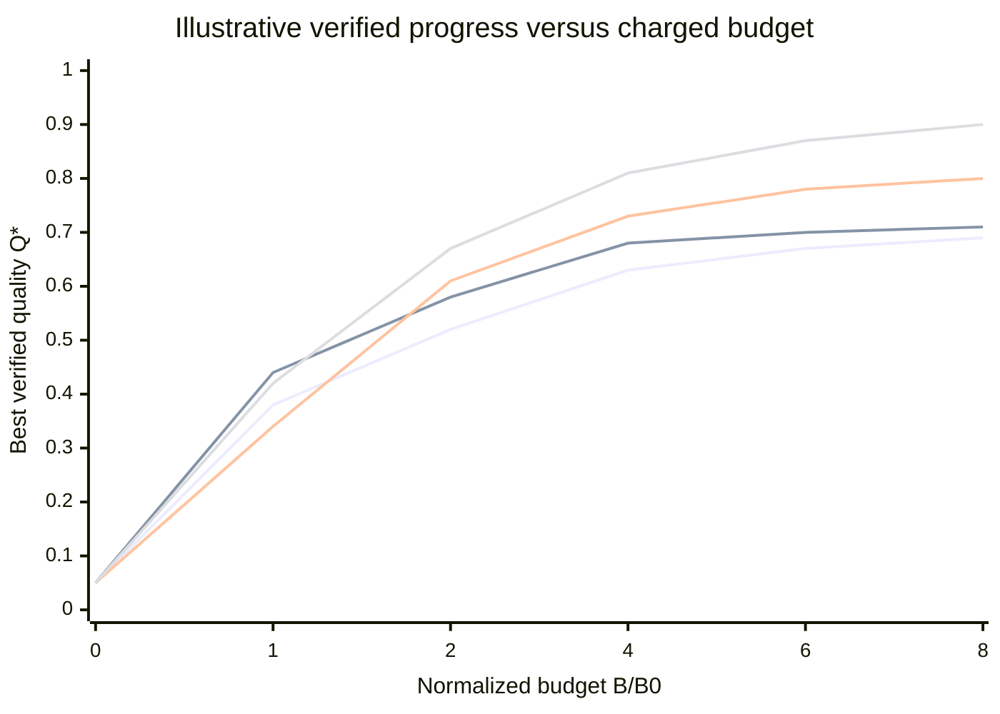
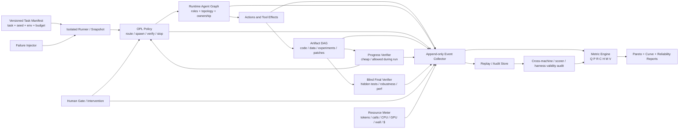

<!-- 来源:ChatGPT 项目「未来人工智能设想」的 Deep Research 输出(会话 6ac5b520-25fc-83ee-a5e5-a768b1fa9eac)
     标题:Long-Horizon Agent Evaluation: SOTA Systems, Metrics, and an Engineering Blueprint for ADA/OPL
     生成:Research completed in 9m · 25 citations · 595 searches(2026-10-07)
     获取:面板在跨域沙箱 frame #f1 内(桥无法向 OOPIF 注入输入:点击/滚轮/Tab 三种实测均不入);由用户点面板的 ⤓ 按钮下载,
          落 ~/Downloads/deep-research-report.md(57761 字符 / 1197 行 / md5 aaa867a946b0cea1daf7491ed432bfc1)
     改名原因:~/Downloads 的原名与 related_files/deep-research-report.md **同名不同内容**(那份是 Relation-First 实验系统);
          导出器每次都复用这个无主题名,故本件按主题 + 日期改名
     核验:38 条引用逐条核过(子代理一遍 + 我亲核三条),台账见 related_files/deepresearch-citation-ledger-2026-10-07.md。
          三处须改后使用:SWE-fficiency 是 0.23×(原文写 0.15×);LHTB 的验证器是 rebuild-from-artifact(原文写 replay-based,
          方向相反);LHTB 类别仓库 8 类 / 论文 9 类(两源冲突)。两处内部矛盾:成本向量两次定义(摘要 7 项已塌成单一美元项)、
          V 自称 first-order 却缺席两个指标清单
     去重:与登记册逐条对照的结论见反转段「独立研究报告 → 采纳(10-07)」;本次未改动正文一字
-->
# Long-Horizon Agent Evaluation: SOTA Systems, Metrics, and an Engineering Blueprint for ADA/OPL

## Executive summary

The most important conclusion from the current landscape is that **no benchmark or orchestration system I found implements the full evaluation object we actually want**:

\[
\boxed{
Y=(Q,P,R,C,H,M,V)
}
\]

where \(Q\) is verified outcome quality, \(P\) progress/search dynamics, \(R\) reliability and recovery, \(C\) compute/resource cost, \(H\) human attention, \(M\) multi-agent composition, and \(V\) evaluation validity.

Instead, the state of the art is fragmented into complementary pieces:

| Engineering need | Best current references | What to borrow |
|---|---|---|
| Long-horizon execution + partial progress | [LHTB](https://github.com/zli12321/LHTB), [AgentBoard](https://github.com/hkust-nlp/AgentBoard), [LoopX](https://github.com/loopx-project/loopx) | Dense/partial outcome grading, durable progress state, long trajectories |
| Strong objective verification | [KernelBench](https://github.com/ScalingIntelligence/KernelBench), [KernelBench-Verified](https://github.com/facebookresearch/kernel_bench_verified), [SWE-bench](https://github.com/SWE-bench/SWE-bench) | Correctness gates before optimization score; hidden tests; regression testing |
| Real optimization rather than task completion | [SWE-fficiency](https://github.com/swefficiency/swefficiency), [GSO](https://github.com/gso-bench/gso), [RE-Bench](https://github.com/METR/RE-Bench) | Performance improvement curves, expert-relative performance, open-ended optimization |
| Compute-aware evaluation | [METR Expenditure Horizon](https://metr.org/blog/2026-07-21-expenditure-horizon/), [RE-Bench](https://github.com/METR/RE-Bench) | Score-vs-expenditure curves rather than one fixed-budget score |
| Repeated-run reliability | [τ-bench](https://github.com/sierra-research/tau-bench) | `pass^k`, state-based verification, consistency across stochastic trajectories |
| Multi-agent topology | [MultiAgentBench/MARBLE](https://github.com/MultiagentBench/MARBLE), [Agent Scaling](https://github.com/ybkim95/agent-scaling) | Explicit star/chain/tree/graph or independent/centralized/decentralized/hybrid treatments |
| Human-attention accounting | [LoopX](https://github.com/loopx-project/loopx), METR human comparisons | Attention as a resource, authority/gate events, human-relative economics |
| Evaluation validity | KernelBench-Verified; [2026 optimization-benchmark audit](https://github.com/chenzhi-cz/performance-optimization-benchmark-reliability) | Hidden robust verifiers, realistic baselines, cross-machine replay, ranking-sensitivity analysis |

This decomposition is strongly supported by the projects themselves. LHTB supplies 46 long terminal tasks with dense partial reward and hidden replay-based verifiers; KernelBench makes correctness a prerequisite for speedup; KernelBench-Verified strengthens this with hidden multi-distribution tests, realistic TF32 baselines, memory metrics, and input-blind generation; METR explicitly models performance as a function of expenditure; τ-bench exposes repeated-run reliability; MARBLE and the Agent Scaling work treat topology as an experimental variable rather than as a vague “multi-agent” label. citeturn13academia41turn13search12turn13search1turn17search0turn13search2turn14search0turn12search21

For **ADA/OPL**, I would therefore not adopt any one benchmark wholesale. I would build a **measurement substrate** that can host these evaluator styles simultaneously:

\[
\boxed{
\text{task}
\rightarrow
\text{agent/search process}
\rightarrow
\text{artifacts}
\rightarrow
\text{blind verifiers}
\rightarrow
(Q,P,R,C,H,M,V)
}
\]

and make **OPL optimization itself an experimental treatment**.

The highest-priority metrics should be:

\[
\boxed{
Q^*(b),\quad
AUC_Q(B),\quad
C_\tau,\quad
pass^k,\quad
L_{\rm recovery},\quad
MC_i,\quad
CE_i,\quad
N_{\rm eff}
}
\]

while always retaining the raw cost vector

\[
C=
(C_{\rm input\ tok},
C_{\rm output\ tok},
C_{\rm calls},
C_{\rm CPU},
C_{\rm GPU},
C_{\rm wall},
C_{\$})
\]

instead of prematurely collapsing cost into tokens or dollars.

There is also one very important warning for our intended algorithm-optimization work: **benchmark validity is now demonstrably a first-order variable**. A 2026 audit replayed the official reference patches from GSO, SWE-Perf, and SWE-fficiency across four Google Cloud machine types. Only **39/102 GSO tasks, 11/140 SWE-Perf tasks, and 411/498 SWE-fficiency tasks** satisfied their benchmark's own original validity criteria in every cross-machine replay; scoring rules also changed model/agent rankings. citeturn15academia41

So for us,

\[
\boxed{V\text{ is not benchmark hygiene. }V\text{ is part of the measured system.}}
\]

That is probably the biggest change I would make to our earlier metric design.

## Evaluation model and evidence standard

A useful distinction is between **what an agent achieved**, **how it got there**, and **whether the measurement can be trusted**.

I recommend formalizing one evaluation episode as

\[
\mathcal E=
(\mathcal T,\pi,\mathcal G,B,\omega,\mathcal V),
\]

where:

- \(\mathcal T\) is the task and initial state;
- \(\pi\) is the orchestration policy, not merely the foundation model;
- \(\mathcal G\) is the runtime agent/topology graph;
- \(B\) is the resource budget;
- \(\omega\) is the environment/seed/failure realization;
- \(\mathcal V\) is the verifier stack.

The output is not just a score. It is a trajectory

\[
\tau=
(s_0,a_0,o_1,\ldots,s_T)
\]

plus an artifact DAG and event ledger from which the seven metric families are computed.

The following interpretation of \(Q,P,R,C,H,M,V\) best matches the strongest current systems:

| Dimension | Engineering interpretation | Evidence that should count |
|---|---|---|
| **Q — Verified outcome quality** | Did the system actually improve the target while respecting hard constraints? | External unit/integration tests, hidden inputs, objective simulator scores, performance measurements |
| **P — Progress/search dynamics** | How efficiently does verified best-so-far quality improve with expenditure? | Verifier checkpoints, artifact lineage, branch outcomes—not self-reported “progress” |
| **R — Reliability/recovery** | Does performance persist across repeats, interruptions, wrong turns and component failure? | Repeated trials, paired fault injection, recovery trajectories |
| **C — Compute/resource cost** | What resources were consumed to get the outcome? | Tokens, calls, CPU/GPU time, tool fees, wall time, dollars |
| **H — Human attention** | How much scarce human supervision was consumed? | Active review minutes, corrections, gates, escalations, context re-entry |
| **M — Multi-agent composition** | Did additional agents/topology causally contribute rather than duplicate work? | Budget-matched agent-dropout/topology ablations and marginal contribution |
| **V — Evaluation validity** | Would the conclusion survive evaluator, machine, harness and scoring changes? | Hidden tests, reference replay, environment pinning, cross-hardware repeats, scorer-sensitivity analysis |

This distinction matters because several widely cited “progress” metrics are not truly trajectory metrics. LHTB, for example, gives dense partial credit by decomposing a task into verifiable graded components, which is much more informative than binary pass/fail, but that does **not automatically mean the benchmark records a continuously verified \(Q(t)\) curve during execution**. To get our desired \(P\), ADA should checkpoint and evaluate artifacts during the run. LHTB itself describes 46 tasks across nine categories, with hidden verifiers and a 90-minute reference budget; the public leaderboard requires full task-level run artifacts. citeturn13academia41turn13search4turn13search8turn13search12

The same distinction applies to LoopX. LoopX is unusually close to our desired *control-plane observability*: its accepted hierarchical-stride RFC separates **effect stride**, **delivery stride**, and **authority stride**, and proposes measurements such as useful-work density, recovery loss, review burden, defect escape, observation debt, settlement lag, fragmentation, and authority churn/drift. But the RFC explicitly calls this a **measurement-first program** and also lists missing cross-layer measurement and adaptive qualification. We should therefore treat several of those quantities as a valuable measurement vocabulary, not as evidence that all of them are already mature benchmark metrics. fileciteturn4file0L2-L2

LoopX also explicitly proposes a project-level value model of the form

\[
R_{\rm project}
=f(\text{quantity},\text{quality},\text{token cost},\text{user-attention cost}),
\]

which is one of the clearest existing formulations of \(H\) as a peer of compute cost rather than a vague usability concern. fileciteturn6file0L2-L28

That is a concept I would adopt almost verbatim, while replacing the unspecified scalar \(f\) with a Pareto/vector representation during research.

## SOTA systems and references

Legend for the tables:

**●** = directly implemented or a first-class measured quantity.  
**◐** = observable/derivable from artifacts, but not a primary standardized metric.  
**—** = not meaningfully covered by the benchmark itself.

Importantly, \(C\) below means **agent resource expenditure**, not merely “runtime of the code the agent produced.” Those are separate quantities.

### Long-horizon and optimization systems

| Project and primary references | Metric coverage | Measurement protocol | Verifier type | Agent topology | Budget accounting | Reproducibility | Known instability / adoption risk | Representative experiment |
|---|---|---|---|---|---|---|---|---|
| **[LoopX](https://github.com/loopx-project/loopx)**; current long-horizon control plane | Q● P● R● C◐ H◐ M● V● | Durable Goals/Todos, evidence, settlements, claims/leases, heartbeats, handoffs; LHTB comparison; proposed hierarchical effect/delivery/authority-stride telemetry | Typed validation/evidence plus external task verifier; LHTB study uses LHTB reward | Peer teams, child work, ownership/handoff; not a canonical fixed topology benchmark | Token/runtime telemetry exists, but current LHTB study explicitly treats costs descriptively | Public implementation, study data and RFCs; current 1.0.3 LHTB study discloses evidence boundaries | Current LHTB comparison has **one effective trial per task/arm**, replacement trials and unequal budgets; maintainers explicitly say it is not an equal-budget causal estimate | Five-arm GPT-5.6 Sol study over 46 LHTB tasks: current Heartbeat mean reward 0.4948 vs 0.4218 Plain and 0.4475 native Goal; strict ≥.95 solves 7/46 for Heartbeat and Plain fileciteturn5file0L2-L2 |
| **[LHTB](https://github.com/zli12321/LHTB)** — [arXiv:2607.08964](https://arxiv.org/abs/2607.08964) | Q● P◐ R◐ C◐ H— M◐ V● | 46 long terminal tasks, nine categories, hundreds of dependent actions; dense subtask reward rather than only terminal binary score | Hidden replay-based graders; reference solution/simulation-style task oracles | Harness-agnostic/BYO-agent; topology not the experimental variable | Standard leaderboard uses 90-minute cap; token/$ normalization is not the primary ranking variable | Containers, public tasks, job directories, result artifacts and terminal recordings; community leaderboard | Dense grading measures partial artifact quality but does not alone establish online search dynamics; standard board runs each task once, so reliability requires extra repetition | Same harness and 90-minute budget across frontier-agent baselines; submission protocol preserves per-trial verifier artifacts. citeturn13academia41turn13search4turn13search8turn13search12 |
| **[Harbor](https://github.com/laude-institute/harbor)** / Terminal-Bench — [Zenodo DOI 10.5281/zenodo.20953922](https://doi.org/10.5281/zenodo.20953922) | Q● P◐ R◐ C◐ H— M◐ V● | Standardized agent execution inside containerized task environments; supports local/cloud and concurrent runs | Per-task executable verifier/grader | Agent-plugin abstraction; topology can be encapsulated inside submitted agent | Wall time/concurrency explicit; provider token/$ accounting must be layered on for apples-to-apples comparison | Docker/container-oriented; framework intended for reusable evaluation and optimization | Task grader quality remains task-specific; harness changes can confound model comparisons unless pinned | Terminal-Bench-style real terminal work; LHTB itself adopts Harbor-compatible execution patterns. citeturn19search2turn19search6 |
| **[KernelBench](https://github.com/ScalingIntelligence/KernelBench)** — [arXiv:2502.10517](https://arxiv.org/abs/2502.10517) | Q● P◐ R— C◐ H— M— V● | Generate GPU kernel; compare output against PyTorch; benchmark runtime; iterative profiling/execution can be used for refinement | Numerical functional-equivalence checks plus benchmark timing | Normally single generator; topology external | Generated-code runtime is measured precisely; agent token/API/GPU-search spend is not the canonical score | Open 250-workload suite and execution framework | Hardware, precision mode and baseline configuration strongly affect apparent speedup | Introduced \(fast_p\): fraction of kernels that are both correct and faster than baseline by threshold \(p\); iterative execution/profiling improves results. citeturn13search1 |
| **[KernelBench-Verified](https://github.com/facebookresearch/kernel_bench_verified)** | Q● P◐ R— C◐ H— M— V● | Re-evaluates generated kernels against realistic TF32 baseline, hidden robustness distributions and memory/speed tradeoff | Four hidden input distributions; all must pass; FP32 tolerances; input-blind generation for reward-hack-prone cases | Generator topology external | Records runtime and GPU memory; generation scripts expose sample count/max tokens, but no universal dollar budget | Open scripts, hidden-test-generation logic, run JSONs and leaderboard generation | Still hardware/architecture dependent; four hidden distributions are stronger than standard evaluation, not exhaustive semantic proof | Seven-model verified study reported major shrinkage between nominal and verified speedups; leaderboard keeps speed and memory as separate axes. fileciteturn8file0L2-L10 |
| **[SWE-bench](https://github.com/SWE-bench/SWE-bench)** — [arXiv:2310.06770](https://arxiv.org/abs/2310.06770) | Q● P◐ R◐ C— H— M◐ V● | Agent edits real repository from issue description; candidate patch executed against tests | Repository tests; modern variants use containerized harnesses; Verified is human-filtered | Agent/harness agnostic | No universal inference-cost budget in the benchmark score | 2,294 original tasks; 500-task Verified subset and standardized leaderboard variants | Passing benchmark tests is not identical to producing a maintainer-acceptable PR; evaluator/harness version must be pinned | Repository-level issue resolution requiring cross-file reasoning and execution. citeturn14search2turn15search9 |
| **[SWE-fficiency](https://github.com/swefficiency/swefficiency)** — [arXiv:2511.06090](https://arxiv.org/abs/2511.06090) | Q● P◐ R◐ C◐ H— M◐ V● | Agent receives repository + slow workload and must improve runtime while preserving behavior; compared with expert optimization | Unit/regression tests plus executable performance workload | Harness agnostic | Artifact runtime measured; agent inference spend must be separately instrumented | 498 tasks across nine Python data/ML/HPC repos; expert patch baselines | Performance timings are machine-sensitive; 2026 audit found only 411/498 reference patches satisfy original validity rules on every cross-machine replay | Reported agents averaged under 0.15× expert speedup, exposing a large optimization gap. citeturn15search0turn15academia41 |
| **[GSO](https://github.com/gso-bench/gso)** / **[SWE-Perf](https://github.com/SWE-Perf/SWE-Perf)** — [GSO arXiv:2505.23671](https://arxiv.org/abs/2505.23671), [SWE-Perf arXiv:2507.12415](https://arxiv.org/abs/2507.12415) | Q● P◐ R◐ C◐ H— M◐ V● | Optimize real repository performance against expert patches/workloads | Correctness/performance tests | Harness agnostic | Output performance native; inference cost external | Real repos, executable environments, expert reference optimizations | **Major validity warning:** cross-machine audit found only 39/102 GSO and 11/140 SWE-Perf reference patches satisfy their own original validity rules in every replay | GSO contains 102 optimization tasks; SWE-Perf 140 performance-improving PR-derived tasks. citeturn15academia40turn15search1turn15academia41 |
| **[RE-Bench](https://github.com/METR/RE-Bench)** — [arXiv:2411.15114](https://arxiv.org/abs/2411.15114) | Q● P● R◐ C● H◐ M◐ V● | Open-ended ML research-engineering environments with score functions; evaluate humans and agents at multiple time budgets and best-of-\(k\) | Task-specific executable/scoring functions | Agent design variable, though topology is not central benchmark dimension | Time and compute are explicit; experiments study multiple total budgets and compare agent economics | Environments, human data, trajectories and analysis code released | Only seven environments; expensive runs and human-expert variance make uncertainty important | 71 eight-hour attempts by 61 human experts; agent/human comparisons at 2, 8 and 32 total hours show very different scaling with budget. citeturn16search2turn17search5 |
| **[MLE-bench](https://github.com/openai/mle-bench)** — [arXiv:2410.07095](https://arxiv.org/abs/2410.07095) | Q● P◐ R◐ C● H◐ M◐ V◐ | Full ML competition workflow: train, validate, iterate and submit | Kaggle-style held-out competition scoring and medal-relative performance | Scaffold configurable | Paper explicitly investigates resource scaling | 75 curated Kaggle competitions, code released, human leaderboard baselines | Public historical competitions create contamination/leakage concerns; paper explicitly studies pretraining contamination | Initial study found o1-preview + AIDE reached at least bronze-medal level on 16.9% of competitions. citeturn19search12 |
| **[PaperBench](https://github.com/openai/preparedness)** — [arXiv:2504.01848](https://arxiv.org/abs/2504.01848) | Q● P◐ R◐ C◐ H◐ M◐ V◐ | Reproduce an ML paper from scratch; score against hierarchical author-developed rubric | Scalable LLM judge over 8,316 rubric components, with separate evaluation of judge performance | Scaffold configurable | Long run resources can be logged, but dollar/resource efficiency is not the headline metric | 20 ICML 2024 Spotlight/Oral papers; rubric co-developed with original authors | LLM grader is more scalable but inherently less objective than executable hidden tests; judge version must be frozen and calibrated | Best reported tested agent in original work scored 21.0% average replication score and remained below expert human baseline. citeturn18search1turn18search25 |

### Reliability, multi-agent composition, and evaluation methodology

| Project and primary references | Metric coverage | Measurement protocol | Verifier type | Agent topology | Budget accounting | Reproducibility | Known instability / adoption risk | Representative experiment |
|---|---|---|---|---|---|---|---|---|
| **[τ-bench](https://github.com/sierra-research/tau-bench)** — [arXiv:2406.12045](https://arxiv.org/abs/2406.12045) | Q● P◐ R● C◐ H— M— V● | Simulated user converses with tool-using agent governed by domain policies; repeated runs measure consistency | End-state/task-goal checks over simulated backend state plus policy-constrained interaction | Primarily single service agent | Calls/tokens can be logged; not the principal leaderboard normalization | Public environments and task definitions | User simulation and model stochasticity make one-shot success misleading—the point of repeated consistency evaluation | Introduced the influential **pass\(^k\)** view: reliability means a task succeeds repeatedly, not merely at least once. citeturn13search2 |
| **[τ^τ-bench](https://arxiv.org/html/2609.04611)** — arXiv:2609.04611 | Q● P◐ R◐ C◐ H◐ M◐ V● | Makes *construction of an operational agent* the task, closer to a client-engagement/evaluation loop than simply running a prebuilt agent | Environment/task acceptance tests | Meta-agent builds another agent; composition is part of the task | Agent-building expenditure can be instrumented | End-to-end construction environment | Very new as of September 2026; much less independently characterized than original τ-bench | Particularly relevant to ADA/OPL because orchestration/configuration itself becomes an evaluated artifact. citeturn19search20 |
| **[AgentBoard](https://github.com/hkust-nlp/AgentBoard)** — [arXiv:2401.13178](https://arxiv.org/abs/2401.13178) | Q● P● R◐ C● H— M— V◐ | Nine multi-turn tasks spanning embodied, game, web and tools; records final success plus **progress rate** and step-level analyses | Environment-specific task evaluators and manually designed progress milestones | Primarily single agent | Number of steps is explicit; token/$ accounting external | Open framework, W&B-compatible analytical board | Progress definitions are domain-specific; normalized “progress” across heterogeneous environments is not automatically equivalent | Created specifically because terminal success rate hides partial progress. citeturn13search3turn13search23turn13search31 |
| **[MultiAgentBench / MARBLE](https://github.com/MultiagentBench/MARBLE)** — [arXiv:2503.01935](https://arxiv.org/abs/2503.01935) | Q● P● R◐ C◐ H— M● V◐ | Multi-agent collaboration/competition across interactive scenarios; milestone KPIs and communication/coordination measures | Scenario-specific outcomes plus milestone and coordination metrics | **Star, chain, tree, graph**, group discussion, cognitive planning | Communication/model use measurable but no single standardized dollar efficiency objective | Modular open framework and datasets | Topology advantage is task-specific; e.g. graph was best in the research scenario, not a universal claim | Cognitive planning improved milestone achievement by about 3% in reported experiments; graph topology led the research scenario. citeturn14search0turn14search20turn14search12 |
| **[Agent Scaling](https://github.com/ybkim95/agent-scaling)** — [arXiv:2512.08296](https://arxiv.org/abs/2512.08296), [Google Research summary](https://research.google/blog/towards-a-science-of-scaling-agent-systems-when-and-why-agent-systems-work/) | Q● P◐ R● C● H— M● V● | Controlled architecture experiments with tools/prompts/compute standardized to isolate coordination effects | Underlying benchmark task verifiers | **Single, Independent, Centralized, Decentralized, Hybrid** | Token/compute budget intentionally standardized | Tagged code release; latest arXiv v3 reports 260 configurations over six benchmarks | Primarily a topology/scaling study rather than a true multi-day optimization environment; conclusions depend strongly on task decomposability | Finds architecture–task interactions: some parallelizable tasks benefit strongly, while sequential planning can degrade substantially; centralized verification contains error propagation better than unverified independence. citeturn12search21turn12search25turn12search6 |
| **Multi-Agent Collaboration via Evolving Orchestration** — [arXiv:2505.19591](https://arxiv.org/abs/2505.19591) | Q● P◐ R◐ C● H— M● V◐ | Central “puppeteer” learns dynamically which worker agents to activate and sequence | Task-specific benchmark rewards | Dynamic centralized orchestration | Computational cost explicitly optimized alongside outcome | Paper and reported experiments expose orchestration structure | Mostly reasoning/task-benchmark evidence, not yet long-horizon engineering validation | Learned orchestration produced more compact cyclic collaboration patterns while reducing compute relative to static collaboration. citeturn12search2 |
| **METR Expenditure Horizon / Metrics of Agent Ability** — [Expenditure Horizon](https://metr.org/blog/2026-07-21-expenditure-horizon/), [Metrics of Agent Ability](https://metr.org/notes/2026-07-24-metrics-of-model-ability/) | Q● P● R◐ C● H● M— V◐ | Fit agent and human score as functions of expenditure; compare fixed-expenditure score, fixed-score expenditure, savings and curve crossover | Inherited from underlying optimization benchmark | Not topology-specific | **Dollar expenditure is the independent variable**; can include model, experiments/GPU and human labor | Method rather than one benchmark; reusable across optimization environments | A single curve intersection can be unstable when curves have similar slopes; fixed-score and fixed-expenditure views should accompany it | NanoGPT speedrun used as empirical illustration of an “expenditure horizon.” citeturn17search0turn17search1 |
| **METR Time Horizon** — [arXiv:2503.14499](https://arxiv.org/abs/2503.14499) | Q● P◐ R● C◐ H● M— V● | Map AI success probability onto the duration humans typically require for comparable tasks | Task-specific success evaluation | Scaffold-specific single agent | Human task time is normalization, not agent GPU/token expenditure | Human timing data and task suites; later versions extend task coverage | Measures *human-equivalent task length*, not literal duration an AI stayed alive; external-validity caveat is explicit | Defines the 50%-task-completion time horizon and attributes progress partly to improved reliability/adaptation to mistakes. citeturn16search3turn17search19 |
| **Performance-optimization benchmark reliability audit** — [arXiv:2607.01211](https://arxiv.org/abs/2607.01211), [GitHub](https://github.com/chenzhi-cz/performance-optimization-benchmark-reliability) | Q◐ P— R● C◐ H— M— **V●** | Replay benchmark reference patches across machine families/runs; compare scoring rules and public submission rankings | Original benchmarks' correctness and performance rules | N/A | Measures runtime environment sensitivity rather than inference spend | Replays 740 optimization tasks across four Google Cloud machine types | It is itself an audit layer, not an agent benchmark | Found only 39/102 GSO, 11/140 SWE-Perf and 411/498 SWE-fficiency tasks pass original reference-validity rules in every cross-machine replay; 9/28 pairwise shared-submission orderings disagreed between GSO and SWE-fficiency. citeturn15academia41 |

A particularly important research reference for \(M\) is the latest version of **Towards a Science of Scaling Agent Systems**. Unlike many swarm papers, it keeps tools, prompts and compute controlled while changing architecture. Its central engineering conclusion is exactly the one relevant to OPL: **more agents are not monotonically better**. The latest arXiv revision reports 260 configurations over six benchmarks and finds large positive gains on decomposable tasks but substantial degradation on sequential ones, with architecture preference predictable from measurable task/system properties. citeturn12search21turn12search25

That means our multi-agent benchmark should never report only

\[
Q(N)
\]

as a function of agent count. We need

\[
Q(
N,
\rho,
\text{topology},
\text{task structure},
C,
\text{verification policy}
).
\]

## Recommended metric suite

Let \(j\) index tasks, \(r\) repeated trials, \(S\) the active set of agents, and \(b\) the **charged cumulative budget**. Let

\[
q_{jr}^{S}(b)
\]

be the externally verified quality of the best artifact available at budget \(b\).

Crucially, “available” means the artifact existed and could have been selected at that point. We should not retroactively credit a branch based on information revealed only by a later hidden evaluation.

Define

\[
Q^*_{jr,S}(b)
=
\max_{b'\le b}q_{jr}^{S}(b').
\]

This single object gives us most of the metrics we care about.

### Verified outcome quality

For algorithm optimization, correctness should normally be a hard gate:

\[
Q(b)
=
\mathbf 1[\text{all hard constraints pass}]
\cdot
g(\text{performance metrics}).
\]

For a CUDA task, for example, \(g\) might depend on speed and memory; for repository optimization, it could depend on runtime after all regressions pass. This follows the best aspect of KernelBench's `fast_p` construction and KernelBench-Verified's hidden correctness gate: an “optimization” that produces the wrong result is not an optimization. citeturn13search1 fileciteturn8file0L2-L10

I would **not** immediately scalarize all engineering objectives. Preserve, for example,

\[
Q_{\rm raw}
=
(
\text{correctness},
\text{latency},
\text{throughput},
\text{memory},
\text{robustness}
)
\]

and maintain the Pareto frontier. Use a scalar \(q\in[0,1]\) only for cross-task statistics and controller training.

### Progress AUC

Our main long-horizon metric should be

\[
\boxed{
AUC_Q(B)
=
\frac{1}{B}
\int_0^B Q^*(b)\,db
}
\]

for normalized \(Q\).

This distinguishes:

- an agent that reaches \(Q=.80\) almost immediately and spends the rest of the budget polishing;
- from one that wanders at \(Q=.10\) for most of the run and happens to reach .80 at the end.

Both have the same final score; they are **not equally good research systems**.

A baseline-adjusted version is useful:

\[
AUC_{\Delta Q}(B)
=
\frac{1}{B}
\int_0^B
\frac{
Q^*(b)-Q_0
}{
Q_{\max}-Q_0
}
\,db.
\]

LHTB and AgentBoard motivate measuring partial progress rather than only terminal success; METR's expenditure work motivates indexing that trajectory by expenditure rather than merely by turn count. citeturn13academia41turn13search3turn17search0

### Cost to threshold

For an engineering target \(\tau\),

\[
\boxed{
C_\tau
=
\inf
\{b:Q^*(b)\ge \tau\}.
}
\]

Examples could be:

\[
\tau=.95\quad\text{for a normalized quality threshold},
\]

or

\[
\tau=(\text{tests pass},\text{speedup}\ge2\times)
\]

for an optimization target.

Runs that never cross \(\tau\) are **right-censored**, not “cost = \(B_{\max}\).” That distinction matters statistically. Report the proportion reaching \(\tau\) and the distribution of \(C_\tau\) among runs, or use survival-analysis machinery for expensive experiments.

### Full compute/resource ledger

Never store only dollars.

Store:

\[
\boxed{
C_{\rm vec}
=
(
T_{\rm in},
T_{\rm out},
N_{\rm model},
N_{\rm tools},
CPU_h,
GPU_h,
t_{\rm wall},
\$_{\rm model},
\$_{\rm tools},
\$_{\rm compute}
)
}
\]

and derive

\[
C_{\$}
=
\$_{\rm model}
+
\$_{\rm tools}
+
\$_{\rm compute}
\]

under a **versioned price schedule**.

Concurrency must be represented correctly:

\[
4\text{ agents}\times 1\text{ GPU-hour}
\ne
1\text{ GPU-hour}
\]

even if they finish after one hour of wall time.

METR's recent work is particularly useful here because it treats performance as a curve \(s_A(x)\) over expenditure rather than assuming a single fixed budget is enough to characterize an agent. citeturn17search0turn17search1

### Repeated reliability with pass\(^k\)

For success threshold \(\tau\), \(k\) repeated trials per task:

\[
\boxed{
pass^k
=
\frac1J
\sum_{j=1}^{J}
\prod_{r=1}^{k}
\mathbf 1[
Q_{jr}^*(B)\ge\tau
].
}
\]

This asks:

> On what fraction of tasks did **every one of the \(k\) runs succeed**?

It should not be confused with `pass@k`, which rewards *at least one* successful sample.

An agent with 80% per-run success may look excellent in `pass@1`, but sustained automation cares about the probability of succeeding repeatedly. τ-bench helped make exactly this distinction salient for interactive agents. citeturn13search2

I would report

\[
pass^1,\quad pass^3,\quad pass^5
\]

on the expensive benchmark subset.

### Recovery loss

Reliability under clean reruns is insufficient. We need controlled intervention experiments.

From an identical state snapshot at budget \(b_0\), run:

- a no-failure counterfactual;
- a matched trajectory with an injected failure.

Define:

\[
\boxed{
L_{\rm recovery}(H)
=
\frac1H
\int_0^H
\left[
Q_{\rm cf}^*(b_0+u)
-
Q_{\rm fail}^*(b_0+u)
\right]_+
du.
}
\]

This measures the **area of lost verified progress** over recovery horizon \(H\).

Also record:

\[
\boxed{
B_{\rm recovery}^{(\epsilon)}
=
\inf
\left\{
u:
Q_{\rm fail}^*(b_0+u)
\ge
Q_{\rm cf}^*(b_0+u)-\epsilon
\right\}.
}
\]

This is the extra budget required to return within \(\epsilon\) of the matched no-failure trajectory.

LoopX's RFC independently identifies recovery loss as a useful long-horizon quantity, along with review burden and defect escape. fileciteturn3file0L2-L28

### Marginal contribution of an agent

For team \(S\) and component \(i\):

\[
\boxed{
MC_i
=
\mathbb E
[
Q(S)-Q(S\setminus\{i\})
].
}
\]

But there are **two different causal estimands**.

In an *expansion* experiment, removing \(i\) simply lowers cost.

In a *fixed-budget architecture* experiment, \(i\)'s unused budget must be reallocated to the rest of the system. The latter is the more important question for OPL:

> Given the same \$100, should we spend \$20 on Agent \(i\), or give that \$20 to deeper reasoning elsewhere?

For interaction-heavy swarms, leave-one-out \(MC_i\) is order-dependent. A stronger but more expensive estimator is a sampled Shapley value:

\[
\phi_i
=
\mathbb E_{\pi}
[
Q(P_i^\pi\cup\{i\})
-
Q(P_i^\pi)
].
\]

### Cost-normalized marginal contribution

Define:

\[
\boxed{
CE_i
=
\frac{
\mathbb E[Q(S)-Q(S\setminus\{i\})]
}{
\mathbb E[C(S)-C(S\setminus\{i\})]
}.
}
\]

I would call this **cost-normalized marginal contribution**.

The denominator should be *incremental system cost*, not merely Agent \(i\)'s token bill, because adding an agent can also create:

- manager calls;
- synchronization;
- extra verifier work;
- duplicate tool executions;
- longer context;
- merge/review overhead.

This is precisely the kind of overhead that controlled multi-agent scaling experiments reveal. citeturn12search21turn12search25

### Effective independent agent count

Our earlier approximation is useful, but should be framed carefully.

For \(N\) exchangeable workers whose **verified marginal gains** have common pairwise correlation \(\rho\):

\[
\boxed{
N_{\rm eff}
\approx
\frac{N}{
1+(N-1)\rho
}.
}
\]

A better general form is

\[
\boxed{
N_{\rm eff}
=
\frac{N^2}
{
\mathbf 1^\top
R_{\Delta}
\mathbf 1
},
}
\]

where \(R_\Delta\) is the empirical correlation matrix of agent-level marginal verified improvement.

The quantity to correlate should **not** be natural-language output similarity.

It should look more like

\[
\Delta Q_{i,j,r,t},
\]

the verified gain attributable to worker \(i\) on task \(j\), trial \(r\), checkpoint \(t\).

This gives a clean interpretation:

\[
N=8,\ N_{\rm eff}=2.1
\]

means we bought eight workers but obtained only about two independent search directions.

The controlled Agent Scaling results are a useful empirical warning here: independent agents can propagate redundant or unverified mistakes, while centralized verification can substantially reduce error amplification. citeturn12search21turn12search25

### Human-attention cost

I would **not initially collapse \(H\) to one number**.

Record:

\[
\boxed{
H_{\rm vec}
=
(
t_{\rm active},
N_{\rm interventions},
N_{\rm gates},
N_{\rm corrections},
N_{\rm reviews},
N_{\rm context\ reentries}
).
}
\]

Only then optionally calculate:

\[
H_{\$}
=
w_{\rm labor}
\frac{t_{\rm active}}{60}
+
\lambda_{\rm interrupt}
N_{\rm interventions}.
\]

Elapsed time while a human ignores the agent must not count as attention.

This is where LoopX is unusually relevant: its product-level reward explicitly includes user-attention cost, and its authority-stride model distinguishes routine progress reporting from interventions that actually change scope, acceptance or permission. fileciteturn6file0L2-L28 fileciteturn4file0L2-L2

### Evaluation validity

I recommend refusing to reduce \(V\) to a single score. Report at least:

\[
V=
(
V_{\rm reference},
V_{\rm machine},
V_{\rm verifier},
V_{\rm scorer},
V_{\rm leakage},
V_{\rm harness}
).
\]

Useful concrete quantities are:

\[
V_{\rm reference}
=
\frac{
\#\text{tasks whose reference solution passes across every replay environment}
}{
\#\text{tasks}
},
\]

cross-machine coefficient of variation for runtime,

\[
CV_{\rm runtime}
=
\frac{\sigma(t)}{\mu(t)},
\]

and pairwise rank-reversal rate:

\[
RR
=
\frac{
\#\text{system pairs whose ordering changes under evaluator/environment variants}
}{
\#\text{system-pair/evaluator comparisons}
}.
\]

The 2026 performance-benchmark audit makes the importance of these quantities concrete: nominally “objective” runtime-based coding benchmarks can still have serious machine and scoring-rule sensitivity. citeturn15academia41

## Experimental protocol for long-horizon optimization

For ADA/OPL, I would begin with **three task strata** rather than inventing a giant benchmark from scratch.

The first stratum should use kernel/micro-optimization problems, ideally KernelBench-Verified, because they offer unusually strong correctness and performance verifiers. The second should use repository-level performance tasks from SWE-fficiency/GSO, but initially only the subset that survives our own cross-machine reference replay. The third should use a smaller number of open-ended LHTB/RE-Bench-style tasks where the system must discover, experiment, revise and optimize over many steps. This gives us increasingly difficult control problems while preserving objective verification. fileciteturn8file0L2-L10 citeturn15academia41turn16search2turn13academia41

**Architecture study and model study should be separate.** In the architecture study, freeze model family/version, prompts available to each role, tools and total charged budget. Otherwise “multi-agent is better” can quietly mean “multi-agent consumed four times as much inference.” The Agent Scaling study is the strongest current methodological precedent because it deliberately standardizes prompts, tools and compute while varying coordination architecture. citeturn12search21turn12search25

I recommend these treatment arms:

| Arm | Policy | Question answered |
|---|---|---|
| **S — Single** | One strong agent, serial tool loop | Baseline search efficiency |
| **I — Independent swarm** | \(N\) identical workers, independent search, verifier chooses | Is simple breadth useful? |
| **C — Centralized** | Manager decomposes/routes workers and integrates | Does coordination outperform independent sampling? |
| **H — Heterogeneous specialists** | Profiler/searcher/optimizer/adversarial verifier/integrator roles | Does role diversity reduce search correlation? |
| **G — Static graph** | Predefined topology such as tree/graph | How much comes from topology alone? |
| **O — OPL adaptive** | State-dependent spawning, routing, verification and stopping by predicted value of computation | Does adaptive control dominate static systems under equal spend? |
| **R — Random-router control** | Same action/model menu as OPL but randomized subject to budget | Is OPL learning useful or merely benefiting from extra options? |

MARBLE supplies useful static topology baselines—star, chain, tree and graph—while the Agent Scaling work supplies independent, centralized, decentralized and hybrid architecture baselines. citeturn14search0turn12search21

Use a geometric budget ladder such as

\[
B\in\{B_0,2B_0,4B_0,8B_0\},
\]

where \(B_0\) is calibrated from the median cost of a competent single-agent attempt.

At each budget we should compare:

\[
Q(B),
\quad
AUC_Q(B),
\quad
C_\tau,
\quad
pass^k,
\quad
H,
\quad
N_{\rm eff},
\quad
MC_i,
\quad
CE_i.
\]

Do **not** allow hidden replacement attempts to disappear from the accounting. Every failed branch, dead agent, retry and verifier execution consumes budget. One reason the current LoopX LHTB evidence boundary is commendable is that it explicitly discloses replacement trials and unequal budgets rather than interpreting its result as a clean equal-budget causal experiment. fileciteturn5file0L2-L2

The verifier stack should be layered:

\[
\begin{aligned}
V_0 &: \text{compile/static/syntax}\\
V_1 &: \text{public functional tests}\\
V_2 &: \text{hidden functional/regression tests}\\
V_3 &: \text{robustness/distribution tests}\\
V_4 &: \text{performance benchmark}\\
V_5 &: \text{cross-machine replay}.
\end{aligned}
\]

The agent can use \(V_0\) and selected \(V_1\) freely. A cheap but independent progress evaluator can periodically update \(P\). \(V_2\)–\(V_5\) should be sufficiently blinded that the controller cannot simply hill-climb against the final benchmark.

KernelBench-Verified gives a concrete example: four hidden input distributions are used for correctness gating, and test inputs are stripped from prompts for known reward-hacking-susceptible problems. fileciteturn8file0L2-L10

For performance measurement, candidate and baseline executions should be interleaved on pinned hardware rather than measured in large separated batches. Store GPU model, driver, compiler, CPU type, image digest, clock/power configuration when available, and every raw timing sample. The performance-benchmark audit shows why this cannot be treated as an afterthought. citeturn15academia41

### Failure-injection protocol

Recovery deserves its own controlled experiment rather than being inferred from naturally occurring failures.

At a reproducible state snapshot \(s_{b_0}\), create matched branches:

\[
s_{b_0}
\to
\begin{cases}
\text{control}\\
F_k(\text{state})
\end{cases}
\]

where \(F_k\) is one of:

| Failure class | Injection | What it tests |
|---|---|---|
| **Worker loss** | Kill one active worker/process | Handoff and redistribution |
| **Context loss** | Restore worker with compressed/partial context but durable state intact | External-memory quality |
| **Branch rollback** | Remove recent uncommitted artifacts | Provenance and checkpoint recovery |
| **Stale observation** | Deliver an old but valid-looking tool result | Observation freshness / revalidation |
| **Tool outage** | Temporarily fail profiler/compiler/service | Alternate-path recovery |
| **Verifier failure** | Timeout/transient grader error | Distinguishing “unknown” from “failed” |
| **Shared-state conflict** | Concurrent workers produce inconsistent artifacts | Merge/conflict discipline |
| **Agent dropout** | Remove a specialist from a swarm | Marginal contribution and topology resilience |
| **Authority gate** | Require human approval before a protected transition | \(H\), authority correctness and escalation behavior |

Each injection should have an identical no-failure control from the same state snapshot, making \(L_{\rm recovery}\) and recovery budget interpretable.

### Budget-versus-progress timeline

The following is **illustrative**, not empirical. The lines represent Single, Independent Swarm, Static Manager, and adaptive OPL in that order.



A conventional final-score benchmark observes only the right edge:

\[
Q^*(8B_0).
\]

Our evaluation should observe the **entire curve**.

That is what makes statements such as

> “OPL routes compute more efficiently”

falsifiable.

If OPL only catches up at \(8B_0\), it is not an efficient orchestrator. If it dominates at low budgets but saturates early, that is a different and equally important finding.

## ADA and OPL implementation blueprint

The key architectural recommendation is:

\[
\boxed{
\text{ADA should own measurement truth;}
\qquad
\text{OPL should only choose actions.}
}
\]

OPL must not own the canonical score, resource accounting, or provenance database. Otherwise it can accidentally—or eventually deliberately—optimize the observer.

A clean pipeline is:



The **append-only event schema** is the highest-value engineering component. Every meaningful transition should record at least:

```text
run_id
task_id
task_version
arm_id
seed

state_id
parent_state_id
branch_id
snapshot_id

agent_id
agent_role
model_id
model_version
policy_id
topology_version

action_id
action_type
tool_id
start_time
end_time
status

input_tokens
output_tokens
cached_tokens
model_calls
tool_calls
cpu_seconds
gpu_seconds
wall_seconds
provider_cost
compute_cost

artifact_id
artifact_hash
parent_artifact_ids

verifier_id
verifier_version
verifier_visibility
verifier_score
hard_constraints_passed

failure_injection_id
human_event_id
authority_snapshot_id

accepted_into_best_so_far
```

From that single substrate, most of the desired metrics become queries rather than bespoke benchmark code.

**Artifacts must form a DAG**, not merely a folder of latest files. If Worker A derives an optimization that Worker B incorporates into a later successful patch, ADA needs to know that lineage. Otherwise \(MC_i\), branch reuse and useful-work density become impossible to estimate.

I would additionally compute:

\[
\boxed{
UWD
=
\frac{
\text{cost of actions on ancestry of accepted artifacts}
}{
\text{total action cost}
}
}
\]

as a **useful-work density** diagnostic.

It is deliberately not a perfect causal metric. A failed experiment can be epistemically useful without becoming an ancestor of the final artifact. But a system with

\[
UWD=0.08
\]

and another with

\[
UWD=0.65
\]

deserve very different inspection even if their terminal scores match.

For OPL specifically, every routing decision should optionally expose a machine-readable decision record:

```text
state_features
candidate_actions
predicted_gain[action]
predicted_cost[action]
predicted_risk[action]
chosen_action
stop_value
remaining_budget
```

This gives us the ability to study the actual meta-policy:

\[
\hat{VOC}(a\mid s)
=
\widehat{\mathbb E}[\Delta Q\mid s,a]
-
\lambda\widehat C(a)
-
\gamma\widehat H(a).
\]

Then we can test calibration:

\[
\hat{VOC}
\quad\text{versus}\quad
VOC_{\rm realized}.
\]

That is much more informative than merely asking whether “OPL scored higher.”

The short engineering checklist I would treat as a launch gate is:

| ADA / OPL capability | Required before serious experiments? | Reason |
|---|---:|---|
| Immutable run/task/environment manifests | **Yes** | Otherwise \(V\) is unrecoverable |
| Append-only event and cost ledger | **Yes** | Required for \(P,C,H,M\) |
| Content-addressed artifact DAG | **Yes** | Enables branch lineage and replay |
| Verifier registry with version/hash/visibility | **Yes** | Prevents silent scorer changes |
| Cheap progress verifier separate from blind final verifier | **Yes** | Allows \(P\) without optimizing final holdout |
| Snapshot/restart mechanism | **Yes** | Required for paired recovery experiments |
| Failure-injection API | **Yes** | Makes \(R\) experimentally identifiable |
| Runtime topology graph | **Yes** for multi-agent experiments | Needed for \(M\) |
| Human-event/authority logger | **Yes** | Needed for \(H\) |
| Provider-independent token/call/cost meter | **Yes** | Needed for fair compute comparison |
| Hardware/performance metadata | **Yes** for optimization work | Critical for \(V\) |
| Cross-machine reference replay | **Yes** before public optimization claims | Existing benchmarks show material machine instability |
| OPL counterfactual/action-candidate logging | **Strongly recommended** | Enables policy diagnosis and VOC calibration |
| Approximate Shapley attribution | Later | Expensive; leave-one-out first |
| Learned adaptive verifier scheduling | Later | Should follow stable measurement substrate |

This is conceptually close to LoopX's insistence that long-running work preserve durable state, evidence, authority and recovery across sessions, but ADA's role would be more explicitly **experimental and causal** rather than product-control-plane oriented. LoopX's own documentation also stresses that long-horizon efficiency comes from correctly placing semantic feedback/settlement/authority boundaries rather than simply maximizing uninterrupted work. fileciteturn4file0L2-L2

## Adoption gaps, risks, and reference stack

The research landscape now gives us almost every *component* we need, but several important pieces are still missing when these systems are considered together.

**Human attention is the least mature measurement dimension.** LoopX explicitly names user-attention cost, and METR supplies rigorous human comparison/economic framing, but there is still no broadly accepted benchmark protocol for measuring the attention a long-running agent consumes through corrections, escalations, approvals and context reconstruction. LoopX's project-value model is therefore a strong conceptual reference, not yet an industry-standard measurement methodology. fileciteturn6file0L2-L28 citeturn17search0

**Recovery is usually observed, not experimentally identified.** Systems advertise persistence, retries or durable state, but few benchmarks fork from exactly the same snapshot into a clean and fault-injected branch. Our proposed paired \(L_{\rm recovery}\) protocol could therefore be a genuine contribution rather than merely another metric wrapper.

**Multi-agent evaluation is still too often budget-confounded.** MARBLE is useful because it makes topology explicit; the Agent Scaling project is stronger for causal engineering comparisons because it standardizes tools, prompts and compute across architectures. Its results also warn against an assumption that a swarm is inherently a more powerful unit of computation: on sequential tasks, coordination overhead can erase or reverse gains. citeturn14search0turn12search21

**Agent count is therefore a poor primary scaling variable.** What we ultimately care about is closer to

\[
\boxed{
\text{useful independent search}
=
f(
N_{\rm eff},
\text{task parallelizability},
\text{verification latency},
\text{communication overhead}
).
}
\]

This is exactly why I think \(MC_i\), \(CE_i\) and \(N_{\rm eff}\) are more useful for us than “number of agents.”

**Evaluation validity is especially dangerous in optimization tasks.** The 2026 audit of GSO/SWE-Perf/SWE-fficiency shows that even when the evaluator is executable code and the objective is “runtime,” results can depend materially on machine choice and scoring aggregation. citeturn15academia41 KernelBench-Verified independently demonstrates another version of this problem: switching to a more realistic baseline and stronger hidden correctness tests substantially changes apparent kernel speedups. fileciteturn8file0L2-L10

Thus an optimization result should not be published simply as

\[
\text{speedup}=1.37\times.
\]

It should look more like

\[
\left(
1.37\times,
CI,
hardware,
baseline,
correctness\ coverage,
hidden\ robustness,
replay\ stability
\right).
\]

**Harness effects must also be treated as part of the treatment.** LoopX's current LHTB study is actually a good example of appropriate caution: even though its Heartbeat arm has a higher mean reward, the project explicitly says one effective trial per task and unequal budgets prevent interpreting that difference as a single-variable causal or equal-budget efficiency estimate. fileciteturn5file0L2-L2 That is exactly the disclosure standard ADA experiments should enforce automatically.

**Test passing is not the same thing as engineering acceptance.** METR's 2026 research index reports a study finding that roughly half of recent agent-generated SWE-bench Verified PRs that pass benchmark tests would not be merged into the upstream repository, another reminder that even high-quality executable verification captures only part of real engineering quality. citeturn17search4 For ADA, the implication is not to abandon executable verification, but to separate:

\[
Q_{\rm functional}
,\qquad
Q_{\rm performance}
,\qquad
Q_{\rm maintainability/review}.
\]

The first two can often be automated strongly; the third may still need blinded human review on a sample.

**LLM judges should therefore be secondary rather than authoritative wherever executable verification is available.** PaperBench shows how far rubric-based scalable judging can go—it decomposes research reproduction into 8,316 gradable rubric components and separately evaluates its judge—but its verifier is still qualitatively different from hidden program tests. citeturn18search1

For our engineering domain, the hierarchy should be:

\[
\boxed{
\text{deterministic verifier}
>
\text{simulator/oracle}
>
\text{statistical performance test}
>
\text{rubric judge}
>
\text{agent self-report}.
}
\]

The last category should almost never influence \(Q\).

The **practical reference stack I would adopt for ADA/OPL** is therefore:

| Layer | Reference implementation to study | ADA/OPL adaptation |
|---|---|---|
| Container/task execution | Harbor + LHTB | Standard task manifest, isolated environments, artifact collection |
| Long-horizon progress | LHTB + AgentBoard | Repeated external checkpoint evaluation; \(Q^*(b)\) curve |
| Durable control state | LoopX | State/evidence/authority/settlement event model |
| Functional/performance verification | KernelBench-Verified | Public + blind tests; robust inputs; realistic baselines |
| Repository optimization | SWE-fficiency + GSO | Real performance-engineering tasks |
| Validity audit | Chen et al. 2026 | Reference replay across hardware; rank-sensitivity checks |
| Compute economics | RE-Bench + METR expenditure metrics | \(AUC_Q(B),C_\tau\), score/expenditure frontiers |
| Repeated reliability | τ-bench | `pass^k`, repeated stateful interaction |
| Static swarm topology | MARBLE | Star/chain/tree/graph controls |
| Controlled multi-agent scaling | Agent Scaling | Equal-budget topology experiments, coordination overhead metrics |
| Open-ended research | RE-Bench / MLE-bench / PaperBench | Higher-order research-loop tasks after core instrumentation stabilizes |

The academic lineage behind that stack is unusually coherent. SWE-bench established repository-level executable software tasks; AgentBoard made incremental process evaluation explicit; τ-bench made interaction reliability salient; RE-Bench placed agents and humans on time/resource curves; KernelBench turned correctness-preserving optimization into an objective target; MARBLE exposed topology as a treatment; 2025–2026 orchestration work began learning routing policies; and the 2026 METR expenditure work moves evaluation toward an economic notion of **how far an agent can profitably optimize under increasing spend**. citeturn14search2turn13search3turn13search2turn16search2turn13search1turn14search0turn12search2turn17search0

For our particular goal, however, none of these quite asks the central question:

\[
\boxed{
\text{Given the current research state and a fixed remaining budget,
what computation should the system perform next?}
}
\]

That is where OPL can be genuinely differentiated.

The relevant optimization problem is not simply

\[
\max Q.
\]

It is

\[
\boxed{
\pi^*
=
\arg\max_\pi
\mathbb E
\left[
Q_T
-
\lambda C_T
-
\gamma H_T
-
\eta L_{\rm failure}
\right]
}
\]

subject to hard verifier and safety constraints, with \(\pi\) deciding not only *what action to take*, but:

\[
\{
\text{think},
\text{experiment},
\text{retrieve},
\text{verify},
\text{spawn},
\text{kill},
\text{merge},
\text{replan},
\text{escalate},
\text{stop}
\}.
\]

That makes the first serious ADA/OPL experiment quite concrete:

\[
\boxed{
\begin{array}{c}
\text{same tasks}\\
+\text{same models}\\
+\text{same tools}\\
+\text{same verifier access}\\
+\text{same charged budgets}\\
+\text{same seeds}
\end{array}
}
\]

and vary only

\[
\boxed{
\text{compute-allocation / composition policy}.
}
\]

Then measure the complete object:

\[
\boxed{
\left[
Q(B),
AUC_Q(B),
C_\tau,
pass^k,
L_{\rm recovery},
H,
MC_i,
CE_i,
N_{\rm eff},
V
\right].
}
\]

That would move us beyond today's dominant question—

> **“Which agent scores highest?”**

—to the much more engineering-relevant one—

> **“Which control policy converts compute, agents, verification, and scarce human attention into verified progress most efficiently and reliably over a long horizon?”**

The existing benchmark ecosystem contains strong pieces of that answer, but as of October 2026 I do not find a public system that measures the whole object end-to-end. That gap is sufficiently specific that **the ADA measurement substrate itself could be a publishable contribution**, while OPL becomes the first policy class evaluated on top of it.