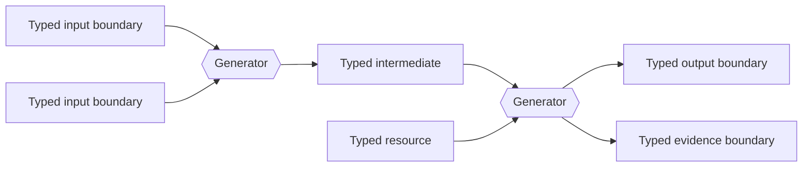
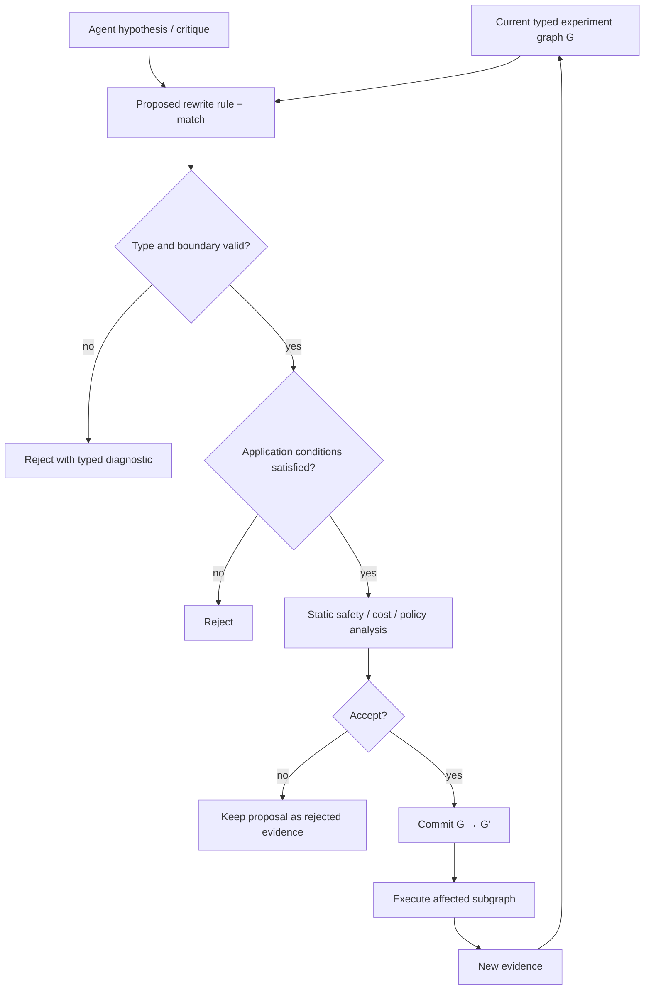
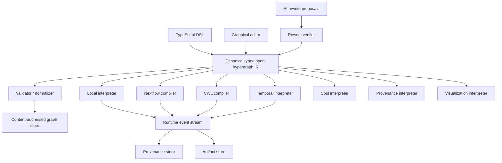
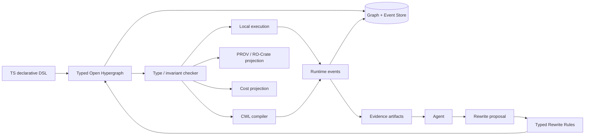

# Relation-First, Compositional Scientific Experiment Systems: State of the Art and a TypeScript Architecture

## Executive summary

The strongest conclusion from the current literature and implementations is that your proposed direction is **technically well grounded, but not yet assembled end-to-end in one mature system**.

A fairly complete toolbox now exists, but its pieces live in different communities:

\[
\boxed{
\begin{array}{c}
\text{typed compositional syntax}\\
+\ \text{open hypergraphs/string diagrams}\\
+\ \text{algebraic graph rewriting}\\
+\ \text{functorial interpretation/compilation}\\
+\ \text{categorical schemas}\\
+\ \text{runtime provenance}\\
+\ \text{agentic search}
\end{array}}
\]

Catlab/AlgebraicJulia provide perhaps the broadest existing implementation of the first five ingredients: generalized algebraic theories, wiring diagrams, attributed C-sets, categorical data migration, structured scientific models, and DPO/SPO/SqPO rewriting. Catlab explicitly represents morphisms through AST, wiring/string-diagram, and programming syntaxes, while related AlgebraicJulia packages interpret those structures as executable scientific models. citeturn18search0turn20search2turn19search0

The **open-hypergraphs** Rust project is an especially close match to the IR you have been describing: syntax is an open hypergraph with explicit global sources and targets; it supports data-parallel composition, decomposition, functors, differentiation transformations, and JSON serialization. However, it remains a small research-oriented project with explicitly experimental APIs rather than a production scientific workflow platform. citeturn18search1

The formal theory for **typed graph rewriting of string diagrams** is substantially more advanced than most workflow systems exploit. String-diagram rewriting can be represented combinatorially as DPO/DPO-with-interface rewriting of typed hypergraphs; confluence results and critical-pair procedures exist, and a 2026 paper gives an algorithm for automatically enumerating critical pairs in an important class of string-diagram rewrite systems. citeturn22academia11turn22search0turn22search1 AlgebraicRewriting.jl and Chyp turn significant portions of that theory into executable software. citeturn19search0turn19search24turn22search2

The **syntax → interpretation** idea is also not merely theoretical. Decapodes composes PDE models diagrammatically and then compiles their string diagrams into executable numerical programs; DisCoPy uses functors to translate string diagrams into numerical, probabilistic, quantum, and other computations; catgrad uses open hypergraphs as compiler IR and generates executable forward/backward programs. citeturn20search3turn19search6turn19search3

At the production workflow layer, systems such as Nextflow, Dagster, CWL, and Temporal solve execution, caching, recovery, lineage, portability, and operational concerns much better than the categorical research systems do, but their semantic cores are DAG/dataflow/asset/function oriented rather than explicitly categorical. Nextflow now has built-in data-lineage facilities and a large execution-backend ecosystem; Dagster makes data assets and their dependency relation primary; CWL provides a portable workflow interchange model and even has a TypeScript object model. citeturn17search4turn23search0turn25search6turn25search2

On the autonomous-science side, the gap is especially clear. AI Scientist-v2 expands experiments using **agentic tree search** rather than typed graph rewriting. The 2026 Experiment-as-Code work introduces declarative experiment programs compiled to instrument APIs, while a very recent categorical agentic-science paper explicitly models schemas as categories, populations as Set-valued functors, provenance as categories of elements, and scientific discovery as verified schema transformations. These are converging intellectually, but the categorical approach is still research-stage rather than a mature autonomous-lab runtime. citeturn24search0turn24search1turn24search2turn24academia28

My central architectural recommendation is therefore **not** to build another workflow engine and not to build an `Experiment` class hierarchy. Build a small semantic kernel:

\[
\boxed{
\text{typed generators}
\rightarrow
\text{open-hypergraph IR}
\rightarrow
\text{typed rewrites}
\rightarrow
\text{multiple interpretations}
}
\]

and let established systems handle execution where possible.

More precisely, I would distinguish three levels:

\[
\boxed{
\begin{aligned}
\text{Level A:}&\quad e:X\to Y &&\text{experiment syntax}\\
\text{Level B:}&\quad \rho:e\Rightarrow e' &&\text{experiment rewrite / expansion}\\
\text{Level C:}&\quad F(e) &&\text{execution, cost, provenance, visualization, etc.}
\end{aligned}}
\]

That distinction is important. An autonomous agent should normally produce **a typed rewrite \(e\Rightarrow e'\)**, not directly mutate execution state and not instantiate a giant new `Experiment` object. The execution system then interprets the revised graph.

The resulting architecture is closer to a **Compositional Experiment Calculus** than to OOE/OOP.

---

## Research landscape and conceptual foundations

### Open systems make the “experiment as morphism” idea precise

The relevant applied-category-theory lineage starts from **open systems**. Courser's treatment of structured and decorated cospans explicitly describes open systems as morphisms with interfaces, so larger systems can be constructed compositionally from smaller ones. Structured cospans have the general form

\[
L(a)\rightarrow x\leftarrow L(b),
\]

with the boundary objects \(a,b\) determining how the open system can be connected to others. citeturn20search0turn20academia10

For experiment infrastructure, the useful analogy is:

\[
\text{Input boundary}
\longrightarrow
\boxed{\text{experimental transformation}}
\longrightarrow
\text{Output boundary}.
\]

The boundary should be richer than merely “file type.” It can contain scientifically relevant interface types such as:

\[
\texttt{RawDataset},
\quad
\texttt{CalibratedSample},
\quad
\texttt{Model}<D>,
\quad
\texttt{Evidence}<H>,
\quad
\texttt{Measurement}<Q,U>.
\]

An important consequence is that **composition is determined by interfaces rather than ownership or inheritance**.

This is exactly the structural change you were pointing toward in our earlier discussion:

\[
\text{OOE:}
\quad
\texttt{BayesianExperiment extends Experiment}
\]

becomes

\[
D\otimes C
\xrightarrow{\mathrm{fit}}
M
\xrightarrow{\mathrm{predict}}
P
\xrightarrow{\mathrm{score}}
E.
\]

The experiment itself can then be a composite term:

\[
e=\mathrm{score}\circ\mathrm{predict}\circ\mathrm{fit}.
\]

No `Experiment` superclass is required.

### Wiring diagrams give a practical computational representation

Patterson, Spivak, and Vagner's work on wiring diagrams is especially relevant because it addresses the engineering problem of implementing symmetric monoidal composition. Processes can be composed sequentially and in parallel, while wiring diagrams provide a normal form in which laws such as interchange are structural rather than requiring continual symbolic rewriting. Their implementation is part of Catlab. citeturn20search1

For scientific experiments, the two primitive compositions correspond naturally to:

\[
f;g
\]

for “use the outputs of \(f\) as inputs to \(g\),” and

\[
f\otimes g
\]

for “perform \(f\) and \(g\) independently/in parallel.”

This is already enough to express a surprising fraction of ordinary experiment pipelines without introducing inheritance, lifecycle methods, or workflow-specific classes.

A key design lesson from this work is that one should **choose an IR in which desired algebraic laws hold structurally** rather than implementing those laws as cleanup passes over arbitrary object graphs. citeturn20search1

### Open hypergraphs are a better IR than ordinary DAG edges

Ordinary DAGs become awkward when operations have multiple typed inputs and outputs:

\[
A\otimes B\xrightarrow f C\otimes D.
\]

An open hypergraph naturally represents \(f\) as a hyperedge incident on multiple source and target ports, while the whole graph itself has an external source and target boundary. The current Rust `open-hypergraphs` implementation follows precisely this representation and adds data-parallel algorithms, decomposition/layering, functor transformations, and serialization. citeturn18search1

This suggests a strong implementation principle for your system:

> **The semantic unit should not be a file and should not be an object. It should be a typed open hypergraph with an explicit boundary.**

The filesystem can consequently become storage rather than ontology.



The entire diagram is itself another morphism:

\[
A\otimes B\otimes C
\longrightarrow
Y\otimes Z.
\]

### Categorical scientific computing demonstrates syntax/semantics separation

The AlgebraicJulia program is the clearest existing body of work showing how these ideas translate into scientific computing. Catlab provides categorical data structures and symbolic operations; its scientific-computing work has represented models as open systems and supported AST, string/wiring-diagram, and program syntax for morphisms. citeturn20search2turn18search0

Decapodes makes the separation even more concrete. PDE models are represented and composed diagrammatically using an operad of wiring diagrams; the resulting string diagrams are then compiled into executable numerical programs using graph algorithms, categorical data migration, and discrete exterior calculus. The paper reports numerical results against established numerical tooling, so this is more than merely a diagram editor. citeturn20search3

GATlab is useful at a different layer. It embeds generalized algebraic theories into Julia and allows free symbolic models and computational models of the same theory, as well as mappings between theories. Its authors explicitly describe the type of a morphism as depending on its domain and codomain and discuss the difficulty of obtaining this kind of dependent typing inside ordinary scientific programming languages. citeturn22search3

That is directly relevant to TypeScript: TypeScript can give us an ergonomic approximation at compile time, but **the full categorical type checker should live in the DSL/runtime IR**, rather than relying exclusively on TypeScript's host type system.

### The most useful primary papers

| Primary source | Main contribution | Relevance to your system |
|---|---|---|
| **Open Systems: A Double Categorical Perspective** citeturn20search0 | Open systems as composable morphisms using structured/decorated cospans | Formal basis for experiment-as-open-process |
| **Wiring diagrams as normal forms…** citeturn20search1 | Computational SMC representation; sequential/parallel composition; Catlab implementation | Core combinatorial syntax |
| **Compositional Scientific Computing with Catlab…** citeturn20search2 | Applies categorical infrastructure directly to scientific computing | Closest historical statement of the overall goal |
| **Categorical Data Structures for Technical Computing** citeturn21academia4 | Attributed C-sets unify graphs, tables, wiring diagrams, Petri nets; Julia implementation | Candidate data/storage model |
| **Functorial Data Migration** citeturn21academia5 | Schema = category, instance = Set-valued functor; canonical migration functors | Schema evolution and data migration |
| **Relational Foundations for Functorial Data Migration** citeturn21academia6 | \(\Sigma,\Delta,\Pi\) migrations and relation to relational query languages | Practical DB bridge |
| **String Diagram Rewrite Theory III** citeturn22search0 | DPO-with-interface rewriting and confluence analysis | Foundation for safe automated rewrites |
| **Critical Pair Enumeration for String Diagram Rewriting** citeturn22search1 | 2026 algorithm for automating critical-pair enumeration | Relevant to rewrite-rule validation/CI |
| **GATlab** citeturn22search3 | Embedded DSL with dependent algebraic typing and theory maps | Strong precedent for a host-language DSL |
| **Decapodes** citeturn20search3 | Diagram composition → solver derivation → executable numerical programs | Strongest science-specific compiler example |
| **Self-Revising Discovery Systems for Science** citeturn24academia28 | Schema categories, Set-valued populations, provenance categories, verified regime transitions | Very recent bridge to agentic science |

Taken together, these papers support something stronger than “use category theory to organize workflow nodes”: **the experiment language can itself have algebraic semantics, with execution as only one interpretation of that language.**

---

## Engineering implementations and how close they are to the target

### Direct categorical and hypergraph implementations

The following projects are the most relevant engineering references I found. “Maturity” here is deliberately qualitative; a research library with excellent mathematics is not automatically equivalent to an operational workflow platform.

| Project | Language / license | Maturity | Core model | Composition primitives | Rewrite support | Provenance | Execution / interpretation | Docs/examples |
|---|---|---|---|---|---|---|---|---|
| **Catlab.jl** citeturn18search0turn19search21 | Julia / MIT | Established research ecosystem; project describes itself as nearing 1.0 | GATs, ACSets, wiring/string diagrams, categorical algebra | Composition, tensor, wiring diagrams, limits/colimits, functors | Some facilities in ecosystem; heavy rewriting delegated to AlgebraicRewriting | Structural data available; not a scientific run-provenance system | Symbolic/computational models; scientific packages build interpreters around it | Extensive examples, notebooks, tests; project itself acknowledges API docs are incomplete |
| **AlgebraicRewriting.jl** citeturn19search0turn19search24 | Julia / MIT | Active research library | Rewriting of Catlab C-sets | Rule composition through categorical constructions | **DPO, SPO, SqPO; application conditions and attribute-aware rules** | Rewrite history must be integrated by caller | Usually applied to models represented in Catlab ecosystem | Full runnable demo and domain examples |
| **open-hypergraphs** citeturn18search1 | Rust / MIT or Apache-2.0 | Early research implementation; APIs explicitly marked experimental | Open hypergraphs as scalable syntax | Sequential/tensor-style algebra, layering, decomposition | General rewrite engine is not currently its primary feature | JSON structure but no scientific provenance layer | Functors including syntax transformations/differentiation | Good small examples; serialization example |
| **DisCoPy** citeturn19search9turn19search6 | Python / BSD-3-Clause | Established research toolkit | String diagrams, hypergraphs, categorical graphical languages | `>>` sequential, `@` monoidal, identities, braids/swaps, feedback structures | Domain-specific rewriting exists; not primarily a DPO graph-rewrite engine | No workflow-run provenance framework | **Functor is a central evaluation mechanism**; numerical/quantum/probabilistic/etc. models | Strong tutorial/notebook documentation |
| **Chyp** citeturn22search2 | Python / Apache-2.0 | Research theorem prover | Cospans of hypergraphs representing SMC morphisms | Sequential `;`, parallel `*`, identity/swap | **First-class string-diagram rewriting and proof tactics** | Proof/rewrite trace rather than experiment provenance | Theorem proving rather than scientific execution | Declarative language, GUI, examples |
| **Decapodes.jl** citeturn20search3 | Julia / MIT | Applied research software | Diagrammatic PDE systems / hypergraphs / string diagrams | Wiring-diagram composition | Transformations used in solver construction; not a general autonomous rewrite platform | Scientific metadata rather than full generic run provenance | **Compiles diagrams into executable PDE solvers** | Paper contains worked scientific examples and benchmark comparison |
| **catgrad** citeturn19search3turn19search11 | Rust / MIT | Early compiler project | **Open hypergraph as compiler IR** | Categorical model composition | Graph rewriting/optimization remains an area of ongoing development | Not a scientific provenance system | Static compilation of forward/backward computations; CPU/GPU-oriented backend abstractions | Repository examples and compiler code |
| **CQL** citeturn21search2 | Java / license requires careful commercial review | Mature single-node data integration tool by project description | Categories as schemas; functorial data migration | Functors, pushouts, \(\Sigma,\Delta,\Pi\) | Schema/equational reasoning rather than workflow rewrite | Project explicitly carries row-level lineage through transformations | JDBC/CSV and data transformations rather than experiment execution | Substantial manual/examples |

Catlab is the closest thing to a **general-purpose mathematical kernel**, whereas Decapodes is one of the clearest demonstrations that a categorical IR can actually be lowered into scientific numerical code. AlgebraicRewriting is the strongest directly reusable implementation reference for the rewrite layer. citeturn18search0turn20search3turn19search0

`open-hypergraphs` is particularly interesting for a TypeScript implementation because its data-oriented representation is simpler to port conceptually than Julia's full categorical infrastructure. Its serialized example consists essentially of global sources, global targets, node values, hyperedge values, and hyperedge incidence data—very close to the minimal IR I would recommend. citeturn18search1

DisCoPy provides perhaps the cleanest user-facing precedent for your proposed semantics:

```text
objects/types
      ↓
boxes/generators
      ↓
parallel @ and sequential >>
      ↓
diagram
      ↓
Functor
      ↓
numerical / probabilistic / quantum / other interpretation
```

That architecture is visible directly in its official documentation. citeturn19search6turn19search26

### Industrial and workflow systems are useful as backends, not semantic models

Several mature systems solve important pieces of the engineering problem without being category-theoretic.

| System | Language / license | Core abstraction | Composition | Graph rewriting | Provenance / lineage | Execution strengths | Relevance |
|---|---|---|---|---|---|---|---|
| **Nextflow** citeturn17search4turn17search20 | JVM/Groovy DSL / Apache-2.0 | Processes + channels/dataflow | Functional/dataflow workflow composition | No categorical DPO rewriting | Built-in lineage records runs, tasks and inputs/outputs; nf-prov adds standards-oriented provenance citeturn23search0 | HPC, cloud, schedulers, containers, caching/resume | Excellent target backend |
| **Dagster** citeturn17search5turn25search12 | Python / Apache-2.0 | **Data assets and dependency relation** | Asset dependency graph, ops/graphs | Dynamic orchestration, but not algebraic graph rewriting | Integrated asset and column lineage citeturn25search3 | Production orchestration, observability, testing | Valuable relation-first industrial comparison |
| **CWL ecosystem** citeturn25search2 | Standard; implementations vary | Portable tools and workflow descriptions | Explicit input/output workflow connections | No algebraic rewrite system in standard | CWLProv and Workflow Run RO-Crate ecosystem | Portable/scalable execution across several runners | Strong export/interchange target; existing `cwl-ts-auto` |
| **Temporal** citeturn17search7turn17search19 | Multiple SDKs incl. TypeScript | Durable workflow function + activities | Function/control-flow composition | Runtime state transitions, not categorical rewriting | Durable event history | Replay, failure recovery, long-running execution | Useful optional durable-runtime backend |

Nextflow is particularly instructive because it demonstrates why the semantic graph and execution engine should be separated. It exposes one pipeline model while abstracting execution over HPC schedulers, Kubernetes, and cloud infrastructure, and its current lineage system records workflow configuration, task executions, and their inputs and outputs. citeturn17search4turn23search0

Dagster is philosophically closer to “relation-first” than conventional task-centric orchestration because an asset represents a logical datum and dependencies among assets form its lineage graph. However, it still does not give you a free symmetric monoidal syntax, categorical laws, typed DPO rewriting, or functorial schema migration. citeturn25search6turn25search15

The practical implication is:

\[
\boxed{\text{do not reimplement Slurm/Kubernetes/cloud orchestration in the categorical kernel}}
\]

Instead:

\[
F_{\text{Nextflow}}:
\mathcal E\rightarrow\text{Nextflow programs}
\]

or

\[
F_{\text{CWL}}:
\mathcal E\rightarrow\text{CWL workflows}.
\]

CWL is particularly attractive because the official ecosystem already includes `cwl-ts-auto`, a TypeScript API for creating/parsing CWL v1.2 descriptions. citeturn25search2

### The maturity gap is real

The direct categorical libraries are strongest at **semantic structure**. Industrial workflow engines are strongest at **execution operations**.

There is currently no clear mature system combining all of:

\[
\begin{aligned}
&\text{typed open-hypergraph experiment IR}\\
+{}&\text{formal DPO-style rewrite rules}\\
+{}&\text{autonomous agent graph expansion}\\
+{}&\text{multiple execution interpretations}\\
+{}&\text{categorical schema migration}\\
+{}&\text{standard scientific provenance}\\
+{}&\text{production HPC/cloud execution}.
\end{aligned}
\]

That conclusion is an inference from the capabilities documented across Catlab, AlgebraicRewriting, open-hypergraphs, Decapodes, AI Scientist-v2, Nextflow, and the provenance ecosystem rather than a claim made by any one project. citeturn18search0turn19search0turn18search1turn20search3turn24search0turn23search0

That gap is important: **your proposed system is not simply duplicating a mature existing framework.** It is closer to integrating several lines of work that have only recently begun to intersect.

---

## Automated experiment expansion, categorical databases, and provenance

### Typed graph rewriting is a plausible substrate for autonomous experimentation

The formal rewrite literature offers a much stronger primitive than “LLM edits YAML.”

A rewrite can be represented schematically as:

\[
L \leftarrow K \rightarrow R,
\]

where:

- \(L\) is the structure to match,
- \(K\) is the interface that remains invariant,
- \(R\) is the replacement.

DPO-style string-diagram rewriting has a precise correspondence with suitable hypergraph rewriting, while later work treats interfaces explicitly and analyzes confluence. citeturn22academia11turn22search0

AlgebraicRewriting.jl implements DPO, SPO, and SqPO rewriting over Catlab C-sets and exposes application conditions and attribute-aware rules in its documented examples. citeturn19search0turn19search24

This suggests a substantially safer autonomous-science interface than unconstrained code generation.

Suppose an experiment currently contains:

\[
D\otimes\theta
\xrightarrow{\mathrm{train}}
M
\xrightarrow{\mathrm{evaluate}}
E.
\]

An agent wants to add parameter sensitivity analysis. Instead of copying a directory and modifying three configuration files, it proposes:

\[
\rho_{\text{sensitivity}}:
\mathrm{train}(\theta)
\Rightarrow
\operatorname{map}_{\delta\in\{-1,0,1\}}
\mathrm{train}(\theta+\delta\epsilon).
\]

Or for leakage protection:

\[
\rho_{\text{heldout}}:
\mathrm{evaluate}(M,D)
\Rightarrow
\mathrm{split}(D);
\mathrm{evaluate}(M,D_{\rm test}).
\]

The important invariant is:

\[
\partial L=\partial R,
\]

unless the rewrite explicitly declares a change of external experiment boundary.

That makes a rewrite a transformation of experiment programs rather than an arbitrary mutation.



Note the deliberate retention of rejected rewrites. In science, a failed attempt is provenance, not garbage.

### Rewrite rules belong at a different semantic level from experiments

There is a useful categorical refinement here.

An experiment is:

\[
e:X\to Y.
\]

A transformation of that experiment is better modeled conceptually as:

\[
\rho:e\Rightarrow e'.
\]

That is closer to a **2-cell** than another ordinary experiment morphism.

This distinction prevents a subtle architecture error:

```text
ordinary operation:
    Dataset → Model

meta-operation:
    TrainOnce ⇒ TrainSweep
```

These should not inhabit one undifferentiated graph namespace.

Open-systems research explicitly uses double-categorical structures when both systems and transformations between systems matter, which provides theoretical precedent for maintaining this two-level distinction. citeturn20search0turn20academia11

You do not need to implement a full double-category API in the first TypeScript prototype, but I would encode the distinction in the data model from day one:

```ts
type ExperimentGraph = ...
type RewriteRule = ...
type RewriteEvent = ...
```

rather than:

```ts
type Node =
  | ExperimentNode
  | RewriteNode
  | EverythingElseNode;
```

### Agentic science is moving toward declarative structures, but not yet DPO-style experiment rewriting

AI Scientist-v2 currently performs iterative scientific work through progressive agentic tree search managed by an experiment-manager agent. It generates hypotheses, runs experiments, analyzes results, and produces manuscripts, but its search state is not a categorical typed experiment graph and expansion is not defined through interface-preserving hypergraph rewrite rules. citeturn24search0turn24search1

The 2026 **Experiment-as-Code Labs** work moves much closer to your engineering vision. Experiments are declarative configurations that can be analyzed, checked for safety/resource constraints, scheduled, and compiled down to instrument APIs; AI agents generate those declarative experiment descriptions. citeturn24search2turn24academia27

A separate 2026 work on **Declarative Data Services** reports an instructive agent-engineering result: unconstrained agentic search over heterogeneous system compositions was unreliable, while introducing typed contracts at successive layers constrained the search and enabled errors to be routed back as typed signals. Although it addresses data-system composition rather than scientific experiments, that result strongly supports a “typed rewrite proposal → verifier → executor” architecture rather than allowing the LLM to own the whole operational state. citeturn24academia29

Most intriguing is the 2026 **Self-Revising Discovery Systems for Science** work. It models a scientific schema as a category \(S_b\), current artifacts as a copresheaf

\[
I_t:S_b\rightarrow\mathbf{Set},
\]

and provenance as its category of elements

\[
\int_{S_b}I_t.
\]

It distinguishes ordinary evolution inside a fixed representational regime from schema-changing discovery and describes scientific-system instances involving typed skills, artifacts, workflow mutation, gates, stress tests, and knowledge-computation graphs. citeturn24academia28turn24search3

That is remarkably close conceptually to what we have been discussing, but it should presently be treated as an **emerging research architecture**, not evidence that a production-grade categorical autonomous-science platform already exists.

### Categorical databases fit naturally under the experiment graph

Functorial data migration gives a powerful answer to the schema side.

The classic model is:

\[
\boxed{
\text{schema }S=\text{category}
}
\]

and

\[
\boxed{
\text{database instance }I:S\rightarrow\mathbf{Set}.
}
\]

A schema functor

\[
F:S\rightarrow T
\]

induces canonical migration operations commonly written

\[
\Sigma_F,\quad\Delta_F,\quad\Pi_F.
\]

These constructions have been related formally to familiar relational operations and implemented in the CQL lineage of systems. citeturn21academia5turn21academia6

Attributed C-sets take a related idea into technical/scientific computing and provide a generic structure covering graphs, data-frame-like structures, Petri nets, and wiring diagrams, with a Julia implementation designed for practical performance. citeturn21academia4

For your system, that suggests separating:

\[
\text{experiment schema}
\]

from

\[
\text{experiment instance}.
\]

For example:

```text
Schema
──────
Dataset
Model
Metric
Evidence

train    : Dataset × TrainConfig → Model
evaluate : Model × Dataset → Evidence
```

versus:

```text
Instance
────────
imagenet-v7 : Dataset
model-a19   : Model
run-8821    : Evidence
```

This also avoids an OOP trap: **“Dataset,” “Model,” and “Evidence” are types in a schema, not classes with ever-growing behavior.**

For genuinely multi-input scientific operations, however, an ordinary unary category-to-Set database model is not sufficient as the whole process language. A symmetric monoidal category, multicategory/operad, or open-hypergraph representation is more natural for operations such as

\[
A\otimes B\otimes C\to D.
\]

The recent categorical-agentic work similarly moves toward multi-parent typed provenance structures when multiple artifacts jointly produce a new artifact. citeturn24search3

### Provenance should be both structural and operational

A pure experiment graph provides **structural provenance**:

\[
A\xrightarrow fB\xrightarrow gC
\]

already explains that \(C\) arose through \(g\circ f\).

But it does not tell us:

- which executable/container version ran,
- which random seed was used,
- which host/GPU/instrument was used,
- which retry succeeded,
- whether a network service had changed,
- which failed attempts preceded the accepted experiment,
- whether external data was mutable,
- what the actual parameter values were.

So the right design is:

\[
\boxed{
\text{declarative derivation provenance}
+
\text{runtime event provenance}
}
\]

not one or the other.

W3C PROV provides an established interoperable vocabulary centered on entities, activities, and agents. citeturn23search2 Workflow Run RO-Crate extends research-object packaging toward workflow-run provenance and is being used across workflow systems; WorkflowHub documents interoperable workflow-execution provenance as a core FAIR-workflow use case. citeturn23search3turn23search5

Nextflow's current lineage capability is a valuable production reference because it records workflow runs/configurations, task executions, and input/output relationships rather than assuming that the static pipeline definition alone is sufficient. citeturn23search0

I would therefore store provenance internally in a richer native model, then provide:

\[
F_{\mathrm{PROV}}(run)
\]

and

\[
F_{\mathrm{ROCrate}}(run)
\]

as export interpretations rather than making either external standard your only internal schema.

---

## A TypeScript architecture for a compositional experiment calculus

### Make the TypeScript API construct terms, not objects with behavior

The surface language can be pleasantly small.

Conceptually:

```ts
const Dataset = object("Dataset", DatasetSchema)
const Model   = object("Model", ModelSchema)
const Metrics = object("Metrics", MetricsSchema)

const train = generator({
  id: "ml/train",
  input: tuple(Dataset, TrainConfig),
  output: tuple(Model),
})

const evaluate = generator({
  id: "ml/evaluate",
  input: tuple(Model, TestDataset),
  output: tuple(Metrics),
})
```

Composition:

```ts
const experiment =
  seq(
    tensor(train, id(TestDataset)),
    evaluate
  )
```

The key rule is:

> `generator()` returns **syntax**, not an executable object.

No:

```ts
class Experiment {
  run() {}
  compare() {}
  fork() {}
  persist() {}
  visualize() {}
}
```

Instead:

```ts
interpret(LocalExecutor, experiment)
interpret(NextflowCompiler, experiment)
interpret(ProvenanceProjection, experiment)
interpret(CostModel, experiment)
interpret(GraphRenderer, experiment)
```

This is much closer to the architecture demonstrated by Catlab/GATlab and DisCoPy, where symbolic syntax and computational models/evaluation are deliberately separated. citeturn20search2turn22search3turn19search6

### Use TypeScript's type system as an ergonomic front end, not the source of truth

A minimal sketch might be:

```ts
interface Obj<Name extends string, A> {
  readonly kind: "object"
  readonly name: Name
  readonly schema: Schema<A>
}

type Boundary =
  readonly Obj<string, unknown>[]

interface Mor<
  In extends Boundary,
  Out extends Boundary
> {
  readonly kind: "morphism"
  readonly input: In
  readonly output: Out
  readonly graph: GraphRef
}

function seq<
  A extends Boundary,
  B extends Boundary,
  C extends Boundary
>(
  f: Mor<A, B>,
  g: Mor<B, C>
): Mor<A, C> {
  return composeGraphs(f, g)
}

function tensor<
  A extends Boundary,
  B extends Boundary,
  C extends Boundary,
  D extends Boundary
>(
  f: Mor<A, B>,
  g: Mor<C, D>
): Mor<
  readonly [...A, ...C],
  readonly [...B, ...D]
> {
  return tensorGraphs(f, g)
}
```

TypeScript's discriminated unions and narrowing are useful for making the IR exhaustive and preventing broad `instanceof`-style hierarchies. citeturn25search0turn25search4

For example:

```ts
type Term =
  | { readonly kind: "generator"; readonly id: GeneratorId }
  | { readonly kind: "identity"; readonly boundary: BoundaryId }
  | { readonly kind: "seq"; readonly left: TermId; readonly right: TermId }
  | { readonly kind: "tensor"; readonly left: TermId; readonly right: TermId }
  | { readonly kind: "swap"; readonly left: ObjectId; readonly right: ObjectId }

function assertNever(x: never): never {
  throw new Error(`Unhandled term: ${JSON.stringify(x)}`)
}
```

However, TypeScript does not give you GATlab-style dependent typing in which arbitrary runtime domain/codomain values become genuine dependent types. GATlab explicitly identifies that tension between categorical dependent typing and ordinary technical languages. citeturn22search3

Therefore use two layers:

\[
\boxed{
\text{TS compile-time approximation}
+
\text{authoritative runtime IR validator}
}
\]

Every graph loaded from JSON, databases, agents, plugins, or old versions must pass runtime type checking regardless of what TypeScript inferred when it was originally created.

Effect Schema is one viable tool because its official API combines static TypeScript representations with runtime validation and transformations; its schema tooling can also generate values for property testing. citeturn25search1turn25search17turn25search29

### Make the serialized open hypergraph the canonical representation

I would not make an AST the durable primary representation.

An AST such as

```text
Seq(
  Tensor(f, g),
  Seq(h, k)
)
```

retains irrelevant syntactic bracketing.

Instead use an open-hypergraph IR resembling:

```ts
interface ExperimentIR {
  readonly schemaVersion: string

  readonly objects: readonly ObjectDecl[]
  readonly generators: readonly GeneratorInstance[]

  readonly ports: readonly Port[]
  readonly incidence: readonly Incidence[]

  readonly inputs: readonly PortId[]
  readonly outputs: readonly PortId[]

  readonly annotations: Readonly<Record<string, JsonValue>>
}
```

A generator instance can have:

```ts
interface GeneratorInstance {
  readonly id: NodeId
  readonly generator: GeneratorDefinitionId
  readonly version: ContentHash

  readonly inputs: readonly PortId[]
  readonly outputs: readonly PortId[]

  readonly parameters: JsonValue
}
```

This is conceptually close to the current `open-hypergraphs` serialized representation, which separates global sources/targets, nodes, edges, and incidence information. citeturn18search1

ASTs remain useful as a **surface syntax**:

\[
\text{TS expression}
\rightarrow
\text{normalized open hypergraph}.
\]

Likewise graphical editing can be another surface syntax:

\[
\text{GUI}
\rightarrow
\text{same open hypergraph}.
\]

And an AI agent can produce a rewrite program:

\[
\text{agent proposal}
\rightarrow
\text{typed rewrite}
\rightarrow
\text{same open hypergraph}.
\]

Thus no representation gets privileged merely because a human happened to author it.

### Make the algebraic doctrine explicit

One major trap would be casually adding operations such as:

```ts
copy(x)
delete(x)
merge(x, y)
```

for every type.

That silently changes the categorical semantics.

Copying a reference to a CSV file is cheap and generally permissible. Copying a physical biological sample is a physical operation. Copying a learned model might mean duplicating a pointer, checkpoint, or actual bytes. “Deleting” evidence is semantically different from allowing an unused intermediate.

So the core should start conservatively with:

\[
\mathrm{id},
\quad
\circ,
\quad
\otimes,
\quad
\mathrm{swap}
\]

and require additional capabilities to be declared by the domain.

Conceptually:

```ts
interface Copyable<A> {
  readonly copy: Generator<[A], [A, A]>
}

interface Discardable<A> {
  readonly discard: Generator<[A], []>
}
```

This gives you an escape from one of the most dangerous workflow abstractions: treating **all wires as infinitely duplicable data references**.

For physical AI4Science systems, this distinction eventually becomes essential.

### Separate semantics from backend execution through interpreters

The central architecture should look like this:



Mathematically one might write:

\[
F_{\text{local}},
F_{\text{Nextflow}},
F_{\text{CWL}},
F_{\text{cost}},
F_{\text{prov}},
F_{\text{viz}}.
\]

But there is an important engineering caveat: **do not call every adapter a functor merely because category theory is fashionable.**

For a genuine functor we want, at least conceptually,

\[
F(g\circ f)=F(g)\circ F(f)
\]

and

\[
F(\operatorname{id}_X)=\operatorname{id}_{F(X)}.
\]

An execution backend involving retries, caching, nondeterministic external services, or scheduler side effects may only preserve this structure observationally or under explicit conditions.

Accordingly I would name the general interface:

```ts
interface Interpreter<Syntax, Result> {
  interpret(term: Syntax): Result
}
```

and optionally certify particular interpreters as law-preserving:

```ts
interface FunctorialInterpreter<Syntax, Result>
  extends Interpreter<Syntax, Result> {
  readonly laws: FunctorLawSuite
}
```

This prevents “functor” from degenerating into a fancy synonym for “visitor.”

### Treat effects and nondeterminism explicitly

Scientific execution contains effects:

\[
\text{randomness},
\text{clock},
\text{network},
\text{GPU},
\text{filesystem},
\text{instrument},
\text{human approval}.
\]

Those should not be invisible fields on an experiment object.

For example:

```ts
const train = generator({
  input: tuple(Data, Hyperparameters, RandomSeed),
  output: tuple(Model),
  requires: [
    capability("gpu"),
    capability("artifact-store"),
  ],
})
```

or through a typed effect layer.

Effect's current TypeScript ecosystem is relevant here because it makes errors, dependencies, resource management, concurrency, and tracing explicit in types rather than hiding them behind ordinary Promise-based execution. citeturn25search8

This does **not** mean Effect should become your categorical semantics. It is better viewed as one host/runtime implementation mechanism for an execution interpreter.

### Rewrite API

The DSL should distinguish rule declaration from rule application:

```ts
interface RewriteRule {
  readonly id: RuleId
  readonly lhs: PatternGraph
  readonly interface: InterfaceGraph
  readonly rhs: ReplacementGraph

  readonly conditions: readonly ApplicationCondition[]
}

interface RewriteProposal {
  readonly rule: RuleId
  readonly match: Match
  readonly rationale: EvidenceRef[]
  readonly proposedBy: AgentOrHuman
}

interface RewriteEvent {
  readonly before: GraphHash
  readonly after: GraphHash
  readonly proposal: ProposalId
  readonly verifiedMatch: Match
  readonly timestamp: string
}
```

For the first implementation, you do **not** need a completely generic academic DPO engine.

Start with a safe subset:

\[
\text{typed local pattern}
+
\text{preserved boundary}
+
\text{attribute predicates}
+
\text{replacement graph}.
\]

Then grow toward more complete DPO/SqPO semantics after the core use cases are understood. AlgebraicRewriting's DPO/SPO/SqPO APIs and Chyp's declarative generator/rule language are excellent implementation references. citeturn19search24turn22search2

### Storage should be graph-centric and content-addressed

I would use four physically separate stores:

| Layer | Recommended storage | Why |
|---|---|---|
| **Experiment definitions** | Immutable content-addressed graph blobs | Graph definitions should be reproducible and branchable |
| **Metadata / query indexes** | PostgreSQL or equivalent relational DB | Efficient search across runs, artifacts, types, tags, relations |
| **Large scientific artifacts** | Object/blob store keyed by digest | Avoid placing datasets/checkpoints inside graph DB |
| **Runtime/rewrite history** | Append-only event log + indexed projections | Preserve attempts, failures and transformations |

A graph node should point to an artifact:

```text
artifact://sha256/...
```

rather than containing a 20 GB tensor.

The graph store should include semantic hashes of:

\[
\text{operation definition}
+
\text{parameters}
+
\text{input artifact hashes}
+
\text{declared environment}
+
\text{relevant implementation version}.
\]

Be careful not to equate “same source hash” with “same scientific computation.” External datasets, RNG, instrument calibration, CUDA/compiler versions, locale, mutable HTTP resources, and hardware nondeterminism can all make that false.

Nextflow's experience with caching/resumption and its separate lineage facility is good evidence that execution reproducibility needs richer run information than merely the static DAG. citeturn23search0

---

## Engineering lessons, trade-offs, and failure modes

### Category theory should constrain complexity, not decorate it

The biggest architectural danger is reconstructing OOP problems with categorical names.

For example:

```ts
interface ScientificMorphism<
  Context extends GiantContext<...>,
  Metadata extends GiantMetadata<...>,
  Execution extends GiantExecutionConfig<...>,
  Provenance extends GiantProvenance<...>
> ...
```

can be every bit as pathological as a God class.

The useful invariant is instead:

\[
\boxed{
\text{complexity must arise through composition of small generators}
}
\]

not through increasingly feature-rich primitives.

Prefer:

\[
f:A\to B,\quad
g:B\to C,\quad
h:C\to D
\]

and

\[
h\circ g\circ f
\]

over:

```text
UniversalExperimentWithPreprocessingAndEvaluationAndCalibration...
```

This is the software-engineering benefit of using a **free or minimally constrained algebraic syntax**.

### Do not confuse workflow dependencies with scientific semantics

An execution DAG says:

> task \(B\) must run after task \(A\).

A scientific derivation says:

> evidence \(E\) was produced from artifact \(A\) through transformation \(f\), under assumptions \(H\).

Those are different relations.

Your semantic IR should preserve the latter. An execution compiler can derive the former.

Thus:

\[
\boxed{
\text{scientific graph}
\rightarrow
\text{execution DAG}
}
\]

is preferable to:

\[
\text{execution DAG}
=
\text{scientific knowledge representation}.
\]

Decapodes' model-to-solver compilation and Catlab's symbolic/computational separation are strong precedents for this direction. citeturn20search3turn20search2

### Static hypergraphs should not become a prison

Some experiments genuinely require:

- adaptive stopping,
- feedback,
- conditionals,
- branching,
- streaming,
- human intervention,
- online optimization.

Do not stretch an acyclic graph beyond recognition merely to preserve a neat theory.

DisCoPy, for example, includes richer diagrammatic structures including streams/feedback-oriented constructs, while open-hypergraphs explicitly targets syntax including circuits with feedback. citeturn19search6turn18search1

A sensible progression is:

\[
\text{acyclic typed open hypergraph}
\]

first, then selectively add:

\[
\text{feedback/traced structure},
\quad
\text{conditionals},
\quad
\text{runtime expansion}
\]

when actual experiments demand them.

### Rewrite matching can become the computational bottleneck

Composition of structured graph data can be made efficient; attributed C-set implementations report performance competitive with specialized data structures for important operations, and current open-hypergraph work explicitly explores data-parallel representations. citeturn21academia4turn18search1

Generic pattern matching and graph rewriting are different. As rule libraries grow, subgraph matching and overlapping-rule analysis can dominate.

Practical mitigations are:

- strongly typed patterns that immediately eliminate most candidate locations;
- arity/type indexes for generators;
- local rewrite neighborhoods rather than global matching by default;
- explicit application conditions;
- rule namespaces/domains;
- deterministic match ordering where reproducibility matters;
- caching matches against immutable graph hashes.

The 2026 critical-pair work is relevant because it shows that meaningful portions of rewrite-system conflict analysis can itself be mechanized at the hypergraph level. citeturn22search1

### Canonicalization is useful but dangerous on a hot path

Two diagrams can represent the same composition despite different node identifiers or syntactic construction order.

You will eventually want notions of:

\[
G_1\simeq G_2.
\]

But full canonical graph labeling/isomorphism should not become a prerequisite for every graph edit.

Use:

1. immutable internal IDs during editing,
2. structural/content hashes for known components,
3. normalized ordering where cheap,
4. expensive equivalence/canonicalization only for deduplication, optimization, or proof tasks.

One of the strengths of wiring-diagram representations is precisely that important monoidal equations can be absorbed into the data representation itself rather than repeatedly discharged through symbolic rewrites. citeturn20search1

### Provenance capture must happen at event time

Trying to reconstruct provenance after execution is inevitably lossy.

At the beginning of a run, emit:

```text
RunStarted
GraphHash
InterpreterVersion
Environment
InputArtifactHashes
Parameters
Seed / randomness policy
```

For every generator:

```text
OperationScheduled
OperationStarted
InputsResolved
EnvironmentResolved
OperationSucceeded | OperationFailed
OutputArtifactHash
```

For autonomous changes:

```text
RewriteProposed
RewriteRejected
RewriteAccepted
GraphVersionCreated
```

Then provenance standards become projections of the event stream rather than reverse engineering.

This aligns well with W3C PROV's activity/entity/agent model and with workflow-run provenance efforts that record actual executions rather than only workflow definitions. citeturn23search2turn23search3

### Reproducibility requires a distinction between replay and rerun

These are not the same thing.

**Replay** means:

\[
\text{reconstruct what actually happened}.
\]

**Rerun** means:

\[
\text{attempt the same experiment again}.
\]

A rerun may produce different output because the operation is stochastic or an external world changed.

Temporal's durable runtime offers a useful engineering contrast: it relies on recorded event history to replay workflow execution after failure. citeturn17search3 Scientific experiments need an analogous event-history concept, but should not pretend that replaying orchestration implies scientifically reproducing every external physical or numerical outcome.

So artifacts should record reproducibility status explicitly:

```ts
type Reproducibility =
  | { kind: "deterministic" }
  | { kind: "seeded"; seed: string }
  | { kind: "environmentBound"; environment: EnvironmentDigest }
  | { kind: "external"; snapshot?: ArtifactHash }
  | { kind: "physical"; calibration: CalibrationRef }
```

### Testing should test algebraic laws, not merely example pipelines

A category-inspired DSL gives you unusually powerful test oracles.

For any well-typed generated terms:

\[
f\circ\mathrm{id} = f,
\]

\[
\mathrm{id}\circ f=f,
\]

\[
h\circ(g\circ f)=(h\circ g)\circ f.
\]

For monoidal composition:

\[
(f_1\otimes f_2);(g_1\otimes g_2)
=
(f_1;g_1)\otimes(f_2;g_2)
\]

where typed.

Testing should therefore include:

| Test class | Invariant |
|---|---|
| **Algebra laws** | identity, associativity, interchange |
| **Graph invariants** | every port has correct incidence/type; external boundary valid |
| **Rewrite laws** | LHS match valid; preserved interface unchanged; output graph well typed |
| **Serialization** | decode(encode(graph)) equivalent to graph |
| **Compiler laws** | compiled compositions observationally agree with separately compiled components |
| **Provenance** | every produced artifact has causal producer/input references |
| **Hash stability** | irrelevant metadata/order changes do not alter semantic identity when policy says they should not |
| **Reproducibility** | declared deterministic generators produce equal artifacts under controlled environment |
| **Migration** | old schemas migrate without violating declared equations/invariants |

Effect Schema's current property-testing integration can generate arbitrary values conforming to schemas, making it useful for fuzzing the host-level representation. citeturn25search17

For rewrite systems, CI can eventually incorporate critical-pair/confluence analysis for rule subsets where the available theory applies. citeturn22search0turn22search1

### There is a subtle difference between “card” UI and semantic unit

Your original “unit file card” idea still makes sense—but I would now interpret a card as a **view**, not the ontology.

A card can show:

```text
train/resnet
────────────────────
Input:
  Dataset<Image>
  TrainConfig

Output:
  Model<ImageClassifier>

Implementation:
  container sha256:...

Used by:
  27 experiment graphs

Rewrite rules:
  sweep-learning-rate
  add-seed-replication
```

But internally that is simply a projection over a generator and its relations.

Thus:

\[
\boxed{
\text{card}=\text{UI projection of graph structure}
}
\]

rather than

\[
\text{card}=\text{new object abstraction}.
\]

This retains the usability of file/card-oriented tools without reintroducing OOE underneath.

---

## Recommended prototype path

### Target architecture

The smallest architecture that genuinely tests the thesis is:



I would explicitly **not** put an `Experiment` class at the center.

The central durable value is:

\[
\boxed{
\texttt{ExperimentGraph}
}
\]

and even that should be a plain immutable algebraic value rather than a giant stateful service object.

### Prioritized implementation sequence

| Priority | Build | Why it comes first | Acceptance criterion |
|---|---|---|---|
| **P0** | Minimal typed open-hypergraph IR | Everything else depends on a stable semantic representation | Can encode sequential, parallel and multi-input/output experiments; JSON round-trip |
| **P0** | Runtime boundary/type checker | TS alone cannot validate agent-generated or persisted dynamic graphs | Invalid compositions are impossible to commit |
| **P0** | `id`, `seq`, `tensor`, `swap` DSL | Establish the compositional calculus before adding convenience APIs | Algebra-law/property tests pass |
| **P1** | Generator registry + Effect/Zod-like runtime schemas | Connect symbolic ports with actual scientific values | Every generator declares runtime-validatable inputs/outputs |
| **P1** | Local interpreter | Proves that syntax can actually execute | Composite graph executes without nodes owning `run()` methods |
| **P1** | Content-addressed graph/artifact store + append-only run log | Provenance should be intrinsic from the beginning | Any output artifact can be traced to graph hash, inputs and operation version |
| **P2** | Restricted typed rewrite engine | Tests the core automated-experiment-expansion hypothesis | Sweep/replicate/evaluator-substitution/ablation expressed without editing source files |
| **P2** | Rewrite provenance | Autonomous mutation must be auditable | Every graph version has an accepted/rejected rewrite lineage |
| **P2** | Agent proposal API | Keeps LLM outside trusted mutation core | Agent can only return typed proposal objects; verifier owns commit |
| **P3** | CWL or Nextflow compiler | Avoid building a scheduler | Same semantic graph executes on an established workflow backend |
| **P3** | W3C PROV + Workflow Run RO-Crate exporter | Interoperate with scientific provenance ecosystem | Run exports pass profile/schema validation |
| **P3** | Cost/resource/static-analysis interpreters | Demonstrates that execution is only one semantics | Graph can be analyzed without running it |
| **P4** | More complete DPO/SqPO matching | Needed once rewrite complexity justifies it | Rules have interfaces/application conditions and deterministic match semantics |
| **P4** | Categorical schema migration | Important when the scientific ontology itself evolves | Stored experiments migrate across schema versions declaratively |
| **P4** | Feedback/dynamic-control semantics | Avoid premature complexity | Introduce only after real adaptive-experiment cases cannot fit static hypergraphs |

### The first experimental DSL should be intentionally small

A credible first public API could contain only:

```ts
object(...)
generator(...)

id(...)
seq(...)
tensor(...)
swap(...)

rule(...)
match(...)
rewrite(...)

interpret(...)
```

Everything else should initially be library code.

For example, parameter sweeps should **not** immediately become a primitive:

```ts
experiment.sweep(...)
```

Instead they should initially be expressed as a graph rewrite or combinator implemented in terms of the core calculus.

That gives you a useful test:

> If an apparently fundamental experiment feature cannot be expressed compositionally, is the calculus missing a genuine primitive, or are we accidentally importing workflow/OOP conventions?

### A concrete first scientific benchmark

I would use an experiment containing:

\[
\text{Dataset}
\xrightarrow{\text{split}}
\text{Train}\otimes\text{Test}
\]

\[
\text{Train}\otimes\text{Config}
\xrightarrow{\text{fit}}
\text{Model}
\]

\[
\text{Model}\otimes\text{Test}
\xrightarrow{\text{evaluate}}
\text{Metrics}.
\]

Then implement four graph rewrites:

\[
\rho_1:\text{single fit}\Rightarrow\text{seed replicates},
\]

\[
\rho_2:\text{single config}\Rightarrow\text{parameter sweep},
\]

\[
\rho_3:\text{evaluator}\Rightarrow\text{alternative evaluator},
\]

\[
\rho_4:\text{component}\Rightarrow\text{ablated component}.
\]

An agent then receives evidence and may **propose only instances of registered rewrite families**.

That benchmark will answer the most important question much earlier than implementing a full lab operating system:

\[
\boxed{
\text{Can meaningful scientific exploration actually be represented as typed graph evolution?}
}
\]

If yes, then general DPO rules, categorical database migration, richer agent search, and physical-lab adapters become justified.

### Projects I would study in source-code order

For implementation rather than theory, my recommended reading order is:

**`open-hypergraphs` first.** Its Rust representation is a relatively direct example of the open-hypergraph-as-syntax idea, including serialization and data-oriented implementation. citeturn18search1

**DisCoPy second.** Study how a compact user DSL builds categorical terms and how functors turn those terms into executable interpretations. citeturn19search6turn19search9

**Catlab + GATlab third.** Study the deeper separation between theory, model, typed morphism syntax, wiring diagrams, and categorical data structures. citeturn18search0turn22search3

**AlgebraicRewriting fourth.** Use it as the principal implementation reference for DPO/SPO/SqPO-style transformation APIs and application conditions. citeturn19search0turn19search24

**Decapodes fifth.** Study it specifically as an example of scientific semantic IR being compiled into a conventional numerical solver. citeturn20search3

**Chyp sixth.** Its small declarative generator/term/rule language is an excellent reference for what a rewrite DSL can look like without a large object hierarchy. citeturn22search2

**CQL and functorial data migration next.** Study these once the graph model is stable, particularly for schema evolution and provenance-aware data transformation. citeturn21academia5turn21academia6turn21search2

**Nextflow/CWL last as compiler targets, not semantic inspirations.** Their greatest value here is production execution, portability and provenance interoperability. citeturn17search4turn25search2turn23search0

### Final assessment

The evidence suggests that the architecture we were converging toward in the previous discussion is not merely a category-theory aesthetic.

Several independent research programs have already validated its individual propositions:

\[
\text{open system}=\text{morphism}
\]

is established in applied category theory. citeturn20search0

\[
\text{process syntax}=\text{wiring/string diagram}
\]

has practical implementations in Catlab and DisCoPy. citeturn20search1turn19search6

\[
\text{diagram}=\text{open/typed hypergraph}
\]

has both formal rewrite theory and working libraries. citeturn22academia11turn18search1

\[
\text{experiment transformation}
=
\text{typed graph rewrite}
\]

is supported by DPO-style theory and implementations such as AlgebraicRewriting and Chyp, although it has not yet become a standard autonomous-science primitive. citeturn19search0turn22search2

\[
\text{same syntax}
\xrightarrow{\text{different interpretation}}
\text{different computation}
\]

is demonstrated concretely by Catlab/GATlab, DisCoPy, Decapodes, and catgrad. citeturn22search3turn19search6turn20search3turn19search3

\[
\text{schema}=\text{category},
\qquad
\text{instance}=\text{Set-valued functor}
\]

has a long database lineage and working tooling. citeturn21academia5turn21search2

And autonomous-science research is now independently moving toward declarative experiments, typed contracts, explicit experiment managers, and categorical/provenance-aware discovery models. citeturn24search1turn24academia27turn24academia29turn24academia28

What has **not** yet been convincingly realized is the composition of all these ideas into one production engineering stack.

That makes the most interesting design point not:

\[
\texttt{class Experiment}
\]

but:

\[
\boxed{
\mathcal E
=
\text{a small typed algebra of experimental generators and their compositions}
}
\]

together with a rewrite/meta layer:

\[
\boxed{
\rho:e\Rightarrow e'
}
\]

and a family of interpretations:

\[
\boxed{
F_i:\mathcal E\rightarrow\mathcal S_i.
}
\]

In that architecture, **an experiment is not primarily a thing with methods**. It is a compositional relation between typed boundaries. An experiment campaign is not a folder tree. It is an evolving typed hypergraph. An autonomous scientist does not primarily create files or subclasses. It proposes verified transformations of that graph. Execution, visualization, cost analysis, provenance, HPC scheduling, and FAIR export are different interpretations of the same semantic object.

That is, in my assessment, the most promising way to avoid merely reinventing OOP as “OOE” while still obtaining an engineering system that TypeScript developers, scientific agents, and conventional workflow infrastructure can actually use.