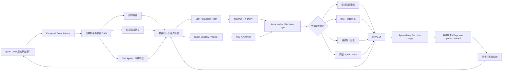

# 面向 Qwen Code 在线状态估计与主动决策的可落地轨迹特征体系：从 `traj_stats` 到 DBN、GBDT 与闭环实验

## Executive Summary

现有 `traj_stats.py` 已经提供了一个很好的“**机械事实层**”：它本地、无网络、无 LLM、双侧对称，并已经采集时间戳、事件类型、token、命令、路径、账本、checkpoint、双侧协议等信息；真正缺少的不是更多累计统计，而是把这些信息规范化为**因果可用的逐事件流、多尺度窗口状态和可回放的决策快照**。fileciteturn0file0

从第一性原理看，轨迹特征的目的不是制造一个“是否该兜底”的异常分数，而是把历史压缩为当前的**信念状态** \(b_t=P(Z_t\mid H_t)\)，再预测不同候选行动 \(u\) 对未来成功、成本和风险的影响；因此应明确区分“观测特征 → 隐状态估计 → 结果预测 → 行动价值预测”四层。PrefixGuard 已证明结构化、因果可用的 prefix trace 中存在可学习的失败预警信息，而且 typed `status/result/observation` 相对 raw text 在 TerminalBench 上有明显增益；EarlyEval 又表明基于行为、事件时序和文本的轻量 LightGBM 可以低成本读取中间轨迹信号。citeturn20view0turn20view1turn16academia24

工程上，我建议前三个月采用“双模型影子竞争”：**小型 controlled-HMM/DBN 负责状态与不确定性，LightGBM 负责非线性结果预测基线**；EWMA/CUSUM、分层 Beta/Dirichlet 后验作为零样本/少样本基础层。Dynamax 已直接支持带外部 control/covariate 的离散时间状态空间模型与在线 filtering；NumPyro 更适合慢周期参数后验采样和模型不确定性，而不是每事件跑 NUTS。citeturn13view5turn14view10

最值得优先实现的并不是 AutoFE，而是约 **20 个因果安全、低延迟、可解释的 P0 特征 + event schema + replay**。AutoFE、tsfresh、OpenFE、Featuretools 和 ASHA 应在这条稳定数据契约之上做“候选发现与淘汰”，最终仍以固定版本 Terminal-Bench-Science/你们内部对应 fork 的任务成功率为主指标验证，而不是以 AUC 或 feature importance 代替主指标。公开可核验的 Terminal-Bench-Science 官方 README 当前仍显示其目标是 100+ tasks、表中已列 20 个任务，因此实验必须固定 benchmark commit，而不能用浮动的 `main`。citeturn17view1

## 基线、第一性原理与文献定位

你前面对系统目标的修正非常重要。这个系统不应形式化成：

\[
\text{“够不够”}\rightarrow
\begin{cases}
继续\\
失败后回退
\end{cases}
\]

而应形式化为部分可观测闭环：

\[
H_t=(o_{1:t},u_{1:t-1})
\]

\[
b_t(z)=P(Z_t=z\mid H_t)
\]

\[
P(Y_{t:t+H},Z_{t:t+H}\mid b_t,u_{t:t+H-1})
\]

\[
u_t^\star
=
\arg\max_{u\in\mathcal U_t}
\mathbb E[
R_{\text{success}}
-\lambda C_{\text{compute}}
-\mu C_{\text{latency}}
-\nu C_{\text{risk}}
\mid b_t,u
]
\]

其中 \(H_t\) 是当前所有可用历史，\(Z_t\) 是不能直接观测的真实运行状态，而“继续当前策略”本身也只是候选行动之一。这个结构实际上比简单异常检测更接近状态空间控制问题；Dynamax 对 SSM 的定义就是隐状态随 Markov 动力学演化、允许受外部输入 \(u_t\) 条件化，并通过观测模型产生 \(y_t\)，其标准任务包括在线 filtering 和未来状态预测。citeturn13view5

因此，**好的轨迹特征并不等于“与最终失败相关性最大的变量”**。它至少要满足五个条件：

| 原则 | 对本系统的要求 |
|---|---|
| 因果可用 | 决策时刻 \(t\) 只能使用当时已经到达的信息 |
| 状态可辨识 | 能帮助区分多个潜在运行状态，而非简单重复同一证据 |
| 行动相关 | 理想情况下能帮助预测不同 \(u_t\) 下的状态转移 |
| 低成本 | 每事件增量更新，避免在线重复扫描整个轨迹 |
| 可审计 | 能追溯到原事件、feature spec、模型版本与决策版本 |

PrefixGuard 的 formulation 很接近第一条：它把轨迹严格定义成按序的 structured steps，把 prefix \(\tau_{:t}\) 作为当前信息集，并要求模型只使用已经发生的 prefix；论文同时指出存在“observability ceiling”——如果失败证据在当前 trace 中尚未出现，再好的 trace-only 模型也无法凭空预测。这一点意味着我们不应该为了追求漂亮的 AUC，把 terminal verifier 或未来信息偷偷编码进特征。citeturn14view1turn20view0

### 现有 `traj_stats` 已经有什么，以及必须先修什么

当前程序已经从 JSONL 提取了 `timestamp/type/assistant text/usageMetadata`，从函数调用提取命令和路径，并计算事件间隔、长静默、token 累计、命令频率、路径集合；另有 ledger、checkpoint、protocol divergence 和 A/B 之间的 8-gram adoption。checkpoint 由 Git tag 的 commit timestamp 截断，而且目标是保持纯本地、无网络、无 LLM、任务无关和双侧对称。fileciteturn0file0

但在将其作为时序模型输入之前，我认为有四个 P0 修正：

**第一，不能只保存 checkpoint 累计值。** `commands_top`、分位数、累计路径集合等不能可靠反推出逐窗口状态；DBN 应消费规范化 event stream，而 checkpoint JSON 继续作为机械统计审计产物。fileciteturn0file0

**第二，当前 `adoption_stats()` 的方向性必须修。** 代码先完整遍历 side A，再完整遍历 side B，因此现有实现不能正确发现一般意义上的 B→A 时间传播：真实时间顺序和遍历顺序不是一回事。应先合并两个 side 的文本事件，再依据 `(causal order, timestamp, local_seq)` 处理；相同 timestamp 且没有依赖边时只能视为“并发/方向未知”，不能硬推断传播。fileciteturn0file0

**第三，当前 `paths` 更准确的语义是“在工具参数中观察到的路径字符串集合”，而非实际修改过的文件集合。** 后续特征应称为 `observed_path_*`；真实 read/write/edit surface 应从 canonical tool event 或文件操作事件中单独提取。fileciteturn0file0

**第四，token usage 要先确定 Qwen 日志中 `usageMetadata` 是 event-delta 还是累计量。** 当前代码直接求和；在线 canonical schema 应显式保存 `usage_semantics`，若源为累计值则先差分，绝不能让同一个字段在不同版本中具有两种数学含义。fileciteturn0file0

文献在整个架构中的位置也应明确，而不是把所有论文混在一起：

| 工作 | 对本工程真正可迁移的部分 | 不应直接照搬的部分 |
|---|---|---|
| PrefixGuard | structured event adapter、prefix 风险、低误报 deployment diagnostics | “失败预警”不等于行动价值 |
| EarlyEval | LightGBM、behavior/timing/text feature baseline、校准 | 它主要解决 evaluation early-stop，不是主动控制 |
| ARCO | terminal reward → step-level credit 的思路 | 首版不应引入在线 LLM judge |
| PEAR | 多 Agent permutation equivariance、动态 routing | debate benchmark 的收益不能外推到 coding |
| Dynamax | HMM/SSM/filtering/controls | 不自动解决结构错配 |
| NumPyro | 参数后验与离线 Bayesian sampling | 不适合每事件跑 NUTS |
| River | 在线 scaler / logistic / drift detector | 不是完整 DBN |
| OpenFE/tsfresh/Featuretools | 候选特征自动发现 | 不应直接把成千上万候选搬到 runtime |
| Hyperband/ASHA | 多保真自动淘汰 | 最终 rung 仍必须完整 benchmark |
| Performative Prediction | 模型干预后数据分布发生变化的理论警告 | 不能靠频繁 retrain 自动解决 |
| MPPI tutorial | 有模型后有限时域采样决策 | 不应在状态模型尚未验证前先做 |

这些对应关系分别得到原始论文和官方文档支持：PrefixGuard 强调 canonical StepView、状态/结果字段与在线 prefix；EarlyEval 使用 LightGBM 读取中间行为；ARCO 将 terminal reward 分解为 step reward 并随 on-policy rollout 更新 evaluator；PEAR 强调 agent relabeling 下的 permutation equivariance；Dynamax、NumPyro 分别覆盖 SSM filtering 与 MCMC；Performative Prediction 明确指出预测一旦驱动决策，就会改变其未来目标分布。citeturn14view2turn16academia24turn13view0turn19view0turn13view5turn14view10turn15view5

## 可直接实现的多尺度特征清单

下面的阈值都只是**首轮工程起点**，不是理论常数；上线阈值最后应由 held-out calibration 按“每任务误触发率”“成本”和主指标选择。PrefixGuard 的部署实验也明确把 threshold calibration 与单纯 AUPRC 排名分开处理。citeturn14view3turn20view1

符号约定：

\[
W_k=\{t-k+1,\ldots,t\},\qquad
J(A,B)=\frac{|A\cap B|}{|A\cup B|}
\]

稳健归一化默认采用：

\[
z_{\rm robust}(x)=
\operatorname{clip}
\left(
\frac{x-\operatorname{median}_{family}}
{1.4826\,MAD_{family}+\epsilon},
-5,5
\right)
\]

比例型量优先使用 Beta 平滑；高基数类别用 stable hash/category，而不是直接把完整 shell 命令作为类别。

### 即时层：每事件更新

| 特征 | 定义 / 公式 | 输入字段 | 窗口 / 时间尺度 | 预期语义 | 复杂度 | 需离线标签 | 易并发 | 初始阈值 / 归一化 |
|---|---|---|---|---|---|---|---|---|
| `event_type` | one-hot / categorical | `type` | 当前事件 | assistant/tool/result/checkpoint 等运行模式 | \(O(1)\) | 否 | 是 | category/hash |
| `gap_log` | \(\log(1+\max(0,t_t-t_{t-1}))\) | `timestamp` | 相邻事件 | 节奏突变、等待/阻塞代理 | \(O(1)\) | 否 | 是，同 run 顺序化 | family robust-z；\(|z|>3\) 仅作异常证据 |
| `status_code` | canonical `{ok,error,timeout,test_pass,test_fail,unknown}` | `type`,`tool_result/result/status` | 当前事件 | 环境反馈；通常比仅看 action 更接近真实状态 | \(O(|result|)\) 初提取，之后 \(O(1)\) | 否 | 是 | 类别；unknown 单独保留 |
| `result_sig` / `result_same` | 规范化 result 后 hash；\(1[\text{sig}_t=\text{sig}_{prev}]\) | tool result | 相邻相同工具 | 同错误/同反馈是否重复 | \(O(|result|)\) | 否 | 是 | 二值 |
| `cmd_family` | 当前 `normalize_cmd` 后首 token | `function_args.command` | 当前事件 | 行为种类 | \(O(|cmd|)\) | 否 | 是 | top-K + other/hash |
| `cmd_fingerprint` | hash(`normalize_cmd(full_cmd)`) | command | 当前事件 | 比 family 更精确的重试识别 | \(O(|cmd|)\) | 否 | 是 | 不直接阈值 |
| `repeat_streak` | 连续相同 `cmd_fp/result_sig` 长度 | 上两项 | 当前连续 run | 自循环的最廉价证据 | \(O(1)\) | 否 | 是 | 3 次提示；5 次高风险候选，需校准 |
| `path_count_event` | 当前事件 unique observed paths 数 | function args/path parser | 当前事件 | 当前操作表面大小 | \(O(P_t)\) | 否 | 是 | `log1p` + robust-z |
| `path_novel_event` | \(|P_t\setminus P_{1:t-1}|/|P_t|\) | path set | 历史集合 | 是否进入新的操作表面 | \(O(P_t)\) | 否 | run-local | \([0,1]\)；Beta 平滑 |
| `token_delta_*` | 当前真实增量 prompt/output/thought/cache | `usageMetadata` | 当前 assistant event | 资源消耗速度 | \(O(1)\) | 否 | 是 | `log1p`；先统一 cumulative/delta 语义 |
| `verification_event` | test/build/check/validator 类型机械映射 | command family + status | 当前事件 | 主动获取“真实状态”的观测动作 | \(O(1)\) | 否 | 是 | 二值/类别 |
| `causal_indegree` | \(|parents(e_t)|\) | `parent_event_ids`（新增） | 当前事件 | 当前操作依赖多少前置结果 | \(O(d_t)\) | 否 | 是 | `log1p` |

这里最值得从 PrefixGuard 移植的是 `status/result/observation` 的规范化。其 TerminalBench field ablation 中，移除 `status` 和 `observation` 分别产生明显性能损失，说明仅依靠“调用了什么命令”会丢掉重要 post-action evidence；但这只是论文 benchmark 上的预测证据，仍需在你们 Qwen 轨迹上重验。citeturn20view1

### 短期层：约数步到数分钟

建议同时维护事件窗口 \(W\in\{4,8,16,32\}\) 中的少量精选尺度，首版不要每个特征×每个窗口全展开。

| 特征 | 定义 / 公式 | 输入字段 | 窗口 | 预期语义 | 复杂度 | 离线标签 | 易并发 | 初始阈值 / 归一化 |
|---|---|---|---|---|---|---|---|---|
| `cmd_repeat_ratio` | \(1-\#unique(cmd\_fp)/|W|\) | cmd fp | 8/16 events | 行为重复 | \(O(1)\) 增量计数 | 否 | 是 | >0.6 仅作强重复证据 |
| `cmd_entropy` | \(-\sum p_i\log p_i/\log K\) | cmd family | 16 | 行为多样性 | \(O(1)\) 增量 + 周期重算 | 否 | 是 | \([0,1]\)；结合 phase 使用 |
| `transition_entropy` | command-family 二元转移熵 | cmd family | 16/32 | 固定循环 vs 探索式序列 | \(O(1)\) 更新 | 否 | 是 | percentile |
| `error_rate` | \(\sum1[status=error]/|W|\) | status | 8/16 | 当前错误密度 | \(O(1)\) | 否 | 是 | Beta(0.5,0.5) 平滑 |
| `same_error_retry_rate` | 同 result sig 且重新执行相同/近似动作比例 | status/result/cmd | 8 | 无新证据的重试 | \(O(1)\)~\(O(W)\) | 否 | 是 | >0.5 候选风险 |
| `recovery_latency` | 最近 error 到首个不同成功反馈的事件数/秒数 | status/time | event + wall time | 从失败恢复速度 | \(O(1)\) | 否 | 是 | family empirical CDF |
| `verification_delta` | 最近两次验证的通过/失败计数或 status 改变量 | canonical verifier result | 最近 2 次验证 | 比“是否跑测试”更接近真实进展 | \(O(1)\) | 否 | 是 | 标准化到 \([-1,1]\)；不可获取则 missing |
| `path_drift` | \(1-J(P_{W_t},P_{W_{t-1}})\) | observed paths | 8 vs 前8 | 操作空间是否迁移 | \(O(|P|)\) | 否 | 是 | \([0,1]\)，不要称“目标漂移” |
| `path_novelty_rate` | 新路径事件数/窗口事件数 | paths | 8/16 | 操作面扩展 | \(O(1)\) amortized | 否 | 是 | Beta 平滑 |
| `path_revisit_rate` | 已见路径访问次数/路径事件数 | paths | 16 | 收敛/反复访问的代理 | \(O(1)\) | 否 | 是 | 与 verification/error 联合解释 |
| `token_burn_step` | \(\Delta tokens/|W|\) | token delta | 8/16 | 单步计算成本 | \(O(1)\) | 否 | 是 | family percentile |
| `token_burn_time` | \(\Delta tokens/\max(\Delta t,\epsilon)\) | token/time | 1–5 min | 实时时间成本 | \(O(1)\) | 否 | 是 | `log1p`+robust-z |
| `cache_ratio` | cached / max(prompt,1) | usage | 8/16 | 上下文缓存/重复程度代理 | \(O(1)\) | 否 | 是 | \([0,1]\)；**不能当进展指标** |
| `observable_change_drought` | 距最近一次 `result_sig/path/status/verification` 有意义变化的步数 | 上述事件 | 持续量 | “很多动作但外界状态不变” | \(O(1)\) | 否 | 是 | 4/8 步为候选，按 family 校准 |
| `pace_ewma` | \(m_t=\lambda x_t+(1-\lambda)m_{t-1}\) | gap/burn/error 等 | 无限衰减 | 平滑局部趋势 | \(O(1)\) | 否 | 是 | 首版 \(\lambda=0.2\) |
| `pace_cusum` | \(S_t^+=\max(0,S^+_{t-1}+z_t-k)\) | robust-z feature | 持续量 | 累积小偏移 | \(O(1)\) | 否 | 是 | 初始 \(k=.5,h=4\sim5\) |
| `peer_path_overlap` | \(J(P^A_W,P^B_W)\) | 两侧 path sets | 8/16 | 两 agent 是否重复操作同一区域 | \(O(P_A+P_B)\) | 否 | 可，需聚合器 | >0.7 且两侧 novelty 低才考虑“重复” |
| `peer_action_overlap` | hashed action-set Jaccard | cmd family/fp | 8/16 | 双侧工作是否同质化 | \(O(W)\) | 否 | 是 | 相对 family baseline |
| `peer_lag` | peer 最新 causal event 与本侧当前 event 的逻辑/墙钟差 | seq/time | 当前 | 协作等待/异步程度 | \(O(1)\) | 否 | 是 | robust-z |

EWMA 的 \(\lambda=0.2\sim0.3\) 是 NIST 给出的检测渐进小变化的常见起点；CUSUM 的标准化实现常以 \(k=0.5\)、\(h\approx4\sim5\) 作为检测约 1σ 均值偏移的经验起点。这里不能直接把工业 SPC 的阈值当成 agent “失败阈值”，只能把它用作 detector 初始化，然后在任务级 false-alert 约束下重新校准。citeturn15view7turn21search0turn21search2

尤其要注意轨迹是强自相关序列。NIST 的实际研究指出，传统 EWMA 在存在 autocorrelation 时可能产生明显虚假报警；因此这里更合理的是对 phase/family residual 做 EWMA/CUSUM，并用完整 task-run 而非单事件估计误报。citeturn15view6

### 中期层：阶段与 checkpoint

| 特征 | 定义 / 公式 | 输入字段 | 时间尺度 | 预期语义 | 复杂度 | 离线标签 | 并发 | 初始归一化 |
|---|---|---|---|---|---|---|---|---|
| `elapsed_fraction` | elapsed / historical budget quantile | first/current ts + long prior | 阶段 | 资源位置，不直接代表失败 | \(O(1)\) | 长期先验需历史 | 是 | family empirical CDF |
| `token_fraction` | cumulative token / family P90 或硬预算 | usage | 阶段 | 预算消耗位置 | \(O(1)\) | 历史可选 | 是 | clip [0,1.5] |
| `checkpoint_delta_steps` | 当前 checkpoint 事件数 − 上个 checkpoint | checkpoint | checkpoint | 阶段活动量 | \(O(1)\) | 否 | 是 | log/robust-z |
| `checkpoint_delta_tokens` | 同理 | token | checkpoint | 阶段计算消耗 | \(O(1)\) | 否 | 是 | log/robust-z |
| `unresolved_count` | ledger unresolved 数量 | ledger | checkpoint | 尚未闭合的显式证据 | \(O(1)\) | 否 | 是 | count + family percentile |
| `unresolved_delta` | \(U_t-U_{prev}\) | ledger | checkpoint | 未解决问题是否增长/收敛 | \(O(1)\) | 否 | 是 | signed robust-z |
| `surface_overlap` | \(|P_A\cap P_B|/|P_A\cup P_B|\) | current surface | checkpoint | 双侧工作表面重叠 | \(O(P)\) | 否 | 是 | \([0,1]\) |
| `surface_coverage_proxy` | observed repo paths / repo file count | paths + git tree | checkpoint | 操作面覆盖代理 | \(O(P)\) | 否 | 是 | \([0,1]\)；不能称“完成度” |
| `protocol_divergence` | differing forks / observed forks | protocol | checkpoint | 两侧策略分歧 | \(O(F)\) | 否 | 是 | Beta 平滑 |
| `adoption_rate` | causal-corrected cross-side content reuse / source events | text sketch + ledger | checkpoint | 信息跨侧传播 | \(O(L)\) 离线或 sketch | 否 | 是 | rate；首版不进实时 hot path |
| `cited_adoption_rate` | cited adoption / adoption | ledger | checkpoint | 有显式引用的信息传播 | \(O(1)\) after extraction | 否 | 是 | Beta 平滑 |
| `blocked_ratio` | blocked DAG nodes / unresolved ready nodes | dependency DAG | 阶段 | 并发工作被依赖阻塞程度 | \(O(V+E)\) 增量 | 否 | 聚合器 | \([0,1]\) |
| `critical_path_proxy` | 剩余未完成依赖图最长链 / 当前图深度 | DAG | checkpoint | 结构性剩余依赖，不等同任务距离 | DAG 增量/周期算 | 否 | 聚合器 | family percentile |
| `trend_vector` | 最近 K 窗口 error/repeat/verification/burn 的线性斜率 | 短期特征 | 3–6 windows | 看“向哪里走”，而非只看当前值 | \(O(1)\) maintained sums | 否 | 是 | robust-z |

这里的关键是坚持语义克制：`path_drift` 只能叫**操作空间漂移**，`surface_coverage_proxy` 只能叫**操作表面覆盖**。除非真实任务提供决策时可见的 validator/progress 信号，否则它们不能被重命名成“远离目标”和“完成度”；PrefixGuard 对 observable/hidden failure 的区分正说明了这一边界。citeturn20view0

双侧特征应尽量采用 `{mean,max,min,difference,rank,Jaccard}` 等 agent-relabel invariant/equivariant 形式，而不要让模型学“agent A 天生比 B 强”。PEAR 的核心理论就是：如果多 Agent 本身是可交换的，router 应在 agent relabeling 下保持等变；这与现有 `traj_stats` 的“双侧对称”设计原则高度一致。citeturn19view0turn19view2

### 长期层：历史先验与任务族统计

| 特征 / 先验 | 定义 | 输入 | 时间尺度 | 用途 | 复杂度 | 需离线结果 | 并发 | 初始化 |
|---|---|---|---|---|---|---|---|---|
| `family_robust_baseline` | 各 feature 的 median/MAD/quantiles | 完整历史 runs | 周/版本 | 冷启动归一化 | 离线 \(O(N)\)，在线 \(O(1)\) | 否 | 是 | global → family shrinkage |
| `family_success_prior` | \(p_f\sim Beta(\alpha_f,\beta_f)\) | terminal success | 周/版本 | 成功率 prior | \(O(1)\) | **是** | 是 | hierarchical/global prior |
| `state_transition_prior` | \(\pi_i\sim Dirichlet(\alpha_i)\) | inferred/labelled state transitions | model version | DBN 冷启动 | \(O(K)\) | 通常是 | 是 | symmetric weak + pooled posterior |
| `action_effect_prior` | \(P(\Delta Y\mid z,u)\) 的分层 posterior | 干预日志 + outcome | 长期 | 真正的行动价值 | 离线 | **是，且需干预数据** | 是 | 强 shrinkage |
| `feature_reliability` | missing/error/schema-drift rate | extractor logs | release | 判断某 feature 当前是否可信 | \(O(1)\) | 否 | 是 | Beta posterior |
| `policy_regime_prior` | 不同 model/scaffold/version 下 feature baseline | model/policy version | 发布周期 | 防止版本漂移混入任务状态 | 离线 | 否/部分 | 是 | hierarchical shrinkage |

**我建议 MVP 真正上线到 hot path 的 P0 只有约 20 个：** `event_type, gap_log, status_code, result_same, cmd_family, repeat_streak, path_novel_event, token_delta, verification_event, cmd_repeat_ratio, cmd_entropy, error_rate, same_error_retry_rate, recovery_latency, verification_delta, path_drift, token_burn_step, observable_change_drought, pace_EWMA/CUSUM, peer_path_overlap`。其余先留在 offline feature store。

这与 EarlyEval 的经验相当吻合：其作者公开实现中的主要 behavioral families 就包括累计 activity、last-step 状态和关键事件 timing，并用 LightGBM 做 prefix outcome prediction；论文报告跨 SWE-bench Verified、TerminalBench 和 Toolathlon 可在较高预测准确率下提前截断一部分评估成本。不过它解决的是 evaluation stopping，所以这里把它作为 **GBDT feature baseline 的证据**，而不是证明这些特征一定会提升主动 Agent 的成功率。citeturn16academia24turn16search0

## 分层状态估计、贝叶斯修正与触发策略

### 特征如何分别进入 DBN 与 GBDT

我不建议把上述几十个特征全部塞进 DBN。DBN 的核心应是一个**低维生成状态模型**：

\[
M_t\in
\{
\text{explore},
\text{execute},
\text{verify},
\text{recover}
\}
\]

\[
R_t\in
\{
\text{healthy},
\text{uncertain},
\text{stalled/degrading}
\}
\]

这只是首版状态语义假设，必须允许被数据推翻；尤其不能把“探索”默认视为低质量。

观测关系可以写成：

\[
p(x_t\mid M_t,R_t,C_t)
\]

状态转移则显式受上一步行动控制：

\[
p(M_{t+1},R_{t+1}\mid M_t,R_t,U_t,C_t)
\]

过滤：

\[
b_t(z_t)
\propto
p(x_t\mid z_t)
\sum_{z_{t-1}}
p(z_t\mid z_{t-1},u_{t-1},c_t)
b_{t-1}(z_{t-1})
\]

Dynamax 官方文档直接支持这种“隐藏状态 + observation + optional control/covariate”的 SSM 表达，并支持 online filtering、smoothing 和 future prediction，因此首版甚至不必一上来写通用图推理引擎；**controlled HMM / switching SSM 就足够验证 DBN 假设的大部分价值**。citeturn13view5

建议各层进入模型的方式：

| 时间层 | DBN / 贝叶斯滤波 | GBDT |
|---|---|---|
| 即时 | emission \(x_t\) | 当前值 |
| 短期 | 少量 EWMA/CUSUM、repeat/error/verification summary | 全部窗口统计、交互项 |
| 中期 | context/control \(C_t\)，如 budget、checkpoint、DAG blocked | 直接 feature |
| 长期 | initial/transition/emission prior | robust normalization、task-family prior |
| DBN posterior | 本身就是状态 | 可用 `P(z_i)`、entropy 作为 stack feature，但必须 OOF 生成 |
| action | transition control \(u_t\) | action-conditioned outcome/value model |

GBDT 的角色与 DBN 不相同。EarlyEval 说明 LightGBM 对中间轨迹表格特征是一条很强的低开销预测基线；PrefixGuard 则说明显式序列状态仍可能提供额外信息。因此首版应该让二者**shadow competition**，而不是凭理论先选赢家。citeturn16search0turn20view1

### EWMA、CUSUM 与 Bayesian posterior

对于单个标准化机械指标 \(z_t\)，EWMA：

\[
m_t=\lambda z_t+(1-\lambda)m_{t-1}
\]

首版使用：

\[
\lambda=0.2
\]

是合理起点；对于不规则墙钟时间，也可以定义：

\[
\lambda_t=1-e^{-\Delta t/\tau}
\]

用真实时间常数 \(\tau\) 代替固定 event half-life。NIST 给出的传统 EWMA 小变化检测起点约为 \(0.2\!-\!0.3\)，同时强调历史 baseline 必须代表 normal regime。citeturn15view7

两侧 CUSUM：

\[
S_t^+=\max(0,S_{t-1}^++z_t-k)
\]

\[
S_t^-=\max(0,S_{t-1}^--z_t-k)
\]

首轮：

\[
k=0.5,\qquad h=5
\]

只作为初始化。NIST/Dataplot 给出的经验规则正是针对检测约一倍标准差均值变化时 \(k=.5\)、\(h\approx4\!-\!5\)；真正 deployment threshold 应根据“一个完整任务发生误报警的概率”而非 event-level \(p\)-value校准。citeturn21search0turn21search2

比例事件可以天然使用 Beta-Binomial：

\[
p_{\rm err}\sim Beta(\alpha_0,\beta_0)
\]

\[
p_{\rm err}\mid D_t
\sim
Beta(\alpha_0+n_{\rm err},\beta_0+n_{\rm ok})
\]

状态转移则用 Dirichlet：

\[
\boldsymbol{\pi}_i
\sim Dirichlet(\boldsymbol{\alpha}_i)
\]

\[
\boldsymbol{\pi}_i\mid D
\sim
Dirichlet(\boldsymbol{\alpha}_i+\mathbf n_i)
\]

这比单独使用点估计更适合冷启动，因为样本少时后验会自然保持宽，而不会把 3/3 成功错误理解成“100% 可靠”。

### 贝叶斯采样能缓解模型错配，但不能解决模型错配

这一点需要比我们前一轮表述再严格一些。

参数采样可以处理：

\[
\theta\sim p(\theta\mid D)
\]

于是：

\[
p(z_t\mid H_t,D)
=
\int p(z_t\mid H_t,\theta)p(\theta\mid D)d\theta
\]

在线时可以保留 8–32 个参数 posterior draws，得到：

\[
\bar b_t(z)
=
\frac1M\sum_{m=1}^M b_t^{(m)}(z)
\]

以及模型间预测方差。

但若真实状态动力学根本不属于假定模型族：

\[
p^\star(z_{t+1}\mid z_t,u_t)
\notin
\{p_\theta\}
\]

那么更多 MCMC 样本只会更精确地描述**错误模型族内部的不确定性**。因此必须同时做 posterior predictive checks、候选结构 ensemble、held-out likelihood/calibration 和实际行动实验。NumPyro 当前官方 MCMC 接口提供 HMC/NUTS、多链和并行/向量化方式，非常适合慢周期参数后验更新；我不建议在 Qwen 每一步调用期间运行 NUTS。citeturn14view10

我的实现建议是：

\[
\boxed{
\text{运行时：Dynamax filtering}
+
\text{慢周期：NumPyro posterior sampling}
}
\]

而不是：

\[
\text{每一步 NumPyro MCMC}
\]

### 不确定性本身也应该成为决策状态

至少输出四个量：

\[
H(b_t)=-\sum_z b_t(z)\log b_t(z)
\]

表示状态后验熵；

\[
margin_t=p_{(1)}-p_{(2)}
\]

表示最可能两个状态之间的间隔；

\[
V_{\theta,t}
=
Var_{\theta\sim p(\theta|D)}
[P(Y\mid H_t,\theta)]
\]

表示参数不确定性；

以及最终 outcome posterior 的 credible interval。

这样便可以区分：

> 高失败风险且模型很确定

和

> 模型只是完全不知道当前发生了什么。

这两种状态的最优动作往往不同：后者更适合选择信息价值高的 `verify/inspect`，而不是直接改变主计划。

### Bootstrap 和任务级置信区间

主实验的 bootstrap 单位不能是 event。事件强相关，同一任务轨迹的 100 步并不等价于 100 个独立观测。建议：

\[
\text{task}
\rightarrow
\text{seed/run}
\rightarrow
\text{events}
\]

按 task 做 cluster bootstrap，task 内连同所有 seed/run 一起抽样；若估计序列 detector threshold，则使用 trajectory/block bootstrap，而非 iid event bootstrap。Bootstrap 本来就是用来估计复杂统计量标准误和置信区间的重采样框架，这里关键在于重采样单位必须尊重序列相关性。citeturn14view16

### 触发策略：风险和干预价值必须拆开

不要使用：

\[
P(\text{failure}\mid H_t)>0.8
\Rightarrow
\text{replan}
\]

而使用：

\[
Q_t(u)
=
\mathbb E[
R_{future}-C(u)
\mid b_t,u
]
\]

\[
u_t^\star=\arg\max_u Q_t(u)
\]

然后只有：

\[
P(Q_t(u^\star)-Q_t(u_{\rm current})>0\mid H_t)
>\eta
\]

才切换动作。

首版可设一个保守工程 gate：risk posterior 连续 2/3 个窗口高于校准阈值，且推荐行动的净收益后验达到约 90% 可信度，才允许强干预；高熵状态优先触发 `verify/inspect`。这些数值是**实验起点，不是文献给定的正确参数**。

未来如果 action-conditioned dynamics 足够可靠，则可以进一步引入 finite-horizon sampling：

\[
U_{t:t+H-1}^{(m)}
\sim q(U)
\]

\[
J^{(m)}
=
\sum_{h=0}^{H-1}
c(z_{t+h}^{(m)},u_{t+h}^{(m)})
\]

然后像 MPPI 一样对候选 action sequence 做概率加权与滚动优化。MPPI/MPC tutorial 正强调，当 dynamics/cost 非线性、非凸或随机时，可以通过采样候选 control sequences 进行有限时域决策；但这应是**状态估计和 action-effect 数据成熟后的决策层**，不是前三个月的第一实验。citeturn13view2

## 特征自动化、多保真筛选与泄露控制

AutoFE 在这里很值得借鉴，但方向应是：

\[
\text{自动产生候选}
\rightarrow
\text{机械淘汰}
\rightarrow
\text{预测淘汰}
\rightarrow
\text{跨任务稳定性淘汰}
\rightarrow
\text{在线决策检验}
\]

而不是“把 AutoFE 结果全部上线”。

OpenFE 最有价值的迁移不是某个具体 operator，而是它的**feature boosting + coarse-to-fine two-stage pruning**思想：面对巨大候选空间，先廉价粗筛，再对少量候选做昂贵精筛。论文正是以此解决自动特征生成空间过大的问题。citeturn15view2turn20view3

建议流程如下：

| 阶段 | 候选规模 | 方法 | 淘汰准则 |
|---|---:|---|---|
| 手工 P0 | 20–30 | 上述因果安全特征 | 契约、延迟、语义审查 |
| 自动生成 | 500–5000 | tsfresh/OpenFE/Featuretools | 仅训练数据 |
| 粗筛 | 100–300 | missing/variance/correlation/univariate/group-CV | 廉价 |
| 精筛 | 30–100 | LightGBM incremental gain、permutation importance、稳定性 | task-group CV |
| 时序模型筛选 | 10–30 | DBN held-out likelihood/Brier/calibration | 独立 validation |
| 在线候选 | 10–30 | shadow replay | latency/FAR |
| 主指标确认 | 少量固定配置 | active A/B | TB-Science success |

### tsfresh 的位置

tsfresh 官方接口可以对 DataFrame/多时间序列进行批量 feature extraction，也支持并行执行；其标准 calculators 已覆盖 autocorrelation、approximate entropy、线性趋势、change quantiles、复杂度等大量时序统计。citeturn14view6turn14view7

我会只让它做 offline discovery，例如对：

- `gap`
- `token_burn`
- `error binary`
- `path novelty`
- `verification delta`
- `repeat ratio`

生成 candidate ACF、trend、entropy、change statistics。

一旦某个 tsfresh 特征证明稳定有效，再**手写 O(1) 增量实现**进入 runtime，而不是在线调用完整 tsfresh。

### Featuretools 与 `cutoff_time`

这是整个 AutoFE 流程中最重要的防泄露规则。

对每个决策样本定义：

\[
t_{\rm cutoff}
=
\text{feature snapshot 的决策时间}
\]

任何：

\[
available\_time(e)>t_{\rm cutoff}
\]

的事件绝对禁止参与特征。

Featuretools 官方定义正是：time index 表示一行信息何时开始可用于 feature calculation，而 `cutoff_time` 之后的数据会被过滤。citeturn13view6

这里我建议比 Featuretools 原生规则再严格一层，引入：

```text
event_time       = 事件在环境中发生的时间
available_time   = 本决策器真正收到该信息的时间
decision_time    = 动作选择冻结时间
```

最终使用条件：

\[
available\_time \le decision\_time
\]

这比只比较 wall timestamp 更能处理并发和网络/进程延迟。

**绝对禁止进入 prefix feature 的例子：**最终 verifier score、未来 checkpoint、任务结束时间 \(T\)、未来 token 总量、未来“是否成功”、决定 action 后才产生的 tool result。

EarlyEval 的公开实现同样把轨迹 prefix 展开后按 task/trajectory 做隔离，并将 calibration 与模型训练分开；PrefixGuard 也使用固定 train/calibration/validation/test splits。这类 split discipline 应直接继承。citeturn16search0turn14view3

### Hyperband / ASHA 如何用于轨迹 AutoFE

Hyperband 的原始工作本质上是给随机候选配置逐渐分配更多资源，并提前淘汰表现差的配置；论文明确允许把 iteration、data samples 或 features 视为 resource。ASHA 则把 successive halving 异步化以适应大规模并发。citeturn16search2turn16academia25

对本项目，建议 fidelity 定义为：

\[
r=
(\text{任务数},
\text{seed 数},
\text{benchmark family 数},
\text{轨迹比例})
\]

一个具体 schedule 可以是：

| rung | tasks | seeds | 用途 |
|---|---:|---:|---|
| R0 | 10–15 | 1 | 杀掉明显无效特征/模型 |
| R1 | 30 | 1–2 | 检验 predictor 与 calibration |
| R2 | 全开发集 | 2–3 | 跨任务稳定性 |
| R3 | 固定 confirmatory set | 3–5 | 只留极少数配置 |

但低 fidelity 上不要直接用“主指标成功率”做激进淘汰，因为几十个 task 的成功率方差过大。低 rung 应先组合 `Brier + logloss + low-FAR recall + latency`；只有最后 rung 使用真正任务成功率裁决。

这也是你以前的“AutoFE → 自动寻参 → 遗传淘汰 → 闭环对比”最值得迁移的部分：**自动化的是假设生成和资源分配，最终证据标准不能自动放松。**

## 工程数据契约、并发语义与闭环接口

PrefixGuard 的 StepView 将异构 trace 规范成 `metadata / observation / action / tool / args / result / status`，而且 adapter 在部署前被冻结；这一思想很适合直接落到 `traj_stats` 下游的 canonical event layer。citeturn14view2

我建议 schema 至少是：

```json
{
  "schema_version": "traj-event/v1",
  "run_id": "...",
  "task_id": "...",
  "task_family": "...",
  "benchmark_release": "...",

  "agent_id": "a",
  "event_id": "...",
  "local_seq": 123,

  "event_time_ns": 0,
  "available_time_ns": 0,
  "parent_event_ids": ["..."],

  "event_type": "tool_result",

  "tool": {
    "name": "shell",
    "command_family": "pytest",
    "command_fingerprint": "..."
  },

  "paths": {
    "read": [],
    "write": [],
    "observed": []
  },

  "result": {
    "status": "test_fail",
    "signature": "...",
    "exit_code": 1
  },

  "usage": {
    "prompt_delta": 0,
    "candidate_delta": 0,
    "thought_delta": 0,
    "cached_delta": 0,
    "source_semantics": "delta"
  },

  "checkpoint": null,

  "source": {
    "transcript_sha_prefix": "...",
    "line": 321
  },

  "extractor_version": "...",
  "feature_spec_version": "...",
  "model_version": "...",
  "policy_version": "..."
}
```

### 时间排序不能只靠 timestamp

对单 agent：

\[
(agent\_id,local\_seq)
\]

定义严格顺序。

跨 agent 则只承认：

\[
e_i\prec e_j
\]

当存在显式 parent/dependency/message/citation 边。

若两个事件只有：

\[
timestamp_i<timestamp_j
\]

但无 causal edge，最多称为时间先后，不能自动宣称“i 导致 j”。

推荐 serialization order：

\[
(run,\ logical\_topological\_order,\ event\_time,\ agent\_id,\ local\_seq)
\]

其中最后几项只为**确定性序列化**，绝不能把 tie-break 当成物理因果关系。

这正好同时修复当前 `adoption_stats()` 的 A→B/B→A 顺序问题。fileciteturn0file0

### 依赖 DAG

建议引入最简单的一等公民：

\[
G_t=(V_t,E_t)
\]

节点：

```text
tool_action
tool_result
artifact
verification
decision
checkpoint
```

边：

```text
depends_on
reads
writes
produces
waits_for
cites
```

这样就能计算：

\[
blocked\_ratio_t
=
\frac{\# blocked\ nodes}
{\# pending\ nodes}
\]

以及 dependency depth、fan-in/out、peer blocking 等特征。

这比纯时间序列多了一层关键的信息：两个 Agent “十分钟没有动作”可能完全不同——一个是真的停滞，另一个可能是在合法等待前置任务完成。

### SQLite 与 Parquet 的职责分离

在线：

```text
SQLite WAL
  events
  feature_snapshots
  posterior_snapshots
  decisions
  interventions
```

我建议单机上使用 writer queue 串行写 event/decision ledger，reader 读取稳定 snapshot；WAL checkpoint 频率按吞吐和读延迟调节。SQLite 官方 WAL 文档明确讨论了 checkpoint 频率在写吞吐与读性能之间的权衡，并允许显式设置自动 checkpoint。citeturn13view11

离线：

```text
Parquet
  /benchmark_release=...
    /task_family=...
      /model_version=...
        events.parquet
        features.parquet
        decisions.parquet
```

Parquet 的 row group / column chunk / metadata 结构很适合做离线列式扫描与 AutoFE 数据集快照，因此应作为 analytical archive，而不是实时事务总线。citeturn13view12

### 每次决策必须留下什么

建议 append-only decision record：

```json
{
  "decision_id": "...",
  "run_id": "...",
  "event_cutoff": "...",
  "input_snapshot_hash": "...",

  "state_posterior": {"healthy": 0.42, "stalled": 0.33},
  "posterior_entropy": 0.91,

  "candidate_actions": [
    {"action": "continue", "expected_utility": 0.11},
    {"action": "verify", "expected_utility": 0.17},
    {"action": "replan", "expected_utility": 0.08}
  ],

  "selected_action": "verify",

  "model_version": "...",
  "policy_version": "...",
  "feature_spec_version": "...",
  "rng_seed": 12345
}
```

之后 outcome **追加**，不修改原预测：

```text
observed_next_state
terminal_success
cost
latency
counterfactual_known = false
```

这会让每一个决策真正做到“有迹可循、可证伪”。

完整在线链路应是：



这里有一个未来上线后必须高度警惕的问题：**当预测开始改变 Agent 行为后，训练数据分布也被改变了。** Performative Prediction 的核心结论正是预测一旦参与决策，就可能改变它试图预测的未来 outcome；因此必须记录 `policy_version`、干预动作和实验 assignment，不能把 intervention 后的数据无条件和 passive 数据混起来 retrain。citeturn15view5

## 验证实验、主指标与统计功效

先说明 benchmark 名称：公开资料中我没有找到名为 **terminal-branch-science** 的权威公开 benchmark；结合本会话上下文，以下公开可核验部分以 **Terminal-Bench-Science / TB-Science** 为对应基准。如果 `terminal-branch-science` 是你们内部 fork，则实验设计完全不变，只需把 benchmark release 换成内部固定 commit。

截至这次检索，TB-Science 官方 README 说明目标是构建 100+ scientific workflow tasks，但当前表格合计仍为 20 个已列任务；它通过 Harbor 执行 agent。因此在 2026 年这个仍快速演进的 benchmark 上，所有结果都必须写成：

```text
benchmark_repo_commit
task_manifest_hash
Harbor version
Qwen model hash
agent scaffold hash
policy version
```

而不能只写“TB-Science score”。citeturn17view1turn17view2

### 对照矩阵

| 组 | 特征 | 状态模型 | 是否干预 | 解决什么问题 |
|---|---|---|---|---|
| A | 无新增 | 无 | 否 | 当前 Qwen Code baseline |
| B | telemetry only | 无 | 否 | 测量采集本身 overhead |
| C | P0 features + EWMA/CUSUM | 规则/统计 | 否，shadow | 最低成本 signal baseline |
| D | P0 features | LightGBM | 否，shadow | 表格非线性预测上限 |
| E | 精简 features | controlled HMM/DBN | 否，shadow | 时间状态与不确定性是否有额外价值 |
| F | 同 E | DBN | **是** | 状态驱动主动决策的主实验 |
| G | 同 D | GBDT + 同一 action policy | **是** | 分离“DBN vs predictor” |
| H | 同 F | DBN + finite-horizon sampler | 是 | 后期 MPC/MPPI 实验 |

**C/D/E 都不会直接提高主指标，因为它们不改变 Qwen 的动作。** 它们的价值是回答“轨迹中到底有没有稳定预测信号”“DBN 是否比 cheap GBDT 多提供了有价值的状态结构”。只有 F/G/H 才是最终的成功率收益实验。

PrefixGuard 的结果非常适合作为“信号存在”的先验：在其 TerminalBench 数据上，structured StepView 的最佳 monitor AUPRC 达到约 0.557，并显著优于对应 raw-text control；但论文自身也强调 ranking metric 与 deployable low-false-alarm warning 是两个问题。因此我们不能把类似 AUPRC 增益直接换算成 TB-Science success gain。citeturn20view1

EarlyEval 则提供另一条证据：作者在三个 agent benchmarks 上用 LightGBM prefix predictors 报告了 89–97% outcome prediction accuracy，并降低了 13–26% 的评估 steps，但其目标是保留 leaderboard fidelity，而非主动修复任务。因此它适合作为 D 组的强工程 baseline，而不是 F 组的替代品。citeturn16academia24turn16search0

### 评价指标

**唯一 confirmatory primary：**

\[
SuccessRate
=
\frac{\#terminal\ success}
{\#tasks}
\]

其他全部是 secondary / diagnostic：

| 类型 | 指标 |
|---|---|
| 状态预测 | log likelihood、Brier、log loss、ECE/calibration |
| 失败预警 | AUPRC、low-FAR recall、lead time、alerts/run |
| 决策 | intervention success、regret、action-value calibration |
| 资源 | input/output tokens、tool calls、wall time、CPU feature time |
| 稳定性 | task-family lift、seed variance、worst-family lift |
| 主动系统 | success-rate lift at equal token/time budget |

建议再加入 **Anytime Performance**。令在预算 \(b\) 下已经完成成功任务的概率为 \(S(b)\)，定义：

\[
AUSC
=
\frac{1}{B_{\max}}
\int_0^{B_{\max}}S(b)\,db
\]

离散情况下按 token/time checkpoints 求面积。

这样能区分两个系统：

- 最后都成功，但一个早 40% 成功；
- 最终成功率相同，但一个前期浪费大量 token。

不过论文 headline 仍应以固定预算 terminal success 为第一指标，Anytime 不能替代它。

### 成本摊销

每个 run 记录：

\[
C_{\rm monitor}
=
C_{\rm feature}
+
C_{\rm filter}
+
C_{\rm decision}
\]

\[
\Delta C
=
C_{\rm monitor}
+
C_{\rm intervention}
-
C_{\rm avoided\ work}
\]

然后至少报告：

\[
\text{tokens per successful task}
=
\frac{\sum tokens}{\sum success}
\]

和：

\[
\text{wall time per successful task}
\]

这比只说“模型 inference 0.5 ms”更接近真实系统收益。EarlyEval 的作者报告 LightGBM 在其数百维特征上 CPU 推理为 sub-millisecond，但你们最终成本仍必须用自身实现重新测量。citeturn16search0

### 样本量：当前 benchmark 尺度并不足以轻易证明小增益

由于 A/B 应在相同 task 上配对，首选 **McNemar / paired binary analysis**。

设：

\[
q=P(A\ne B)
\]

是两系统结果不一致的比例，

\[
\delta=P(B=1)-P(A=1)
\]

是希望检测的成功率绝对提升。一个便于 planning 的正态近似为：

\[
n
\approx
\frac{(1.96+0.84)^2q}{\delta^2}
\approx
\frac{7.85q}{\delta^2}
\]

得到：

| 目标绝对提升 | 预期 discordance \(q\) | 约需独立配对 task-runs |
|---:|---:|---:|
| +5 pp | 0.10 | 314 |
| +5 pp | 0.20 | 628 |
| +8 pp | 0.10 | 123 |
| +8 pp | 0.20 | 245 |
| +10 pp | 0.10 | 79 |
| +10 pp | 0.20 | 157 |

这只是 planning approximation。实际首先跑 pilot 得到真实 \(q\)，再进行 power simulation。

尤其不能说：

\[
20\ tasks\times5\ seeds=100
\]

就等于 100 个独立任务。相同 task 的不同 seed 仍有明显 cluster dependence。主分析应使用 task-level paired bootstrap 或 hierarchical logistic/Bayesian model，将 task 作为随机效应。

因此如果公开 TB-Science 的固定版本仍只有几十个 task，**3–5 pp 的可信主指标收益很可能需要多 seed、扩展 benchmark 或跨 release 的预注册验证**；这也是为什么前三个月先建立 shadow prediction/effect-size pilot 很重要。官方 benchmark 本身目前仍在扩张。citeturn17view1

### 推荐统计检验顺序

只设一个 confirmatory hypothesis：

\[
H_0:\Delta Success\le0
\]

\[
H_1:\Delta Success>0
\]

先做 A/A 检查 benchmark 噪声，再做 paired A/B；同时报告绝对 pp lift、bootstrap CI 和 Bayesian posterior \(P(\Delta>0)\)，不要只报 p-value。

消融则作为 exploratory：

```text
- status/result
- repeat/cycle
- time/pacing
- path/surface
- verification
- token/budget
- peer/DAG
- long-term priors
- DBN temporal state
- uncertainty gating
```

其中尤其应有：

\[
DBN_{\rm full}
\quad vs\quad
DBN_{\rm shuffled\ edges}
\]

如果打乱专家结构后性能不降，就说明“贝叶斯网络结构知识”并没有提供我们宣称的价值。

## 风险、自审与三个月优先实现路线

### 最重要的失败模式

| 风险 | 为什么危险 | 缓解 |
|---|---|---|
| 把重复当失败 | test-fix-test 本来就是有效循环 | phase + result change + verification 联合判断 |
| 把 path drift 当目标漂移 | 操作表面变化可能是必要探索 | 永远保留 `path_` 命名；不宣称目标距离 |
| 把覆盖面当完成度 | touched/mentioned files 与任务完成不等价 | 只叫 coverage proxy |
| autocorrelation 导致 EWMA/CUSUM 假警报 | 连续 event 强相关 | residualize + run-level calibration + block bootstrap |
| future leakage | predictor 会获得不可能知道的信息 | `available_time <= decision_time` + immutable snapshots |
| 同 task prefix 跨 train/test | 极严重伪泛化 | task/run group split |
| checkpoint 累计特征泄露 | 可能隐含未来统计 | online prefix 重算，不读未来 JSON |
| current adoption 方向错误 | A-first/B-second 遍历污染方向 | 先修 causal merge |
| token usage 语义错 | cumulative 值被重复相加 | schema 明确 delta/cumulative |
| Agent A/B identity bias | 破坏对称性 | permutation-invariant/equivariant features |
| AutoFE 多重比较过拟合 | 数千特征总能撞出“相关性” | nested group CV + untouched test |
| DBN 结构错配 | posterior 很自信但世界模型错 | posterior predictive checks + model ensemble |
| Bayesian sampling 被误解成万能纠错 | 只处理模型内部参数不确定性 | 显式结构候选 + online falsification |
| 预测准确但行动有害 | risk ≠ intervention benefit | 独立 action-value model |
| 历史 action selection confounding | “重规划任务更差”可能只是任务本来就难 | 有限安全随机化 / propensity logging |
| 干预改变训练分布 | predictor 成为 environment 的一部分 | policy/version logging + shadow/control arm |
| benchmark 漂移 | TB-Science 任务集持续变 | 固定 commit/task manifest |
| feature overhead 反噬 | 小收益被监控成本吃掉 | telemetry-only B 组 + per-event latency budget |

EWMA 在自相关数据中的假警报风险有直接统计文献支持；而“预测改变未来数据分布”则是 performative prediction 的核心问题。这两点我认为是这个项目最容易在论文中低估的风险。citeturn15view6turn15view5

ARCO 也提醒了另一个有价值但不应过早引入的方向：terminal reward 可以通过可演化 evaluator 被分解为 step-level credit，其 evaluator 还会跟随 on-policy rollouts 更新以适应 policy 的新 failure modes。对本项目而言，它更适合作为**第二阶段 offline weak-label / research arm**；在 MVP 中继续坚持 `traj_stats` “无在线 LLM judge”的机械观测原则更干净，也更容易归因。citeturn13view0

### 三个月交付路线

| 时间 | 工程交付 | 研究 Gate |
|---|---|---|
| 第 1–2 周 | `traj-event/v1`；逐事件 exporter；prefix replay；修 adoption 时间排序；usage semantics；event/available time | 同一输入 replay 必须字节/feature 可复现 |
| 第 3–4 周 | P0 20 个特征；EWMA/CUSUM；robust normalizer；SQLite event ledger；Parquet archive | 在线 overhead 可忽略于一次 Qwen/tool step；零未来泄露 |
| 第 5–6 周 | LightGBM/EarlyEval-style shadow baseline；group split；calibration；River online logistic/drift 对照 | 必须证明轨迹 prefix 存在 out-of-task predictive signal |
| 第 7–8 周 | Dynamax controlled HMM/小型 DBN；state posterior/entropy；NumPyro 参数 posterior 离线训练 | DBN 在 held-out calibration/logloss 或提前量上优于简单统计，否则不复杂化 |
| 第 9–10 周 | decision ledger；action-value schema；`continue/verify/replan/branch/reassign` 候选；小比例安全随机实验 | risk predictor 与 action-effect 明确拆开 |
| 第 11–12 周 | 固定 TB-Science/internal release A/B；核心消融；task-cluster bootstrap；成本/Anytime；少量 AutoFE+ASHA | 只有 terminal success lift 才能宣称主指标收益 |

River 可作为第 5–6 周的廉价在线对照：其当前官方 API 包含在线 LogisticRegression、StandardScaler 以及 ADWIN/PageHinkley 等 drift detector，因此不用为 shadow baseline 自己写整套 streaming ML。citeturn13view3turn14view11turn14view12

OpenFE/tsfresh/Featuretools 和 ASHA 我反而放在较后面，是有意的：**在 event semantics、cutoff 和 split contract 尚未固定之前，自动化只会更高效地寻找泄露。** OpenFE 的 coarse-to-fine pruning、tsfresh 的大量时序统计、Featuretools 的 `cutoff_time` 和 ASHA 的并行多保真机制都很成熟，但它们应该服务于一个先经过因果可用性审计的数据层。citeturn20view3turn14view6turn13view6turn16academia25

### 最小可行集与我的最终优先级判断

如果只能批准一个三个月项目，我会把范围严格控制成：

**`Event Contract → P0 Features → LightGBM shadow → Bayesian/DBN shadow → Action-value logging → 小规模主动 A/B`。**

而不是先做：

**`大规模 AutoFE → 超参搜索 → MPC`。**

理由是，从现有证据看，PrefixGuard 已较强地支持“typed trajectory prefix 中存在在线状态信号”，EarlyEval 又支持“廉价树模型可以把部分信号读出来”；真正尚未得到文献替你回答、也正是你们可能做出研究贡献的部分，是：

\[
\boxed{
\text{这种轨迹状态估计是否能改变行动，
并在固定总预算下提高最终任务成功率？}
}
\]

citeturn20view1turn16academia24

如果这个答案为正，那么 DBN 的意义就不只是“比 GBDT 多几个百分点 AUC”，而是它提供：

\[
\boxed{
历史
\rightarrow
当前隐状态后验
\rightarrow
未来状态分布
\rightarrow
候选行动反事实
\rightarrow
主动闭环决策
}
\]

这才真正对应你前面强调的系统本质。

同时，我会把**贝叶斯网络的收益假设写成可证伪命题**：在相同、因果安全的观测特征下，显式时间状态 + 参数不确定性如果不能改善 out-of-task calibration、早期状态辨识和最终 intervention value，那么就退回更简单的 GBDT/序贯统计模型；如果能够改善，再逐步把 action-conditioned transition 扩展到有限时域 MPC/MPPI。概率推断式 MPC 的理论工具已经足够成熟，真正需要先解决的是你们自己的 \(p(z_{t+1}\mid z_t,u_t)\) 是否有足够可靠的数据支撑。citeturn13view2turn13view5

换言之，**当前最值得工程投入的不是“做一个更复杂的轨迹评分器”，而是建立一个严格因果、低成本、可版本化、可 replay、能从预测一路追踪到行动和 terminal outcome 的状态观测闭环。** 一旦这个地基成立，GBDT、DBN、Bayesian sampling、AutoFE、ASHA，乃至后续 MPPI 都可以在同一个可证伪实验框架中竞争，而不是成为彼此无法归因的功能叠加。

这份 `traj_stats.py` 很有参考价值。看完实现后，我认为我们可以把之前讨论的 DBN 方案进一步收敛，而且有一个重要判断：

现有程序适合作为可信的机械观测层，但还不能直接作为动态贝叶斯网络的时间序列输入。

我建议保留它的统计契约，在其下游增加序贯特征与概率状态估计，而不是将贝叶斯模型直接塞进现有统计程序。

traj_stats.py


## 1. 目前真正可获得哪些数据？

代码已经覆盖了比我们之前假设更丰富的观测源。

| 数据来源          | 当前可计算量                                   | 对 DBN 的价值   |
| ------------- | ---------------------------------------- | ----------- |
| Qwen JSONL 轨迹 | 消息类型、时间戳、assistant 文本、token usage、工具结果数量 | 运行状态与资源消耗   |
| 工具调用参数        | 命令首词、命令频率、路径集合                           | 行为重复、操作范围变化 |
| 时间序列          | 事件间隔、中位数、分位数、长时间静默                       | 活动节奏与变化检测   |
| Git 里程碑       | checkpoint 时间、commit、仓库文件树               | 观测边界与代码表面   |
| 引用账本          | 引用类型、未解决项、轨迹行号引用                         | 证据活动与未解决引用  |
| 双侧轨迹          | 文本片段重合、引用关系、文件表面交集                       | 两侧交互的机械代理指标 |
| 协议记录          | fork 选择、双方选择分歧                           | 决策分叉的可观测结果  |

尤其值得注意：代码本身已经能从原始 JSONL 中取得逐事件时间戳和文本，只是最后输出的主要是累计统计。

因此，不必为了 DBN 重新建设一整套数据采集基础设施。

但目前没有充分提供以下变量：

- 工具执行是否真正成功、测试是否通过。
- 每一步是否带来经过验证的任务进展。
- 行动前有哪些候选策略，以及为什么选择当前策略。
- 任务目标距离的可靠定义。
- 最终任务成功标签与行动反事实结果。

所以我们可以直接建模轨迹行为模式，但不能把它自动等同于真实任务成功状态。

## 2. 现有统计量如何映射到序贯特征？

我建议优先构造这些不依赖任务语义的特征。

| 特征         | 从现有数据如何计算                      | 能说明什么       |
| ---------- | ------------------------------ | ----------- |
| 命令自循环率     | 滑动窗口中重复规范化命令的比例                | 行为重复程度      |
| 路径集合漂移     | 相邻窗口路径集合的 Jaccard 距离           | 操作范围变化      |
| 行为多样性      | 命令分布熵、不同命令数量                   | 探索与重复模式     |
| 活动节奏变化     | 事件间隔 EWMA、CUSUM                | 时间动态变化      |
| token 消耗速度 | 窗口 token 增量 / 事件数              | 资源消耗模式      |
| 引用未解决变化    | 相邻 checkpoint 的 unresolved 数量差 | 引用账本的未解决项变化 |
| 分叉差异       | 双侧 fork 选择差异                   | 协作策略分歧      |

这里必须坚持一个区分：

路径漂移不等于任务目标漂移，命令自循环不等于无效循环，引用减少也不必然代表任务成功。

我们可以把它们当作 DBN 的观测变量，让模型推断潜在状态；不能预先赋予它们未经验证的成功或失败含义。

对于你之前提到的“贴近、远离”，如果指的是距离任务目标的变化，现有机械统计还不足以可靠计算。可以先研究操作空间的收敛代理量，但需要使用不同名称，避免概念混淆。

## 3. 我发现一个需要优先修正的实现问题

`adoption_stats()` 当前按以下顺序遍历：

```
for side in ("a", "b"):    for (i, ts, tx) in b_side_stats_map[side]["_texts"]:        ...
```

它先处理 A 的全部文本，再处理 B 的全部文本，而不是按双方事件的实际时间排序。

因此：

当前 `b_to_a` 的统计实际上无法正常产生。

即使 B 在真实时间上先提出某段文本，A 后来使用，程序仍可能因为先遍历 A 而无法识别 B→A。

这会直接影响后续 DBN 对双侧交互的状态估计。

应先合并事件，再按 `(timestamp, side, line_number)` 进行确定性排序；相同时间戳且缺乏明确先后关系时，不应强行推断传播方向。

即使修正顺序，8-gram 重合仍只能表示文本重合且存在时间先后，不能证明知识采纳或因果影响。

另外还有两个数据一致性问题：

- `meta.transcripts.sha256` 哈希的是整个 JSONL 文件，而统计只截取 checkpoint 时间之前的事件。后续新增轨迹可能使同一个 checkpoint 的输出发生变化。
- `load_ledger()` 和 `protocol_stats()` 的部分输入可能来自当前工作目录，而不是 checkpoint 的固定快照。因此，现有“相同输入必然得到相同结果”的设计目标，需要进一步明确哪些文件属于固定输入。

这些问题值得在概率建模之前处理，否则贝叶斯后验可能把统计实现的变化误认为真实环境变化。

## 4. 我建议的 DBN 结构

根据当前实际可观测数据，我会把首版隐状态定义为行为运行模式，而不是直接定义为成功或失败。

例如：

\\[ Z_t\in \\{ \text{探索扩展}, \text{稳定推进模式}, \text{高重复模式}, \text{低活动模式} \\} \\]

这些只是待检验的统计状态类别，名称不构成对任务效果的判定。

现有 traj_stats 原始观测源

JSONL · Git · 引用账本 · 双侧协议

逐事件 / 滑动窗口特征

重复、漂移、节奏、消耗、交互、观测缺失

DBN 状态过滤

潜在模式后验 + 状态转移 + 参数不确定性

独立的预测与决策层

只有具备行动与结果证据后，才学习行动收益

对于两个对称执行侧，我建议共享同一套模型参数与先验，但分别维护各自的状态后验：

\\[ b_t^A=P(Z_t^A\mid H_t^A,H_t^{shared}) \\]

\\[ b_t^B=P(Z_t^B\mid H_t^B,H_t^{shared}) \\]

必要时增加一个共享的交互状态 \\(I_t\\)，表示双方在当前阶段的操作重叠与协调模式。

这样既符合双侧对称原则，也避免错误地把两个执行侧当成互相独立。

## 5. 贝叶斯采样具体放在哪里？

结合现有数据规模的不确定性，我会采用：

快层：精确过滤。 对少量离散状态，每个事件直接更新 \\(P(Z_t\mid H_t)\\)，通常不需要粒子滤波。

慢层：贝叶斯参数采样。 对状态转移矩阵、观测分布进行 Dirichlet 或其他收缩先验更新，并保留参数不确定性。

更慢层：模型比较。 比较普通 HMM、阶段条件 DBN、带持续时间的 HSMM 等少量候选模型，而不是立即进行无约束的图结构搜索。

最重要的是：目前 `ckpt-m00/m01/m1` 这类里程碑数量可能很少，不能只把各 checkpoint 的累计 JSON 直接送进 DBN 学习状态转移。

需要从原始轨迹生成真正的逐事件或固定窗口序列。累计计数可以做差，但分位数、截断后的命令排行、路径集合等不能简单做差恢复完整历史。

## 6. 工程上我会保持现有统计层不变

你在代码中明确规定了：

- 无网络、无 LLM、无任务先验。
- 双侧对称。
- 统计结果共享、只读。
- checkpoint 自动触发。
- 相同固定输入产生字节一致的结果。

我建议这些约束继续保留。

贝叶斯推断不应该改变 `x/stats/<tag>.json` 中的机械统计结论。更合适的做法是增加独立的、带版本号的下游推断产物，记录模型版本、输入统计哈希、后验分布与不确定性。

这样就能明确区分：

机械事实 → 统计特征 → 概率推断 → 决策判断。

其中只有第一层具有当前程序规定的确定性统计性质，后面几层属于可被实验推翻的模型结论。

### 我的阶段性判断

这份代码改变了我对首版实现的建议：目前最值得优先实现的，不是增加更复杂的贝叶斯采样算法，而是把已有的逐事件信息保留下来，形成严格可复现的时间序列观测接口。

完成这一步后，小型 DBN/HMM 就有了相当合适的数据基础；再逐步加入参数后验采样、模型比较和行动条件转移。

如果下一步能提供一份实际生成的 `ckpt-m*.json`，以及经过脱敏的少量原始 JSONL 事件，我们就可以进一步确定：哪些变量真正有时间预测价值、哪些只是冗余代理指标，以及首版 DBN 究竟需要多少隐状态和依赖边。